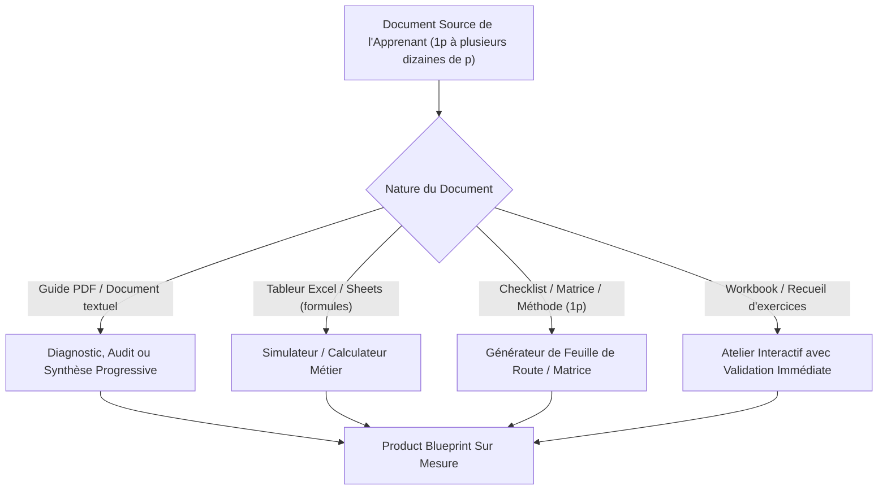
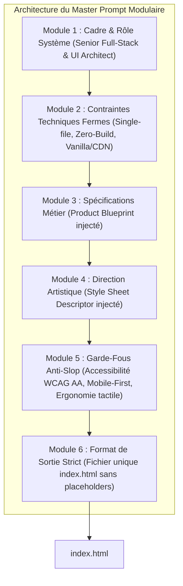
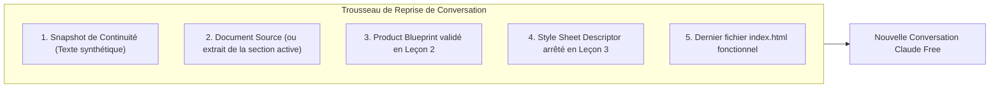
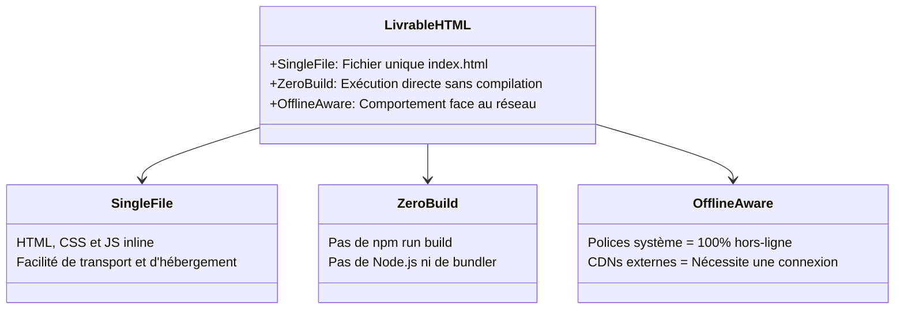
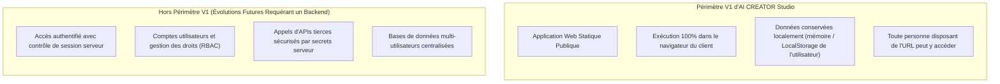
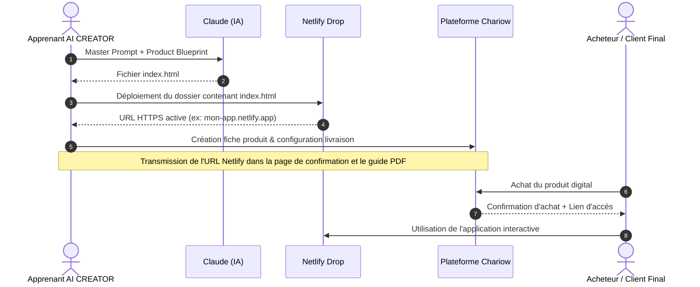
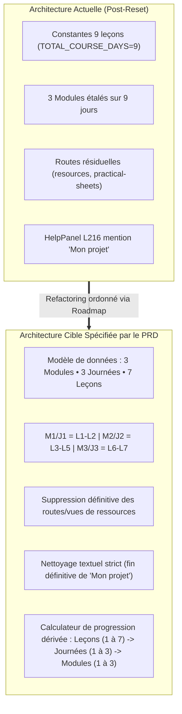
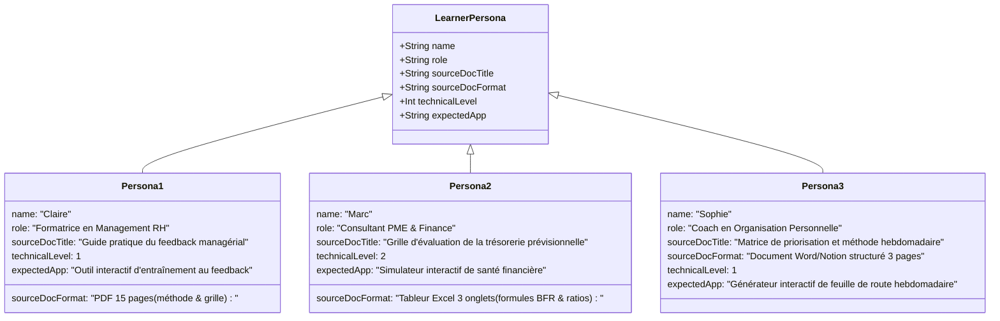
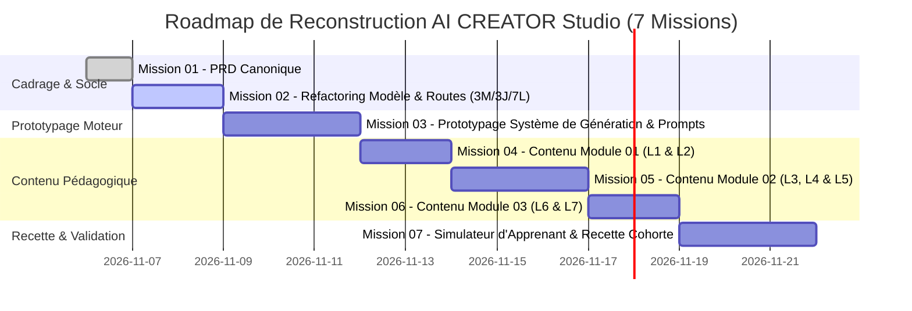

# PRODUCT REQUIREMENTS DOCUMENT (PRD) CANONIQUE : AI CREATOR STUDIO

> **Version** : 1.1.0-CANONICAL  
> **Statut** : RÉFÉRENCE CANONIQUE OFFICIELLE (POST-AUDIT 01-B)  
> **Date** : Novembre 2026  
> **Auteur** : Senior Product Manager, Software Architect & Learning Experience Designer  
> **Dépôt** : [https://github.com/Kreesten-hsh/AI_CREATOR_STUDIO](https://github.com/Kreesten-hsh/AI_CREATOR_STUDIO)  
> **Fichier de destination** : `docs/COURSE_PRD.md`

---

## 1. RÉSUMÉ EXÉCUTIF

**AI CREATOR Studio** est une plateforme web interactive d'apprentissage conçue pour guider les formateurs, consultants, coachs et créateurs dans la transformation directe d'un document existant (guide PDF, feuille de calcul, méthode opérationnelle, workbook, matrice décisionnelle) en un produit digital interactif autonome, déployé en ligne sur Netlify et commercialisé via Chariow.

Le cursus se positionne comme un **mini-cours guidé**, structuré en **3 modules thématiques**, répartis sur **3 journées pratiques**, totalisant **7 leçons hautement opérationnelles** et complété par **2 bonus pratiques** différés hors du tronc commun. La durée indicative de 3 journées (représentant un volume d'effort cumulé estimé à environ 3 h 15) constitue un **objectif pédagogique cible** dont la validation effective sera mesurée et ajustée lors de tests réels de cohortes.

À rebours des formations théoriques ou des générateurs d'applications génériques produisant du « slop » IA standardisé, AI CREATOR Studio applique un principe strict d'**adaptation au document réel de l'apprenant** (*Document-First*), une **fidélité absolue aux connaissances sources** (*Source Fidelity*), et une **indépendance esthétique totale** de l'application produite vis-à-vis de la charte graphique de la plateforme formatrice.

Le livrable final produit par l'apprenant est un **fichier unique `index.html`**, autonome vis-à-vis de tout processus de build (*Zero-Build*), pensé d'abord pour les écrans mobiles (*Mobile-First*), hébergé sans frais sur Netlify et mis à disposition des clients finaux via Chariow. La V1 assume en toute transparence le modèle d'une **application web statique publique** : toute personne détenant l'URL publique peut y accéder et consulter le code exécuté côté client. Les mécanismes d'authentification forte et de contrôle d'accès côté serveur relèvent d'architectures backend hors périmètre de cette version initiale.

Ce document constitue la spécification canonique exhaustive et immuable gouvernant la reconstruction pédagogique, l'ingénierie d'interface et le socle technique de la plateforme.

---

## 2. IDENTITÉ ET VISION DU PRODUIT

### 2.1. Titre Officiel et Promesse de Valeur

- **Titre officiel du cours** :  
  *« Utiliser Claude pour créer un produit digital qui ne ressemble pas à de la merde générée par l'IA »*  
  *(Intitulé immuable, préservant la tonalité franche, directe et anti-slop du positionnement de marque).*

- **Promesse de travail** :  
  *« Transforme ton document existant en application interactive à ton image et publie-la en ligne en 3 jours, sans coder. »*

- **Nature du produit** :  
  **MINI-COURS GUIDÉ**. L'expérience est explicitement formalisée comme un parcours pédagogique pas-à-pas. Le terme « challenge » est formellement proscrit de toute documentation, interface et communication.

### 2.2. Vision Pédagogique et Anti-Slop

La plupart des créateurs utilisant l'IA pour générer du logiciel tombent dans l'un des deux écueils suivants :
1. **L'illusion du prompt magique unique** : Tenter de générer une application entière en une seule invite conduit à des interfaces génériques, des bugs silencieux et la perte de la substantifique moelle du contenu initial.
2. **Le syndrome du template rigide** : Forcer chaque apprenant dans un modèle préétabli (ex. un quiz standard ou un formulaire basique) détruit l'utilité métier de son document source.

AI CREATOR Studio résout cette contradiction par une méthode en entonnoir rigoureuse :
$$\text{Document Source} \longrightarrow \text{Analyse d'Interaction} \longrightarrow \text{Product Blueprint} \longrightarrow \text{Direction Artistique} \longrightarrow \text{Génération Modulaire} \longrightarrow \text{Publication Netlify} \longrightarrow \text{Livraison Chariow}$$

---

## 3. PROBLÈME RÉSOLU ET PROPOSITION DE VALEUR

### 3.1. Le Problème du « Document Mort »

Les formateurs, consultants et coachs disposent d'actifs intellectuels précieux :
- Des guides PDF denses que les acheteurs parcourent rarement dans leur intégralité.
- Des tableurs Excel/Sheets complexes dont les formules sont facilement altérées ou mal comprises par les utilisateurs.
- Des méthodes opérationnelles étape par étape difficiles à appliquer de manière autonome.

Ces supports souffrent d'une valeur perçue déclinante face aux outils interactifs modernes, d'une friction cognitive élevée à la lecture passive, et d'un passage à l'action insuffisant de la part des clients finaux.

### 3.2. La Barrière Technique Classique

Transformer ces documents en applications web interactives nécessitait traditionnellement :
- Le recours à des prestataires de développement externes (délais souvent incompatibles avec des tests rapides de marché et budgets significatifs pour des indépendants).
- L'utilisation d'outils No-Code complexes (Bubble, FlutterFlow) nécessitant des semaines d'apprentissage et des abonnements récurrents.
- L'usage naïf de LLMs générant du code partiel, non responsive, cassé ou visuellement médiocre.

### 3.3. La Proposition de Valeur d'AI CREATOR Studio

AI CREATOR Studio permet à un non-développeur de :
1. **Valoriser son savoir-faire existant** sans devoir réécrire son contenu de zéro.
2. **Obtenir une application sur mesure** qui matérialise fidèlement sa méthode sous forme d'outil d'action (audit, diagnostic, calculateur, matrice décisionnelle).
3. **Générer un livrable autonome** sans frais d'infrastructure ni abonnement d'hébergement récurrent.
4. **Mettre en ligne et organiser la livraison client** à travers un parcours éprouvé et sans complexité superflue (Netlify + Chariow).

---

## 4. PUBLIC CIBLE ET PRÉREQUIS

### 4.1. Personas Cibles

*(Les situations et offres ci-dessous sont des profils illustratifs représentatifs de l'audience visée).*

| Profil | Situation Initiale Illustrative | Actif Source Type | Résultat Visé dans le Cours |
|---|---|---|---|
| **Le Formateur / Enseignant** | Propose des formations composées de supports statiques et cherche à stimuler l'engagement actif. | Workbook d'exercices ou guide méthodologique. | Application d'exercices interactifs guidés avec auto-évaluation instantanée. |
| **Le Consultant B2B** | Réalise des audits manuels répétitifs et souhaite outiller ses prospects ou clients. | Grille d'audit Excel ou document de diagnostic Word. | Outil d'auto-diagnostic client générant un score et des recommandations ciblées. |
| **Le Coach Opérationnel** | Transmet des feuilles de route PDF que ses coachés peinent à mettre en œuvre seuls. | Guide pratique ou plan d'action séquentiel. | Planificateur d'étapes interactif avec suivi local de la progression. |
| **L'Infopreneur / Créateur** | Commercialise des produits d'information textuels et souhaite accroître la valeur perçue de ses offres. | Document thématique riche en cadres méthodologiques. | Mini-outil web interactif à forte valeur d'usage. |

### 4.2. Prérequis Réels de l'Apprenant

- **Prérequis d'Entrée Obligatoires** :
  - **Disposer d'un document ou d'une méthode existante** : Le contenu peut faire **de 1 page** (matrice décisionnelle dense, fiche mémo, grille d'audit concise) **à plusieurs dizaines de pages** (guide, workbook, tableur). Le critère d'admission repose sur la **qualité, la cohérence et l'utilité pratique** de la matière, non sur un nombre de pages arbitraire.
  - Posséder un ordinateur fonctionnel muni d'un navigateur web moderne (Google Chrome, Mozilla Firefox, Safari, Arc ou Microsoft Edge).
  - Avoir accès à un compte **Claude Free** (Anthropic). *Aucun abonnement payant Claude Pro n'est requis.*
- **Prérequis Techniques Exclus** :
  - **Zéro compétence en programmation** (ni HTML, ni CSS, ni JavaScript).
  - **Zéro maîtrise de Git ou du terminal de commande**.
  - **Zéro connaissance préalable des modèles d'architecture web**.

### 4.3. Protocoles de Préparation pour Formats Complexes

Lorsque le document source présente des caractéristiques spécifiques, les mesures préalables suivantes sont recommandées en Leçon 1 :
- **Tableurs (.xlsx, .csv)** : Extraire les formules clés, la logique de calcul et les libellés sous forme d'un tableau récapitulatif textuel ou d'un export Markdown structuré.
- **Documents scannés (PDF images)** : Utiliser un outil d'OCR préalable (Google Drive, Apple Live Text, utilitaire système) pour extraire un texte sélectionnable propre avant soumission à Claude.
- **Documents très volumineux (> 40–50 pages)** : Isoler le chapitre, module ou processus clé destiné à être interactif pour éviter la saturation prématurée du contexte de Claude Free.

---

## 5. PÉRIMÈTRE FONCTIONNEL ET EXCLUSIONS

### 5.1. Périmètre Inclus (In-Scope V1)

- **Parcours Didactique Complet** : Accompagnement structuré à travers 3 Modules, 3 Journées et 7 Leçons.
- **Protocoles de Prompts Dédiés** : Blocs de prompts copiables (`CopyBlock`) pré-calibrés avec zones personnalisables explicites pour chaque étape clé avec Claude.
- **Protocole de Continuité Conversationnelle Renforcé** : Méthode formelle de réamorçage de session garantissant le travail sur Claude Free sans dépendre de fonctionnalités Pro.
- **Architecture de Génération HTML** : Directives strictes pour la production d'un fichier `index.html` unique, inline, mobile-first et sans dépendances de compilation.
- **Déploiement et Monétisation** : Procédure pas-à-pas de publication sur Netlify et de paramétrage de la livraison client via Chariow.
- **2 Bonus Pratiques Différés** : Fiches structurelles pour ManyChat et Marketing Library (hors évaluation du cursus principal).

### 5.2. Périmètre Exclu (Out-of-Scope V1)

- **Pas d'environnement de compilation complexe** : Aucun bundling Node.js, Webpack, Vite ou Tailwind CLI n'est imposé à l'apprenant pour son application.
- **Pas de backend hébergé ni de base de données distante** : L'application générée fonctionne côté client sans serveur applicatif dédié ni microservices.
- **Pas d'authentification utilisateur serveur** : La V1 n'intègre pas de système de connexion utilisateur (login/mot de passe avec contrôle de session serveur). L'application Netlify est une page publique statique.
- **Pas de système d'injection dynamique global « Mon projet »** : Proscription définitive du profil de projet global dans la plateforme AI CREATOR Studio. L'apprenant personnalise directement ses blocs de prompt locaux.
- **Suppression définitive des sections `Ressources` et `Fiches pratiques`** : Sorties du périmètre applicatif et de la navigation.
- **Pas d'éditeur de code intégré (Web IDE)** : L'apprenant teste son livrable directement dans son navigateur ou via l'interface de prévisualisation de Claude.

---

## 6. ARCHITECTURE PÉDAGOGIQUE DÉTAILLÉE

Le cursus d'AI CREATOR Studio est articulé autour d'un objectif de réalisation en 3 journées de travail, avec un volume horaire estimatif d'environ 3 h 15 d'effort actif (à consolider empiriquement lors des tests réels).

```mermaid
journey
    title Parcours Apprenant AI CREATOR Studio (3 Modules • 3 Journées • 7 Leçons)
    section Jour 1 : CHOISIR (Obj. ~45 min)
      Préparer le document & configurer Claude: 5: Apprenant
      Analyse du document & 3 options d'interaction: 4: Apprenant, Claude
      Sélection & validation du Product Blueprint: 5: Apprenant
    section Jour 2 : CRÉER (Obj. ~1 h 30)
      Définition de la Direction Artistique (DA): 4: Apprenant
      Génération de la V1 avec le Master Prompt: 5: Claude
      Retouches ciblées, débogage & tests mobile: 4: Apprenant, Claude
    section Jour 3 : PUBLIER & LIVRER (Obj. ~1 h 00)
      Exportation index.html & Déploiement Netlify: 5: Apprenant
      Paramétrage Chariow & Test du parcours client: 5: Apprenant
```

### Synthèse Matricielle du Cursus

| Module | Journée | Leçon | Intitulé de la Leçon | Durée Indicative Cible | Livrable Intermédiaire |
|---|---|---|---|---|---|
| **M1 : CHOISIR** | **Jour 1** | **L1** | Préparer son document et configurer Claude | ~15 min | Espace Claude dédié + Document source préparé et nettoyé |
| | | **L2** | Analyser son document, identifier 3 interactions et choisir | ~30 min | **Product Blueprint validé** + Source Fidelity Mapping initial |
| **M2 : CRÉER** | **Jour 2** | **L3** | Définir sa direction artistique indépendante | ~20 min | Spécification de style (Palette, Typographies, Composants) |
| | | **L4** | Générer la première version (V1) de son application | ~40 min | Fichier `index.html` fonctionnel V1 généré par Claude |
| | | **L5** | Effectuer des retouches ciblées, corriger et tester | ~30 min | **Application HTML finale vérifiée**, responsive et sans bug |
| **M3 : PUBLIER ET LIVRER** | **Jour 3** | **L6** | Publier son application sur Netlify | ~25 min | URL publique HTTPS active et opérationnelle |
| | | **L7** | Organiser la livraison via Chariow et tester le parcours d'achat | ~35 min | **Produit Chariow configuré**, accès testé et livraison validée |

---

## 7. SPÉCIFICATIONS DÉTAILLÉES DES SEPT LEÇONS

Chaque leçon dispose de sa propre logique d'apprentissage, adaptée à la nature de son livrable.

---

### LEÇON 1 : Préparer son document et configurer Claude

- **Identifiant** : `LESSON-01`
- **Module & Journée** : Module 01 (CHOISIR) — Journée 1
- **Durée indicative cible** : ~15 minutes
- **Objectif opérationnel** :  
  Préparer son document source pour une analyse par Claude sans perte de matière, appliquer les ajustements nécessaires selon son format (tableur, scan, document dense), et configurer une discussion dédiée dans Claude Free.
- **Entrées requises** :  
  - Le document digital existant de l'apprenant (PDF, DOCX, Google Doc, Notion, XLSX, 1 page ou plus).
  - Un compte actif Claude (version gratuite).
- **Actions de l'apprenant** :  
  1. Auditer son document : vérifier la présence des connaissances clés, étapes, calculs ou recommandations.
  2. Préparer le texte brut selon le format : extraire les formules pour un tableur, lancer une OCR pour un document scanné, ou cibler la section cœur pour un document volumineux.
  3. Ouvrir une discussion neuve dans Claude, nommée rigoureusement : `[PROJET] - Création Application Interactive`.
  4. Envoyer le prompt de cadrage initial configurant le rôle d'analyste produit de Claude.
- **Utilisation exacte de Claude** :  
  Prompt d'initialisation de session (`PROMPT-L1-INIT`) :
  ```text
  Tu es un expert Senior en Product Design, Learning Experience Design et Architecture Web.
  Je vais te confier le contenu de mon produit digital existant (guide, méthode ou tableur).
  Ton rôle sera de m'accompagner pas à pas dans sa transformation en une application web interactive, utile, élégante et sans code.
  
  Règles fondamentales pour notre travail :
  1. Tu ne génères aucun code pour l'instant.
  2. Tu adoptes une posture consultative : pose-moi des questions pertinentes et attends mes réponses.
  3. Tu respectes strictement la matière de mon document (ne supprime aucune expertise métier).
  
  Confirme simplement que tu as bien compris ces consignes et invite-moi à te soumettre mon document.
  ```
- **Livrable concret** :  
  Une conversation Claude active et calée, prête à recevoir le document source.
- **Critères de validation observables** :
  - [ ] Le document source est lisible au format texte ou PDF téléchargeable sans artefact d'encodage.
  - [ ] La conversation Claude est isolée et identifiée par le nom du projet.
  - [ ] Claude a accusé réception des consignes d'attente sans générer prématurément du code.

---

### LEÇON 2 : Faire analyser son document, identifier trois possibilités d'interaction et choisir la plus pertinente

- **Identifiant** : `LESSON-02`
- **Module & Journée** : Module 01 (CHOISIR) — Journée 1
- **Durée indicative cible** : ~30 minutes
- **Objectif opérationnel** :  
  Soumettre son document à Claude, obtenir une synthèse structurée de sa substantifique moelle, confronter 3 concepts d'interaction distincts et figer le **Product Blueprint** de son application.
- **Entrées requises** :  
  - Le document source préparé (L1).
  - La session Claude initialisée (L1).
- **Actions de l'apprenant** :  
  1. Téléverser le document source ou coller son texte dans la session Claude.
  2. Exécuter le prompt d'analyse et de proposition d'interaction (`PROMPT-L2-ANALYZE`).
  3. Examiner les 3 concepts proposés (forces, limites, complexité perçue).
  4. Choisir le concept le plus adapté à son audience cible.
  5. Demander la génération du Product Blueprint formalisé.
- **Utilisation exacte de Claude** :  
  Prompt d'analyse et de divergence (`PROMPT-L2-ANALYZE`) :
  ```text
  Voici le contenu de mon document source :
  ---
  [COLLE ICI LE CONTENU OU JOINS TON DOCUMENT]
  ---
  
  Effectue les deux tâches suivantes :
  1. ANALYSE SOURCE : Résume en 5 points clés l'utilité métier, les étapes indispensables et les formules/règles d'or contenues dans ce document.
  2. 3 CONCEPTS D'INTERACTION : Propose 3 manières fondamentalement différentes de transformer ce contenu en application interactive :
     - Concept A (ex: Diagnostic / Audit avec score personnalisé et recommandations).
     - Concept B (ex: Simulateur / Calculateur interactif ou matrice de décision).
     - Concept C (ex: Générateur de plan d'action personnalisé étape par étape).
  
  Pour chaque concept, précise : le problème résolu, l'expérience de l'utilisateur final, et pourquoi ce format est supérieur à un simple document statique.
  Termine en me demandant quel concept je souhaite retenir.
  ```
  Prompt de formalisation du Blueprint (`PROMPT-L2-BLUEPRINT`) :
  ```text
  Je retiens le [CONCEPT CHOISI : A, B ou C].
  Rédige maintenant le PRODUCT BLUEPRINT complet de l'application selon cette structure :
  - 1. Nom de travail de l'application & Promesse utilisateur
  - 2. Profil de l'utilisateur cible
  - 3. Entrées utilisateur (champs, curseurs, cases à cocher nécessaires)
  - 4. Moteur de logique / Règles de calcul / Branches de décision (extraites fidèlement du document)
  - 5. Sorties et Résultats affichés (rapport, visualisations, étapes concrètes, copie de plan)
  - 6. Cartographie de Fidélité Source (liste des sections du document source et leur équivalent dans l'app)
  ```
- **Livrable concret** :  
  Le **Product Blueprint** complet et la première version du **Source Fidelity Mapping**.
- **Critères de validation observables** :
  - [ ] Les 3 concepts d'interaction proposés sont variés et pertinents pour le document.
  - [ ] Le concept retenu préserve l'expertise métier du document sans simplification abusive.
  - [ ] Le Product Blueprint spécifie clairement les entrées, la logique interne et les résultats finaux.

---

### LEÇON 3 : Définir sa direction artistique indépendante

- **Identifiant** : `LESSON-03`
- **Module & Journée** : Module 02 (CRÉER) — Journée 2
- **Durée indicative cible** : ~20 minutes
- **Objectif opérationnel** :  
  Arrêter une charte visuelle personnalisée, professionnelle et accessible pour son application, sans subir l'esthétique de la plateforme formatrice ni les choix par défaut génériques de l'IA.
- **Entrées requises** :  
  - Le Product Blueprint validé (L2).
- **Actions de l'apprenant** :  
  1. Choisir le tempérament visuel de son application parmi 4 archétypes éditoriaux :
     - *Corporate Sobre & Précis* (Fond clair, ardoise, bleu marine, typographie sans-serif géométrique).
     - *Éditorial Print & Chaleureux* (Fond crème/ivoire, encre noire, touches bordeaux/vert forêt, serif élégante).
     - *Moderne Vibrant & SaaS* (Fond neutre, violet/indigo électrique, bordures subtiles, typographie tech).
     - *Minimaliste Haute Lisibilité* (Contraste noir et blanc franc, typographie grotesk, zéro fioriture).
  2. Valider les contrastes colorimétriques (norme WCAG AA : ratio minimal 4.5:1 sur le texte courant).
  3. Exécuter le prompt de cadrage esthétique avec Claude.
- **Utilisation exacte de Claude** :  
  Prompt de cadrage stylistique (`PROMPT-L3-STYLE`) :
  ```text
  Nous passons à la Direction Artistique (DA) de mon application.
  IMPORTANT : Ne reproduis pas la charte graphique de la plateforme de formation. Cette application doit avoir sa propre identité visuelle.
  
  Voici mes choix d'ambiance :
  - Archétype esthétique souhaité : [CHOISIS : Corporate / Éditorial Print / Vibrant SaaS / Minimaliste]
  - Couleurs dominantes souhaitées : [EX: Fond blanc cassé #F8FAFC, Accent Bleu Nuit #1E293B, Boutons Émeraude #059669]
  - Style des composants : [Bords légèrement arrondis 8px / Ombres douces / Bordures nettes 1px]
  - Ton typographique : [Moderne et épuré : Inter ou Plus Jakarta Sans via Google Fonts]
  
  Génère le 'Style Sheet Descriptor' que nous injecterons dans le Master Prompt :
  1. Variables CSS de couleurs (:root avec --bg, --surface, --text, --primary, --accent, --border).
  2. Ratios de contraste vérifiés pour le texte (accessibilité WCAG AA).
  3. Règles d'espacement et de typographie responsive.
  ```
- **Livrable concret** :  
  Le *Style Sheet Descriptor* personnalisé prêt à être intégré dans le Master Prompt.
- **Critères de validation observables** :
  - [ ] La palette de couleurs comporte au minimum un fond, une surface, une encre de texte et un accent d'action.
  - [ ] Les contrastes texte/fond garantissent une lisibilité optimale sur écran mobile.
  - [ ] La DA est propre au produit de l'apprenant et n'utilise pas la charte Burgundy/Cream de la plateforme.

---

### LEÇON 4 : Générer la première version (V1) de son application avec Claude

- **Identifiant** : `LESSON-04`
- **Module & Journée** : Module 02 (CRÉER) — Journée 2
- **Durée indicative cible** : ~40 minutes
- **Objectif opérationnel** :  
  Assembler le Master Prompt modulaire et générer la version 1 complète de l'application sous la forme d'un fichier `index.html` unique et immédiatement testable.
- **Entrées requises** :  
  - Le Product Blueprint (L2).
  - Le Style Sheet Descriptor (L3).
  - La session Claude continue (ou protocole de reprise avec le trousseau complet si nécessaire).
- **Actions de l'apprenant** :  
  1. Récupérer le Master Prompt dans AI CREATOR Studio.
  2. Renseigner les zones balisées avec son Blueprint et sa DA.
  3. Envoyer l'instruction à Claude et lancer la génération complète.
  4. Extraire le code généré : copier l'intégralité du bloc ou télécharger le fichier `index.html` produit.
  5. Effectuer le premier test local : double-cliquer sur le fichier `index.html` pour l'ouvrir dans son navigateur web.
- **Utilisation exacte de Claude** :  
  Exécution du **Master Prompt de Génération V1** (`PROMPT-L4-MASTER-GEN`) :
  ```text
  Tu vas maintenant générer l'application web complète sous la forme d'UN FICHIER UNIQUE nommé 'index.html'.
  
  Règles techniques impératives :
  1. FICHIER MONOPAGE TOTAL : Tout le HTML, tout le CSS (<style>) et tout le JavaScript (<script>) doivent être dans ce seul fichier index.html. Aucun fichier externe CSS ou JS séparé.
  2. ZERO-BUILD : Le code doit s'exécuter directement dans un navigateur sans aucune étape de compilation.
  3. JAVASCRIPT VANILLA DE PRÉFÉRENCE : Utilise JavaScript moderne vanilla (DOM standard, ES6+). N'utilise React que si la complexité des états le rend indispensable, et dans ce cas via CDN avec versions figées strictes. N'utilise JAMAIS le Play CDN de Tailwind en production : écris du CSS propre et compilé dans la balise <style>.
  4. MOBILE-FIRST & ACCESSIBILITÉ : Balise <meta name="viewport" content="width=device-width, initial-scale=1.0">, zones de clic minimales de 44x44px, pas de texte inférieur à 14px, pas de débordement horizontal.
  5. SÉCURITÉ : Aucune clé d'API, aucun mot de passe factice non sécurisé.
  
  Spécifications du produit :
  [COLLER LE PRODUCT BLUEPRINT DE LA LEÇON 2]
  
  Spécifications de la direction artistique :
  [COLLER LE STYLE SHEET DESCRIPTOR DE LA LEÇON 3]
  
  Génère l'intégralité du code dans un seul bloc de code sans coupure ni placeholder TODO.
  ```
- **Livrable concret** :  
  Le fichier `index.html` V1 fonctionnel et ouvert dans le navigateur local.
- **Critères de validation observables** :
  - [ ] Le code est fourni dans un seul bloc de code complet ou un fichier téléchargeable.
  - [ ] Le double-clic sur `index.html` affiche l'application sans écran blanc ni crash de la console.
  - [ ] Les champs d'entrée principaux et le bouton d'action principal déclenchent une interaction visible.

---

### LEÇON 5 : Effectuer des retouches ciblées, corriger et tester

- **Identifiant** : `LESSON-05`
- **Module & Journée** : Module 02 (CRÉER) — Journée 2
- **Durée indicative cible** : ~30 minutes
- **Objectif opérationnel** :  
  Détecter les éventuels bugs, ajuster la réactivité mobile, vérifier la fidélité au contenu source (*Source Fidelity Check*) et finaliser le fichier `index.html` prêt pour la mise en ligne.
- **Entrées requises** :  
  - Le fichier `index.html` V1 généré (L4).
  - La grille de contrôle qualité d'AI CREATOR Studio.
- **Actions de l'apprenant** :  
  1. Exécuter le test des 3 largeurs d'écran dans son navigateur (smartphone 375px, tablette 768px, desktop 1280px via l'inspecteur ou en redimensionnant la fenêtre).
  2. Tester les cas limites (champs vides, valeurs extrêmes, textes longs).
  3. Vérifier la cartographie de fidélité source : s'assurer qu'aucun conseil fondamental du document original n'a été tronqué.
  4. Formuler des requêtes de retouche chirurgicales à Claude si des anomalies sont constatées.
  5. Valider la version finale du fichier `index.html`.
- **Utilisation exacte de Claude** :  
  Prompt de correction ciblée (`PROMPT-L5-PATCH`) :
  ```text
  Voici les ajustements précis à apporter à notre fichier index.html :
  
  Problèmes observés lors du test :
  1. [EX: Sur écran mobile (375px), le tableau de résultat déborde horizontalement].
  2. [EX: Il manque l'avertissement de sécurité de l'étape 3 du document original].
  3. [EX: Le bouton 'Copier mon plan' n'affiche pas de confirmation visuelle quand on clique].
  
  Consigne : Modifie le code pour corriger ces points sans toucher aux fonctionnalités qui marchent déjà. Rends-moi le fichier index.html complet et corrigé.
  ```
- **Livrable concret** :  
  Le fichier `index.html` final, validé sur mobile et desktop, conforme à la grille de fidélité source.
- **Critères de validation observables** :
  - [ ] Zéro barre de défilement horizontale indésirable à 375px de large.
  - [ ] L'ensemble des points clés de l'audit initial (L2) sont bien présents dans l'interface finale.
  - [ ] Les interactions fonctionnent sans erreur visible dans la console du navigateur.

---

### LEÇON 6 : Publier son application sur Netlify

- **Identifiant** : `LESSON-06`
- **Module & Journée** : Module 03 (PUBLIER ET LIVRER) — Journée 3
- **Durée indicative cible** : ~25 minutes
- **Objectif opérationnel** :  
  Déployer gratuitement son fichier `index.html` sur Netlify sans ligne de commande, configurer un sous-domaine HTTPS propre et vérifier l'accessibilité publique mondiale de l'application.
- **Entrées requises** :  
  - Le fichier `index.html` final validé (L5).
  - Un compte gratuit Netlify.
- **Actions de l'apprenant** :  
  1. Préparer son dossier de déploiement local : créer un dossier nommé `mon-application-interactive` et y placer son fichier `index.html`.
  2. Se connecter sur Netlify ([app.netlify.com](https://app.netlify.com)).
  3. Accéder à l'espace *Sites* > *Deploy manually* (Netlify Drop).
  4. Glisser-déposer le dossier préparé (ou le fichier directement selon l'interface active de Netlify Drop).
  5. Patienter pendant le déploiement instantané.
  6. Personnaliser le sous-domaine gratuit dans *Site configuration* > *Change site name* (ex: `diagnostic-gestion-pro.netlify.app`).
  7. Ouvrir l'URL sur son smartphone pour valider le chargement direct en conditions réelles.
- **Utilisation exacte de Claude** :  
  Claude intervient ici en support de dépannage si l'apprenant rencontre une erreur d'affichage Netlify (ex: page 404 consécutive à un mauvais nom de fichier comme `Index.html` avec majuscule).  
  Prompt de diagnostic Netlify (`PROMPT-L6-NETLIFY-HELP`) :
  ```text
  Mon déploiement Netlify affiche une page 'Page Not Found' (404).
  Voici la structure de ce que j'ai téléversé : [décris ton fichier ou dossier].
  Explique-moi comment résoudre ce problème immédiatement.
  ```
- **Livrable concret** :  
  Une URL publique HTTPS active, accessible depuis n'importe quel terminal connecté à Internet.
- **Critères de validation observables** :
  - [ ] L'URL Netlify est sécurisée en HTTPS avec un certificat SSL valide.
  - [ ] L'application se charge correctement sur smartphone sans bug de mise en page.
  - [ ] Le nom du site a été personnalisé pour être lisible par un client final.

---

### LEÇON 7 : Organiser la livraison via Chariow et tester le parcours d'achat

- **Identifiant** : `LESSON-07`
- **Module & Journée** : Module 03 (PUBLIER ET LIVRER) — Journée 3
- **Durée indicative cible** : ~35 minutes
- **Objectif opérationnel** :  
  Créer le produit sur Chariow, configurer la page de remerciement et le document d'accès, et exécuter une commande test réelle pour valider l'expérience client de bout en bout.
- **Entrées requises** :  
  - L'URL publique de son application Netlify (L6).
  - Un compte vendeur Chariow.
  - Un code promotionnel à 100 % ou mode test pour valider le parcours.
- **Actions de l'apprenant** :  
  1. Se connecter à son tableau de bord Chariow et créer un nouveau produit digital.
  2. Renseigner les éléments de présentation : Titre accrocheur, promesse claire, prix de vente.
  3. Configurer le mode de livraison :
     - *Option A (Recommandée)* : Page de confirmation avec bouton d'accès direct vers l'URL Netlify + Guide PDF d'accompagnement téléchargeable.
     - *Option B* : Envoi d'un email automatique d'accès immédiat contenant le lien direct et les conseils d'utilisation.
  4. Mettre en place un code promo de test à 100 % (ex: `TEST-VALIDATION`).
  5. Ouvrir la page de vente Chariow dans une fenêtre de navigation privée.
  6. Réaliser l'achat test : saisir ses coordonnées, appliquer le code de réduction, valider la commande.
  7. Vérifier que la redirection vers l'application fonctionne parfaitement et que le client accède immédiatement à la promesse.
- **Utilisation exacte de Claude** :  
  Prompt de rédaction de la notice d'accueil client (`PROMPT-L7-ONBOARDING`) :
  ```text
  Rédige le texte de la page de remerciement et de l'email de livraison pour mes acheteurs sur Chariow.
  - Nom de l'application : [NOM]
  - URL Netlify : [URL]
  - Bénéfice immédiat : [CE QUE LE CLIENT VA RÉALISER DANS LES 5 PREMIÈRES MINUTES]
  
  Le ton doit être professionnel, chaleureux et donner 3 étapes simples pour démarrer immédiatement :
  1. Cliquer sur le lien d'accès.
  2. Enregistrer la page dans ses favoris.
  3. Réaliser sa première session interactive en moins de 10 minutes.
  ```
- **Livrable concret** :  
  Une fiche produit active sur Chariow avec un parcours d'achat et de livraison entièrement vérifié.
- **Critères de validation observables** :
  - [ ] Le produit est publié et accessible sur Chariow.
  - [ ] L'achat test aboutit sans erreur à la page de confirmation d'accès.
  - [ ] L'URL de l'application est transmise de manière fluide sans friction technique pour l'acheteur.

---

## 8. SYSTÈME D'ADAPTATION AUX DOCUMENTS DES APPRENANTS

AI CREATOR Studio refuse catégoriquement l'approche « taille unique ». Le cursus prend en charge la diversité des formats de départ, qu'il s'agisse d'un document d'une seule page ou d'un support plus étendu :



### Typologie des 5 Grandes Familles d'Interactions Générables

1. **L'Auto-Diagnostic & Audit Évaluatif** :
   - *Pour qui* : Méthodes de consulting, bilans de compétences, audits organisationnels ou de conformité.
   - *Mécanique* : Série de questions pondérées, score synthétique par dimension, identification des points de blocage et plan d'action priorisé.
2. **Le Simulateur & Calculateur Métier** :
   - *Pour qui* : Formules financières, tarification, rentabilité d'investissement, calculs prévisionnels.
   - *Mécanique* : Sliders et champs numériques interactifs, recalculs instantanés côté client sans rechargement, visualisation graphique des résultats.
3. **Le Générateur de Feuille de Route Personnalisée** :
   - *Pour qui* : Guides méthodologiques étape par étape, plans de lancement, matrices décisionnelles.
   - *Mécanique* : Filtres de contexte initial, génération d'un calendrier d'actions sur mesure et bouton d'exportation (copie presse-papier ou impression).
4. **La Matrice de Décision Interactive** :
   - *Pour qui* : Guides d'orientation, choix technologiques, arbres décisionnels de résolution de problèmes.
   - *Mécanique* : Arborescence de questions conditionnelles menant à la recommandation exacte selon la situation de l'utilisateur.
5. **L'Atelier Pratique d'Exercices Guidés** :
   - *Pour qui* : Workbooks de formation, méthodes d'entraînement opérationnel.
   - *Mécanique* : Saisie libre, comparaison avec les repères méthodologiques, auto-notation et mémorisation locale de la progression.

---

## 9. PRODUCT BLUEPRINT ET SOURCE FIDELITY MAPPING

### 9.1. Structure Canonique du Product Blueprint

Le Product Blueprint est le document pivot de transition entre le savoir de l'apprenant et l'ingénierie logicielle de Claude. Il contient obligatoirement les 6 sections suivantes :

```markdown
# PRODUCT BLUEPRINT : [NOM DE L'APPLICATION]

1. IDENTITÉ DU PRODUIT
- Nom public :
- Promesse en une phrase :
- Cible précise :

2. STRUCTURE D'INTERACTION
- Type d'application : [Diagnostic / Calculateur / Planificateur / Matrice / Atelier]
- Parcours utilisateur en 3 étapes : [Étape 1 : Saisie] -> [Étape 2 : Traitement] -> [Étape 3 : Restitution]

3. SPÉCIFICATIONS DES ENTRÉES (INPUTS)
- Liste des champs, curseurs, options avec labels et valeurs par défaut.

4. MOTEUR MÉTIER & LOGIQUE INTERNE (LOGIC ENGINE)
- Règles de calcul, barèmes de scoring, formules exactes extraites du document.

5. RESTITUTION DES RÉSULTATS (OUTPUTS)
- Structure du rapport généré, métriques clés, recommandations conditionnelles, bouton d'action final (ex: Copier / Imprimer).

6. CARTOGRAPHIE DE FIDÉLITÉ SOURCE (SOURCE FIDELITY MAPPING)
```

### 9.2. Matrice de Source Fidelity Mapping (Garantie Anti-Perte)

Pour éviter que l'IA ne gomme les nuances ou les avertissements capitaux du document source, chaque apprenant valide son tableau de fidélité :

| Section du Document Source | Connaissance / Règle Métier Clé | Transcription dans l'Application | Statut de Vérification |
|---|---|---|---|
| *Section A* | Formule de calcul ou règle logique principale | Calculateur ou moteur dynamique dans l'écran de résultat | $\checkmark$ Préservé |
| *Section B* | Mises en garde et erreurs fréquentes à éviter | Encadré d'avertissement contextuel selon les saisies | $\checkmark$ Préservé |
| *Section C* | Grille de barème ou paliers d'évaluation | Logique de calcul du résultat final et recommandations associées | $\checkmark$ Préservé |

---

## 10. ARCHITECTURE FONCTIONNELLE DU MASTER PROMPT ET CONTINUITÉ

Le Master Prompt d'AI CREATOR Studio est conçu de manière modulaire afin d'assurer une exécution sans faille dans le contexte d'un compte Claude gratuit.



### 10.1. Protocole de Continuité et Trousseau de Reprise sur Claude Free

Sur Claude Free, la taille de contexte de la conversation et les limites horaires peuvent imposer d'ouvrir un nouveau fil de discussion.  
Le *Snapshot de Continuité* ne remplace pas magiquement les actifs du projet : il en résume l'état logique. En cas de changement de conversation, l'apprenant utilise le **Trousseau Complet de Reprise** :



Prompt de génération du Snapshot de continuité (`PROMPT-CONTINUITY-SNAPSHOT`) :
```text
Nous approchons de la limite de longueur de cette conversation.
Rédige un 'SNAPSHOT DE CONTINUITÉ' complet résumant :
1. L'état actuel exact du projet.
2. Le Product Blueprint validé.
3. La Direction Artistique retenue.
4. Les retouches restant à effectuer.
5. Les 3 prochaines étapes précises que nous devons exécuter.
Indique-moi également les fichiers que je devrai joindre dans la nouvelle conversation (document source, Blueprint, dernier code index.html).
```

### 10.2. Garantie d'Indépendance vis-à-vis de Claude Pro

Le parcours pédagogique est conçu pour fonctionner **intégralement avec Claude Free** :
- Aucun recours à la fonctionnalité *Projects* (réservée à Claude Pro).
- Aucun recours aux fonctionnalités d'export ou d'artefacts payants.
- Toutes les opérations reposent sur le chat standard, le copier-coller de texte/code et le téléversement de fichiers supporté en version gratuite.

---

## 11. EXIGENCES DE GÉNÉRATION HTML

Pour assurer la viabilité technique et l'autonomie totale des apprenants, les règles d'ingénierie applicative suivantes sont strictement imposées à Claude :

### 11.1. Triptyque Technique Fondamental

Le PRD pose une distinction formelle entre les trois propriétés suivantes :



1. **Fichier unique (`index.html`)** :  
   Tout le code structurel, stylistique (`<style>`) et comportemental (`<script>`) réside dans un seul fichier. Aucune ressource relative locale (`style.css`, `app.js`, images locales non encodées) n'est requise.
2. **Autonomie de compilation (*Zero-Build*)** :  
   Le livrable est interprétable immédiatement par n'importe quel moteur de rendu de navigateur moderne. Aucune commande de compilation (`npm`, `vite`, `webpack`, `tsc`) n'est requise de la part de l'apprenant.
3. **Fonctionnement réseau (*Offline vs Online*)** :  
   - Si l'application utilise des polices système standard (`system-ui`, `-apple-system`, `sans-serif`) et du JS vanilla pur : l'application fonctionne à **100 % hors-ligne**.
   - Si l'application charge des polices Google Fonts ou une bibliothèque tierce via CDN : elle nécessite une connexion active pour charger ces ressources externes lors du premier accès.

### 11.2. Règles d'Usage des Bibliothèques et CDNs

- **Vanilla JavaScript privilégié** : JavaScript ES6+ pur pour l'immense majorité des cas d'usage (manipulation du DOM, LocalStorage, événements).
- **React via CDN (Exception Cadrée)** :  
  Autorisé uniquement lorsque la complexité de l'application (états multiples synchronisés, formulaires à embranchements profonds) le justifie expressément. Dans ce cas, les versions doivent être **figées et sécurisées par intégrité** :
  ```html
  <script src="https://unpkg.com/react@18.3.1/umd/react.production.min.js" crossorigin></script>
  <script src="https://unpkg.com/react-dom@18.3.1/umd/react-dom.production.min.js" crossorigin></script>
  ```
- **Interdiction Formelle du Tailwind Play CDN en Production** :  
  L'utilisation de `<script src="https://cdn.tailwindcss.com"></script>` est **strictement interdite pour la production**. Ce script expérimental compile le CSS à la volée dans le navigateur du client, provoquant des sauts visuels majeurs (*Flash of Unstyled Content*), une surcharge mémoire et des risques de rupture d'API. Le Master Prompt contraint Claude à injecter du CSS compilé propre dans la balise `<style>`.

---

## 12. EXIGENCES MOBILES

La conception des applications créées par les apprenants accorde une priorité absolue aux terminaux mobiles (*Mobile-First*), compte tenu de la prépondérance des usages sur smartphone lors de la consultation de liens partagés.

### Grille d'Exigences Mobiles Imposées

| Critère Mobile | Spécification Technique Requise | Vérification en Leçon 5 |
|---|---|---|
| **Viewport Meta** | `<meta name="viewport" content="width=device-width, initial-scale=1.0, maximum-scale=5.0">` | Présence dans le `<head>` |
| **Cibles Tactiles** | Dimensions minimales de tous les boutons et inputs : **44x44 pixels**. Espacement minimal entre 2 éléments cliquables : **8 pixels**. | Contrôle au doigt sans risque de clic erroné |
| **Zéro Débordement** | `overflow-x: hidden` sur les conteneurs racines, `max-width: 100%`, `box-sizing: border-box` universel. Aucun scroll horizontal. | Test de défilement latéral à 375px |
| **Typographie Tactile** | Taille minimale du corps de texte : **16 pixels** (évite le zoom forcé automatique d'iOS sur les champs de saisie). | Saisie fluide sans redimensionnement de l'écran |
| **Absence de Dépendance au Survol** | Aucune information critique ou action masquée derrière un état `:hover`. Toute information secondaire est accessible par clic/tap accordéon. | Fonctionnalité complète sur écran tactile |
| **Formulaires Adaptés** | Attributs `inputmode` adaptés : `inputmode="numeric"` pour les chiffres, `type="email"` pour les courriels, `type="tel"` pour les téléphones. | Déploiement automatique du pavé tactile adapté |

---

## 13. ARCHITECTURE ET EXIGENCES DE SÉCURITÉ

La transparence technique la plus totale est exigée dans la pédagogie du cours. L'apprenant doit appréhender sans illusion le modèle de sécurité du web statique.

### 13.1. Le Principe Fondamental du Code Client

> [!CAUTION]
> **Un fichier HTML statique ne peut dissimuler aucun code, aucune formule ni aucun secret au visiteur qui y accède.**  
> Tout visiteur ouvrant la page peut afficher le code source ou inspecter les outils de développement (F12) et lire l'intégralité du code HTML, CSS et JavaScript.

En conséquence, AI CREATOR Studio établit les interdits absolus suivants :
- **Ne jamais présenter un mot de passe JavaScript en clair ou une invite `prompt()` comme une authentification ou un contrôle d'accès effectif**.
- **Ne jamais considérer Chariow, une URL non publique, un token côté client ou un document PDF d'accès comme un verrou de sécurité protégeant une application Netlify**.
- **Ne jamais intégrer de clé d'API privée payante (OpenAI, Stripe, Sendgrid, etc.) directement dans le fichier HTML**.
- **Ne jamais stocker de données confidentielles de tiers dans le LocalStorage**.

### 13.2. Cadrage Transparent des Modèles Applicatifs



- **La V1 assume pleinement le modèle de l'application statique publique** :  
  L'application est hébergée sur Netlify sous une URL accessible publiquement. Chariow sert de plateforme de vente et transmet l'adresse d'accès au client final (via page de confirmation et notice PDF). Toute personne possédant cette URL peut charger l'application. Ce modèle est parfaitement adapté à des calculateurs, diagnostics, générateurs de plans d'action ou ateliers d'auto-évaluation.
- **Toute protection d'accès effective nécessite un backend** :  
  Si un créateur souhaite restreindre techniquement l'accès aux seuls acheteurs vérifiés, cela exige une architecture serveur (Netlify Functions, Edge Middleware avec validation de token/webhook Chariow, authentification utilisateur) qui relève d'une phase avancée hors du périmètre de cette V1.

---

## 14. PARCOURS NETLIFY ET CHARIOW

Le parcours de distribution relie la création locale à la monétisation réelle :



### 14.1. Parcours Netlify (Hébergement)

- **Mode de Déploiement Guidé** :  
  L'apprenant crée un dossier local dédié (ex: `dist/` ou `mon-outil/`) contenant son fichier nommé strictement `index.html` (en minuscules). Il glisse-dépose ce dossier sur Netlify Drop.
- **Alternative de déploiement** :  
  Le dépôt direct du fichier `index.html` individuel est supporté selon les versions de l'interface Netlify, mais la méthode par dossier est documentée comme la référence universelle évitant toute erreur d'arborescence.
- **Configuration** :  
  Personnalisation du nom de sous-domaine gratuit (`[mon-projet].netlify.app`) et activation immédiate du certificat HTTPS gratuit automatique.

### 14.2. Parcours Chariow (Monétisation & Livraison)

- **Paramétrage du Produit** :  
  Création d'un produit de type « Produit Digital » avec tarification choisie par l'apprenant.
- **Stratégie de Livraison Client** :  
  Chariow permet la redirection post-achat et la mise à disposition d'un fichier téléchargeable. Le cursus enseigne le modèle combiné :
  1. Affichage du lien d'accès vers l'URL Netlify sur la page de confirmation de commande.
  2. Fourniture d'un **Guide d'Accueil PDF** téléchargeable sur Chariow (contenant le lien d'accès permanent, le mode d'emploi et les conseils d'utilisation).
- **Vérification Obligatoire** :  
  L'apprenant exécute un test de commande réel à 0 € (via un code promotionnel à 100 %) pour valider le circuit client complet avant toute diffusion.

---

## 15. FONCTIONNALITÉS DE LA PLATEFORME PÉDAGOGIQUE

L'application web **AI CREATOR Studio** sert de véhicule d'apprentissage. Ses fonctionnalités sont conçues pour maximiser l'autonomie et supprimer la friction :

### 15.1. Composants d'Apprentissage & Boîte à Outils UI

- **Bloc de Prompt Copiable (`CopyBlock`)** :  
  Composant central affichant les invites pré-rédigées avec zones à personnaliser clairement balisées (ex: `[COLLE ICI TON SOMMAIRE]`). Bouton de copie en un clic avec retour tactile immédiat (« Extrait copié »). Aucun profil dynamique global n'est injecté automatiquement en V1.
- **Checklist Opérationnelle d'Étape (`StepChecklist`)** :  
  Permet à l'apprenant de cocher manuellement ses avancées au sein d'une leçon pour valider ses critères de réussite.
- **Encadrés d'Alerte & Astuces (`CalloutBox`)** :  
  Points de vigilance méthodologiques, astuces pro et alertes sur les erreurs fréquentes avec Claude.
- **Panneau d'Aide & Dépannage (`HelpPanel`)** :  
  Accompagnement autonome en cas de blocage avec Claude (prompts de secours en cas d'erreur de code, d'arrêt de génération ou d'écran blanc). *La mention résiduelle obsolète « Mon projet » est définitivement bannie.*
- **Lecteur de Contenu Structuré (`ProseSection`)** :  
  Mise en page éditoriale soignée avec typographie contrastée, listes d'actions et encadrés d'accentuation.
- **Composants Médias & Schémas (`ImageBlock`, `ScreenshotBlock`, `DiagramBlock`)** :  
  Illustrations concrètes des étapes d'interface (captures d'écran Claude, Netlify, Chariow).

### 15.2. Persistance Locale & Respect de la Vie Privée

- **Persistance LocalStorage Pure** :  
  L'état d'avancement de l'apprenant (leçons complétées, cases cochées) est sauvegardé automatiquement dans le `localStorage` de son navigateur (`ai-creator-studio:progress:v3`).
- **Sauvegarde et Restauration JSON** :  
  Possibilité pour l'apprenant d'exporter sa progression sous forme de fichier JSON de sauvegarde et de la réimporter sur un autre appareil.
- **Zéro Inscription Obligatoire pour la V1** :  
  L'apprenant démarre immédiatement son apprentissage sans barrière d'authentification préalable.

---

## 16. ARCHITECTURE TECHNIQUE ACTUELLE ET ÉVOLUTIONS NÉCESSAIRES

### 16.1. Diagnostic de la Base de Code Existante (Post-Mission 0)

L'audit technique du dépôt au commit actuel établit :
- **Stack** : React 19, TypeScript 5.5, Vite 6, Tailwind CSS 3.4, Vitest 2.1.9, Framer Motion, Lucide React.
- **Santé du Code** : Typage TypeScript strict (`npm run typecheck`) sans aucune erreur. Suite de tests unitaires et d'intégration validée à 100 % (13 fichiers de test, 98 tests passants).
- **Structure Héritée Post-Reset** :
  - `src/data/days/day-01.ts` à `day-09.ts` : Actuellement configurés comme squelettes vides (`isSkeletonPlaceholder: true`).
  - `src/data/navigation/mainCourses.ts` : Référence 3 modules avec des plages de 3 jours chacun (J1-J3, J4-J6, J7-J9), ce qui correspond à l'ancienne organisation de 9 leçons.
  - `src/data/course.ts` et `src/utils/progressCalculator.ts` : Définissent des constantes `TOTAL_COURSE_DAYS = 9` et `TOTAL_COURSE_LESSONS = 9`.
  - `src/app/routes.tsx` et `src/types/course.ts` : Conservent encore des routes et types résiduels pour `resources` et `practical-sheets`.
  - `src/components/widgets/HelpPanel.tsx` (ligne 216) : Contient une référence textuelle résiduelle obsolète à « l'onglet Mon projet ».

### 16.2. Évolutions Techniques Nécessaires (Spécification pour les Missions Ultérieures)



---

## 17. EXIGENCES DE QUALITÉ ET CRITÈRES D'ACCEPTATION

Toutes les exigences critiques du produit reçoivent un identifiant normé, une priorité MoSCoW (Must, Should, Could, Won't) et un critère d'acceptation vérifiable :

| Identifiant | Domaine | Priorité | Description de l'Exigence | Critère d'Acceptation Vérifiable |
|---|---|---|---|---|
| `REQ-PED-01` | Pédagogie | **MUST** | Structuration en 3 Modules, 3 Journées et 7 Leçons | La plateforme affiche exactement 3 modules et 7 leçons numérotées de L1 à L7. |
| `REQ-PED-02` | Pédagogie | **MUST** | Approche Document-First | Aucune leçon n'impose de modèle vierge. L1 exige le document source de l'apprenant (1p ou plus). |
| `REQ-PED-03` | Pédagogie | **MUST** | Source Fidelity | La leçon L2 produit un tableau de correspondance liant chaque règle source à l'application. |
| `REQ-PED-04` | Pédagogie | **MUST** | Indépendance Graphique de l'Apprenant | Les invites de L3 et L4 instruisent explicitement Claude de ne pas utiliser la charte Burgundy d'AI CREATOR. |
| `REQ-GEN-01` | Génération | **MUST** | Livrable en fichier unique `index.html` | Le résultat généré par Claude est constitué d'exactement un fichier HTML avec CSS et JS intégrés. |
| `REQ-GEN-02` | Génération | **MUST** | Exécution Zero-Build | Le fichier `index.html` s'ouvre par double-clic dans le navigateur sans aucune étape de compilation. |
| `REQ-GEN-03` | Génération | **MUST** | Exclusion de Tailwind Play CDN | Le CSS généré réside dans une balise `<style>` native et ne fait pas appel à `cdn.tailwindcss.com`. |
| `REQ-GEN-04` | Génération | **MUST** | Compatibilité Claude Free | L'ensemble des invites fonctionne sans abonnement payant Claude Pro ni fonction Projects. |
| `REQ-MOB-01` | Mobile | **MUST** | Conception Mobile-First | L'interface générée est exempte de débordement horizontal à 375px et propose des cibles tactiles $\ge$ 44px. |
| `REQ-SEC-01` | Sécurité | **MUST** | Modèle Statique Transparent | Le cours informe explicitement l'apprenant que son code et son URL Netlify sont publics. Aucun secret ni pseudo-auth JS n'est généré. |
| `REQ-LIV-01` | Livraison | **MUST** | Déploiement Netlify Drop | Le parcours guide l'apprenant vers l'obtention d'une URL HTTPS active sans ligne de commande. |
| `REQ-LIV-02` | Livraison | **MUST** | Intégration Chariow | Le produit est configuré sur Chariow et un achat test à 0 € valide la transmission du lien d'accès. |
| `REQ-PLT-01` | Plateforme | **MUST** | Persistance Locale | La progression est conservée en LocalStorage et survit au rechargement de la page. |
| `REQ-PLT-02` | Plateforme | **MUST** | Blocs Prompts Copiables | Les blocs `CopyBlock` copient le texte intégral avec balises sans altération du presse-papier. |
| `REQ-PLT-03` | Plateforme | **MUST** | Sortie de Ressources & Fiches | Aucune mention de « Ressources » ni « Fiches pratiques » n'apparaît dans la navigation active. |

---

## 18. SPÉCIFICATION DE L'AGENT SIMULATEUR D'APPRENANT

Afin de tester en continu l'efficacité pédagogique du cours sans biais humain, un agent d'évaluation autonome est spécifié pour une implémentation future.

> [!NOTE]
> **Statut de l'Agent Simulateur** : Spécification de conception pour implémentation future (hors du périmètre de code de la Mission 01-B).

### 18.1. Rôle et Responsabilités de l'Agent

L'agent simulateur incarne un profil d'apprenant type. Il parcourt séquentiellement les 7 leçons du cours en utilisant :
- Les textes, consignes et blocs de prompts disponibles sur l'interface de la plateforme.
- Une instance standard de Claude (version gratuite).
- Un document source réel attribué selon son persona de test.

L'agent consigne chaque point de blocage, ambiguïté textuelle ou friction technique rencontré au fil du parcours.

### 18.2. Les 3 Personas de Test Harmonises

L'ensemble des références aux personas est unifié de manière stricte entre la modélisation et le texte :



1. **Persona 1 : Claire — Formatrice en Management RH**
   - *Document source* : Guide pratique du feedback managérial (PDF de 15 pages comprenant 4 étapes de cadrage, une grille de critères et 5 exemples concrets).
   - *Niveau technique* : 1/3 (Aucune compétence en programmation, usage quotidien d'outils bureautiques).
   - *Livrable attendu* : Application interactive d'entraînement au feedback avec mises en situation et auto-évaluation.
2. **Persona 2 : Marc — Consultant PME & Finance**
   - *Document source* : Grille d'évaluation de la trésorerie prévisionnelle (Tableur Excel de 3 onglets avec formules de BFR, seuils de sécurité et ratios de liquidité).
   - *Niveau technique* : 2/3 (Bonne maîtrise des formules Excel, aucune connaissance du développement web).
   - *Livrable attendu* : Simulateur interactif de santé financière d'entreprise avec calculs instantanés et indicateurs visuels.
3. **Persona 3 : Sophie — Coach en Organisation Personnelle**
   - *Document source* : Matrice de priorisation et méthode d'organisation hebdomadaire (Document structuré de 3 pages décrivant un processus de tri en 4 cadrans et une feuille de route en 5 étapes).
   - *Niveau technique* : 1/3 (Usage bureautique standard de Notion/Word, zéro code).
   - *Livrable attendu* : Générateur interactif de feuille de route hebdomadaire personnalisée avec bouton de copie presse-papier.

### 18.3. Système d'Évaluation, Grille de Notation et Journal de Frictions

Le système d'évaluation repose sur une double mesure :
1. **Une note principale globale sur 10 points** évaluant l'intégralité du parcours de L1 à L7.
2. **Un journal de frictions détaillé par leçon**, consignant chaque anomalie selon son niveau de sévérité (*Bloquant*, *Majeur*, *Mineur/Cosmétique*).

#### Grille d'Évaluation Globale du Parcours (1 pt par critère vérifié)

| N° | Critère d'Évaluation Global | Condition d'Attribution du Point (1/1) | Condition d'Échec (0/1) |
|---|---|---|---|
| **1** | **Clarté et compréhensibilité des consignes** | L'apprenant comprend immédiatement ce qu'il doit faire à chaque leçon sans ambiguïté de vocabulaire. | Terme technique de développeur non expliqué ou consigne confuse nécessitant une interprétation. |
| **2** | **Exhaustivité et autonomie des prompts copiables** | Les blocs `CopyBlock` fournissent des invites complètes et explicites sans nécessiter d'invention par l'apprenant. | L'apprenant doit deviner ou ajouter lui-même des directives techniques non guidées. |
| **3** | **Compréhension et guidage par Claude Free** | Claude adopte le rôle adéquat dès le prompt d'initialisation et ne génère pas de code prématuré en L1/L2. | Claude ignore les contraintes d'attente ou exige des clarifications répétées sur son rôle. |
| **4** | **Fidélité au document source (Source Fidelity)** | L'application finale préserve l'intégralité des règles métier, calculs ou recommandations clés du document d'origine. | Claude omet silencieusement des notions fondamentales ou invente des règles absentes du document. |
| **5** | **Autonomie Zero-Build du fichier généré** | Le fichier `index.html` fonctionne directement au double-clic local sans outil de build ni erreur de console bloquante. | Erreur de syntaxe JS, écran blanc, dépendance locale manquante ou CDN brisé. |
| **6** | **Conformité Mobile-First réelle** | L'interface générée est parfaitement utilisable à 375px de large sans scroll horizontal indésirable et avec des cibles tactiles $\ge$ 44px. | Débordement latéral visible, boutons trop rapprochés pour être cliqués au doigt, typographie illisible. |
| **7** | **Indépendance esthétique de l'application** | L'application possède sa propre identité visuelle et n'utilise pas la charte Burgundy/Cream de la plateforme formatrice. | L'application reprend par défaut les couleurs d'AI CREATOR Studio ou ressemble à du HTML brut sans style. |
| **8** | **Fluidité de la publication Netlify** | Le déploiement par glisser-déposer sur Netlify aboutit à une URL HTTPS active sans blocage technique. | Échec d'arborescence (ex. mauvais nom de fichier) ou erreur 404 non résolue par le protocole de dépannage. |
| **9** | **Cohérence du parcours de livraison Chariow** | La configuration Chariow permet la transmission claire et immédiate du lien d'accès à l'acheteur. | Confusion sur la manière dont l'acheteur accède à l'application ou absence de notice d'accueil. |
| **10** | **Accomplissement sans intervention de code manuelle** | L'ensemble des ajustements et corrections est obtenu exclusivement par des retouches guidées dans Claude. | L'apprenant a été contraint d'éditer manuellement du code HTML, CSS ou JS pour faire fonctionner l'outil. |

> [!IMPORTANT]
> **Règle d'Attribution du 10/10** :  
> Un score de **10/10 est possible** si et seulement si les 10 critères ci-dessus sont rigoureusement démontrés et appuyés par des preuves factuelles observables. Tout manquement entraîne la déduction du point correspondant et l'inscription d'une entrée dans le journal de frictions.

### 18.4. Délimitation des Périmètres de Testabilité

Pour préserver la crédibilité de l'évaluation, les frontières suivantes sont arrêtées :

```mermaid
flowchart TD
    subgraph SimuPeda["1. Simulations Pédagogiques (Automatisables via LLM)"]
        direction TB
        SP1["Exécution des prompts dans Claude Free"]
        SP2["Évaluation de la clarté des consignes"]
        SP3["Génération du Product Blueprint & DA"]
        SP4["Vérification du Source Fidelity Mapping"]
    end
    
    subgraph TestsTechniques["2. Tests Techniques du Code (Automatisables en CI)"]
        direction TB
        TT1["Validation syntaxique HTML/CSS/JS"]
        TT2["Rendu headless browser (Puppeteer / Playwright)"]
        TT3["Contrôle de l'absence d'overflow à 375px"]
        TT4["Vérification des contrastes WCAG AA"]
    end
    
    subgraph TestsExternes["3. Opérations Requérant Outils Externes & Validation Humaine"]
        direction TB
        TE1["Déploiement réel sur Netlify Drop (compte requis)"]
        TE2["Création de produit et achat test réel sur Chariow"]
        TE3["Validation finale par une cohorte de vrais apprenants"]
    end
```



- **Un agent simulateur ne peut pas effectuer un véritable achat Chariow sans carte/coupon et autorisations réelles**. Les étapes de paiement et de déploiement réel sur compte tiers font l'objet soit de mocks d'interface lors des tests automatisés, soit d'une validation humaine supervisée.
- **Validation humaine préalable obligatoire** : Avant tout lancement public, une cohorte de 5 vrais créateurs (représentatifs des personas) testera le cursus pour confronter les mesures de l'agent simulateur à l'expérience humaine réelle.

---

## 19. REGISTRE DES RISQUES ET DÉPENDANCES

| Risque Identifié | Probabilité | Impact | Stratégie d'Atténuation Prévue |
|---|---|---|---|
| **R-01 : Quotas et saturation de contexte sur Claude Free** | Moyenne | Élevé | Trousseau complet de reprise (Snapshot + document source + Blueprint + DA + dernier `index.html`) pour réamorcer une session propre sans rupture. |
| **R-02 : Modification de l'interface de Netlify Drop** | Faible | Moyen | Documentation du déploiement par dossier standardisé (`dist/` contenant `index.html`), méthode universelle pérenne quelle que soit l'évolution visuelle de Netlify. |
| **R-03 : Complexité excessive du document source de l'apprenant** | Élevée | Élevé | La leçon 2 contraint le découpage en 1 seule interaction cœur (diagnostic, calculateur ou plan d'action) plutôt que de tenter de numériser un document encyclopédique d'un bloc. |
| **R-04 : Régression lors du passage de 9 à 7 leçons dans le code** | Moyenne | Élevé | Roadmap ordonnée en missions atomiques avec validation systématique des tests de non-régression (`npm test`, `npm run typecheck`). |
| **R-05 : Tentative de l'apprenant d'éditer manuellement le code** | Moyenne | Élevé | Consignes fermes dans chaque leçon : interdiction de toucher au code manuellement ; toute modification doit être demandée à Claude par retouche conversationnelle. |
| **R-06 : Confusion sur la sécurité de l'URL publique Netlify** | Moyenne | Élevé | Cadrage transparent dès le début : l'application V1 est statique et publique. Aucune promesse de protection d'accès serveur n'est formulée. |

---

## 20. ROADMAP D'IMPLÉMENTATION ORDONNÉE

La reconstruction complète du projet s'articule en **7 missions ordonnées** respectant les dépendances techniques et pédagogiques réelles :



### Détail des 7 Missions Séquentielles

- **Mission 01 (Terminée)** : Création et audit de cohérence du PRD Canonique (`docs/COURSE_PRD.md`).
- **Mission 02** : Refactoring du Modèle de Données, Routage et Intégrité Technique :
  - Passage officiel à 3 Modules, 3 Journées et 7 Leçons dans `src/types/course.ts`, `src/data/navigation/mainCourses.ts`, `src/data/course.ts` et `src/utils/progressCalculator.ts`.
  - Suppression définitive des routes et fichiers résiduels pour `resources` et `practical-sheets`.
  - Élimination de la mention « Mon projet » dans `HelpPanel.tsx` (L216).
  - Mise à jour de la suite de tests Vitest pour valider l'intégrité de la structure à 7 leçons.
- **Mission 03 (CLÉ : Prototypage du Système de Génération)** :
  - Concevoir, tester et valider les gabarits de Product Blueprint sur plusieurs catégories de documents réels (guide RH, tableur finance, matrice organisationnelle).
  - Tester empiriquement la méthode de *Source Fidelity Mapping*.
  - Calibrer le Master Prompt modulaire et les invites de retouche chirurgicale sur Claude Free.
  - Vérifier la génération de code Zero-Build, single-file et mobile-first avant de figer le contenu des leçons.
- **Mission 04** : Implémentation du Contenu Pédagogique du Module 01 (CHOISIR) :
  - Rédaction et intégration des leçons L1 et L2 dans `src/data/days/day-01.ts`.
  - Intégration des blocs `CopyBlock` calibrés pour la préparation, l'analyse et le Product Blueprint.
- **Mission 05** : Implémentation du Contenu Pédagogique du Module 02 (CRÉER) :
  - Rédaction et intégration des leçons L3, L4 et L5 dans `src/data/days/day-02.ts`.
  - Intégration du Master Prompt modulaire validé et des protocoles de retouches ciblées.
- **Mission 06** : Implémentation du Contenu Pédagogique du Module 03 (PUBLIER ET LIVRER) :
  - Rédaction et intégration des leçons L6 et L7 dans `src/data/days/day-03.ts`.
  - Intégration des procédures de déploiement Netlify et de configuration de livraison Chariow.
- **Mission 07** : Implémentation du Harness de Test de l'Agent Simulateur, Recette Automatisée et Validation Humaine :
  - Mise en place de l'outil d'évaluation automatisé sur les 3 personas de test.
  - Exécution des tests d'intégrité et de friction.
  - Campagne de test sur cohorte réelle préalable au lancement.

---

## 21. REGISTRE DES DÉCISIONS OUVERTES ET HYPOTHÈSES

| Référence | Sujet / Décision | Statut | Cadrage / Arbitrage Retenu |
|---|---|---|---|
| `DEC-ARB-01` | Suppression de Ressources & Fiches pratiques | **CONFIRMÉ** | Sortie définitive du périmètre fonctionnel. Les composants atomiques réutilisables restent dans la boîte à outils UI. |
| `DEC-ARB-02` | Maintien des 2 Bonus pratiques | **CONFIRMÉ** | Bonus 01 (ManyChat) et Bonus 02 (Marketing Library) conservés dans la structure mais différés hors du tronc commun. |
| `DEC-ARB-03` | Compatibilité stricte Claude Free | **CONFIRMÉ** | Tout le parcours fonctionne sur Claude Free via un fil unique et le trousseau de reprise en cas de nouvelle session. |
| `DEC-ARB-04` | Blocs de Prompts Copiables en V1 | **CONFIRMÉ** | `CopyBlock` avec placeholders textuels explicites. Bannissement absolu du concept « Mon projet ». |
| `DEC-ARB-05` | Distinction Module / Journée / Leçon | **CONFIRMÉ** | 3 Modules, 3 Journées, 7 Leçons. Progression principale sur les 7 leçons, progression dérivée pour jours et modules. |
| `DEC-ARB-06` | Propriétés techniques du livrable HTML | **CONFIRMÉ** | Fichier unique (`index.html`) $\neq$ Zero-Build $\neq$ Offline (dépendant des polices/CDNs). |
| `DEC-ARB-07` | Parcours de déploiement Netlify | **CONFIRMÉ** | Déploiement guidé par dossier contenant `index.html` comme référence universelle robuste. |
| `DEC-ARB-08` | Modèle de sécurité V1 assumé | **CONFIRMÉ** | Application statique publique hébergée sur Netlify sans prétention d'authentification serveur en V1. |
| `DEC-ARB-09` | Prototypage préalable du moteur (Mission 03) | **CONFIRMÉ** | Insertion d'une mission de validation du système de génération avant la rédaction définitive des leçons. |
| `DEC-ARB-10` | Intégration d'un mini-moteur de prévisualisation iframe | **À DÉCIDER** | Faut-il intégrer dans AI CREATOR Studio un visualiseur HTML local ou laisser l'apprenant double-cliquer sur son fichier ? *(Recommandation V1 : double-clic natif pour garantir l'autonomie).* |
| `DEC-ARB-11` | Conditions d'accès aux Bonus 01 et 02 | **À DÉCIDER** | Débloqués à la complétion de la Leçon 7 ou accessibles librement dès le départ ? *(Recommandation : déblocage à la complétion).* |
| `DEC-ARB-12` | Modalités exactes de la cohorte de test humaine | **À VÉRIFIER** | Cohorte test de 5 créateurs réels après validation technique lors de la Mission 07. |

---

## 22. DÉCISIONS VALIDÉES

1. **Architecture Curriculaire Fixée** : 3 Modules, 3 Journées, 7 Leçons au total.
2. **Identité Immuable** : Titre officiel préservé au mot près (*« Utiliser Claude pour créer un produit digital qui ne ressemble pas à de la merde générée par l'IA »*). Statut de Mini-cours guidé (proscription absolue du terme « challenge »).
3. **Sortie de Périmètre** : Suppression définitive des espaces `Ressources` et `Fiches pratiques`.
4. **Maintien des 2 Bonus** : Conservés tels quels dans la navigation, différés hors cursus.
5. **Autonomie Technique** : Fichier unique `index.html`, Zero-Build, JavaScript vanilla prioritaire, interdiction formelle du Tailwind Play CDN en production.
6. **Sécurité Transparente** : Transparence totale sur la nature publique du fichier statique, zéro secret dans le HTML, zéro fausse promesse d'authentification client.
7. **Pédagogie Anti-Slop** : Approche Document-First, admission des documents de 1 page qualitatifs, Source Fidelity Mapping et direction artistique indépendante choisie par l'apprenant.
8. **Roadmap Réaliste** : Insertion d'une étape de validation du système de génération (Mission 03) avant l'écriture des leçons.

---

## 23. DÉCISIONS ENCORE OUVERTES

1. **Prévisualisation Iframe intégrée vs Double-clic local** :  
   Arbitrage final à rendre en Mission 05 sur l'opportunité d'ajouter un composant d'aperçu HTML dans la leçon L5.
2. **Déverrouillage des 2 Bonus** :  
   Conditionner l'accès au statut de complétion de la Leçon 7 (recommandé pour valoriser la fin du cursus) ou laisser un accès libre non linéaire.
3. **Périmètre éditorial définitif du Bonus 01 (ManyChat) et Bonus 02 (Marketing Library)** :  
   À formaliser dans une mission dédiée ultérieure hors du tronc commun.

---

## 24. RISQUES MAJEURS ET PLANS D'ATTÉNUATION

1. **Saturation de contexte sur Claude Free lors de la génération de code (L4)** :  
   Si le code généré est très long, Claude Free peut couper sa réponse en plein vol.  
   *Mitigation* : Consigne explicite d'écrire « Continue » dans Claude, ou d'exploiter le trousseau de reprise en deux temps (structure HTML/CSS puis logique JavaScript).
2. **Régression de la suite de tests existante lors du passage à 7 leçons** :  
   Les tests actuels vérifient la présence de 9 leçons et 9 fichiers `day-xx`.  
   *Mitigation* : La Mission 02 adaptera les assertions de test (`curriculumIntegrityV2.test.ts`, `progressCalculatorV3.test.ts`) pour refléter fidèlement le modèle canonique à 7 leçons.
3. **Génération d'un livrable trop complexe pour Claude Free sans prototypage** :  
   *Mitigation* : L'insertion de la Mission 03 permet d'éprouver le Master Prompt et les Blueprints sur les 3 personas avant d'écrire les leçons pédagogiques définitives.

---

## 25. PROCHAINE MISSION RECOMMANDÉE

### Mission 02 : Refactoring du Modèle de Données, Routage et Intégrité Technique

- **Objectif** : Adapter le socle technique du dépôt pour accueillir le cursus à 7 leçons spécifié dans le présent PRD canonique révisé.
- **Périmètre** :
  1. Mettre à jour `src/types/course.ts` pour distinguer explicitement `Module`, `Journée` et `Leçon`.
  2. Aligner `src/data/course.ts`, `src/data/navigation/mainCourses.ts` et `src/data/sprints.ts` sur les 3 modules / 3 journées / 7 leçons.
  3. Adapter `src/utils/progressCalculator.ts` pour calculer la progression sur 7 leçons et dériver la progression des 3 journées.
  4. Déprécier et nettoyer les routes et composants résiduels `resources` et `practical-sheets`.
  5. Supprimer la mention textuelle résiduelle « Mon projet » dans `src/components/widgets/HelpPanel.tsx` (L216).
  6. Mettre à jour la suite de tests Vitest pour valider l'intégrité à 100 % du modèle à 7 leçons.

---

## 26. CRITÈRES DE SUFFISANCE DU PRD POUR DÉMARRER L'IMPLÉMENTATION

Le présent document est déclaré **suffisamment complet, fiable et prêt pour la phase d'implémentation** sur la base des critères vérifiables suivants :
- [x] L'ensemble des 21 sections obligatoires et des 5 sections de clôture sont rédigées avec rigueur et clarté.
- [x] Toutes les affirmations de sécurité sont véridiques, mesurées et sans promesse trompeuse.
- [x] Les documents d'une page sont admis dès lors qu'ils sont qualitatifs, et les formats complexes disposent d'un protocole de préparation.
- [x] Les statistiques non sourcées et montants fabriqués ont été éliminés.
- [x] Les 3 personas du simulateur sont rigoureusement alignés entre les diagrammes et le texte.
- [x] Le système de notation de l'agent simulateur mesure le parcours global sur 10, journalise les frictions par leçon et distingue simulations automatisées et actions externes nécessitant une validation humaine.
- [x] Le protocole de continuité Claude Free intègre un trousseau complet de reprise sans dépendre de fonctionnalités Pro.
- [x] La roadmap intègre la Mission 03 dédiée au prototypage du système de génération avant la rédaction des leçons.
