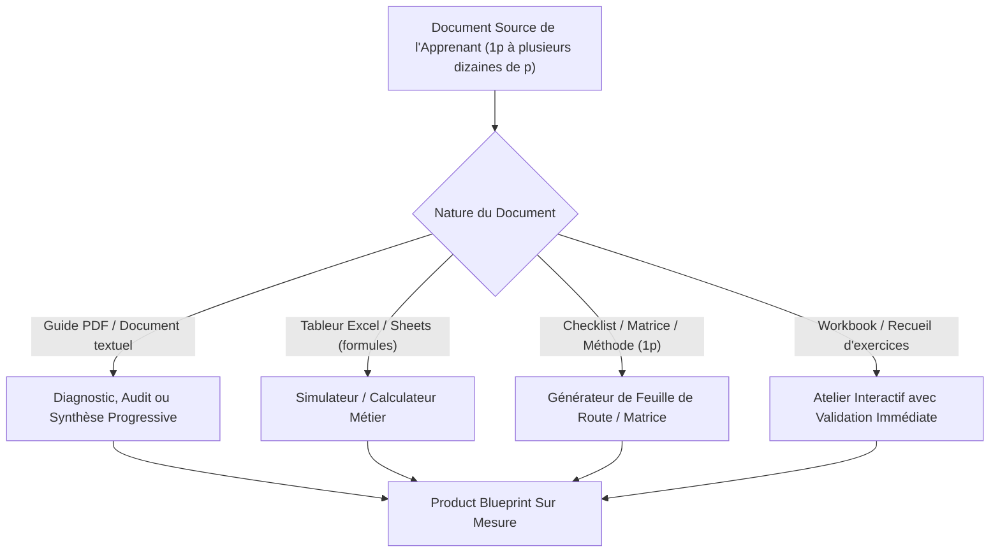
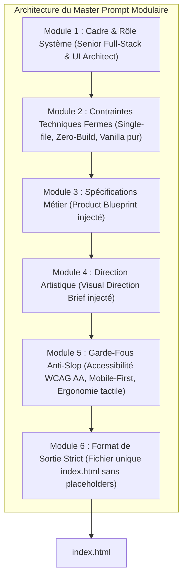
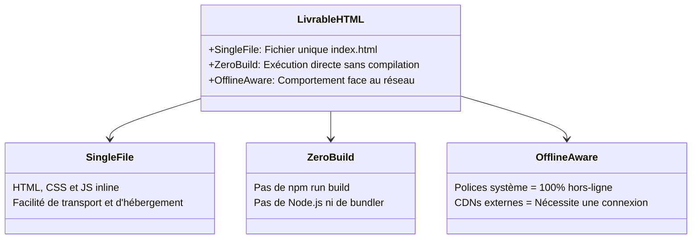
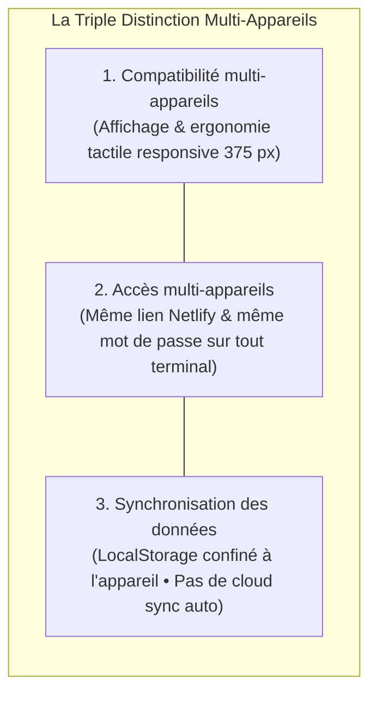
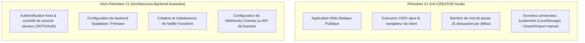
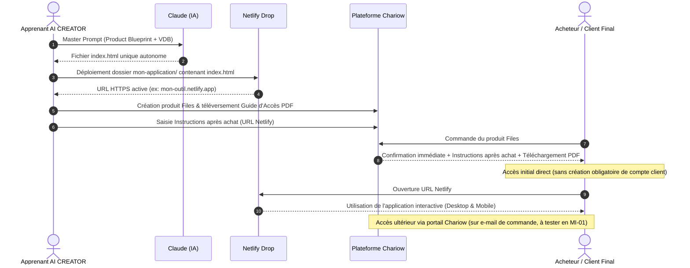
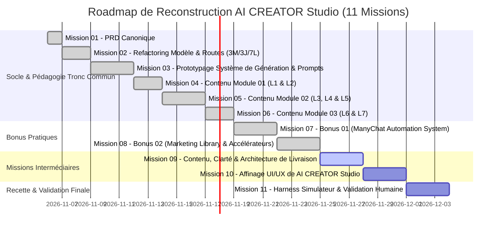

# PRODUCT REQUIREMENTS DOCUMENT (PRD) CANONIQUE : AI CREATOR STUDIO

> **Version** : 1.1.0-CANONICAL  
> **Statut** : RÉFÉRENCE CANONIQUE OFFICIELLE (POST-AUDIT 01-B)  
> **Date** : Novembre 2026  
> **Auteur** : Senior Product Manager, Software Architect & Learning Experience Designer  
> **Dépôt** : [https://github.com/Kreesten-hsh/AI_CREATOR_STUDIO](https://github.com/Kreesten-hsh/AI_CREATOR_STUDIO)  
> **Fichier de destination** : `docs/COURSE_PRD.md`

---

## 1. RÉSUMÉ EXÉCUTIF

**AI CREATOR Studio** est une plateforme web interactive d'apprentissage conçue pour guider les formateurs, consultants, coachs et créateurs dans la transformation directe d'un document existant (guide PDF, feuille de calcul, méthode opérationnelle, workbook, matrice décisionnelle) en un produit digital interactif autonome, déployé en ligne sur Netlify et commercialisé via Chariow.

Le cursus se positionne comme un **mini-cours guidé**, structuré en **3 modules thématiques**, répartis sur **3 journées pratiques**, totalisant **7 leçons hautement opérationnelles** et complété par **2 bonus pratiques** différés hors du tronc commun. La durée indicative de 3 journées (représentant un volume d'effort cumulé estimé à environ 3 h 15) constitue un **objectif pédagogique cible** dont la validation effective sera mesurée et ajustée lors de tests réels de cohortes.

À rebours des formations théoriques ou des générateurs d'applications génériques produisant du « slop » IA standardisé, AI CREATOR Studio applique un principe strict d'**adaptation au document réel de l'apprenant** (*Document-First*), une **fidélité absolue aux connaissances sources** (*Source Fidelity*), et une **indépendance esthétique totale** de l'application produite vis-à-vis de la charte graphique de la plateforme formatrice.

Le livrable final produit par l'apprenant est un **fichier unique `index.html`**, autonome vis-à-vis de tout processus de build (*Zero-Build*), pensé d'abord pour les écrans mobiles (*Mobile-First*), hébergé sans frais sur Netlify et mis à disposition des clients finaux via Chariow (Guide d'Accès PDF et instructions après achat). La V1 assume en toute transparence le modèle d'une **application web statique publique** : l'intégration d'un écran d'accès avec mot de passe JavaScript dissuasif pour les offres à accès réservé constitue une exigence cible du PRD dont l'alignement avec les prompts réels et les leçons sera finalisé lors de la Mission Intermédiaire 01. En tout état de cause, un tel mot de passe JavaScript constitue une barrière d'accès dissuasive et non une authentification forte côté serveur. Toute personne motivée détenant l'URL publique peut consulter le code HTML/JS exécuté côté client. Les architectures backend (serveurs dédiés, bases distantes, fonctions Netlify, webhooks) demeurent strictement hors périmètre de cette version initiale.

Ce document constitue la spécification canonique exhaustive et immuable gouvernant la reconstruction pédagogique, l'ingénierie d'interface et le socle technique de la plateforme.

---

## 2. IDENTITÉ ET VISION DU PRODUIT

### 2.1. Titre Officiel et Promesse de Valeur

- **Titre officiel du cours** :  
  *« Utiliser Claude pour créer un produit digital qui ne ressemble pas à de la merde générée par l'IA »*  
  *(Intitulé immuable, préservant la tonalité franche, directe et anti-slop du positionnement de marque).*

- **Promesse de travail** :  
  *« Transforme ton document existant en application interactive à ton image et publie-la en ligne en 3 jours, sans coder. »*

- **Nature du produit** :  
  **MINI-COURS GUIDÉ**. L'expérience est explicitement formalisée comme un parcours pédagogique pas-à-pas. Le terme « challenge » est formellement proscrit de toute documentation, interface et communication.

### 2.2. Vision Pédagogique et Anti-Slop

La plupart des créateurs utilisant l'IA pour générer du logiciel tombent dans l'un des deux écueils suivants :
1. **L'illusion du prompt magique unique** : Tenter de générer une application entière en une seule invite conduit à des interfaces génériques, des bugs silencieux et la perte de la substantifique moelle du contenu initial.
2. **Le syndrome du template rigide** : Forcer chaque apprenant dans un modèle préétabli (ex. un quiz standard ou un formulaire basique) détruit l'utilité métier de son document source.

AI CREATOR Studio résout cette contradiction par une méthode en entonnoir rigoureuse :
$$\text{Document Source} \longrightarrow \text{Analyse d'Interaction} \longrightarrow \text{Product Blueprint} \longrightarrow \text{Direction Artistique} \longrightarrow \text{Génération Modulaire} \longrightarrow \text{Publication Netlify} \longrightarrow \text{Livraison Chariow}$$

---

## 3. PROBLÈME RÉSOLU ET PROPOSITION DE VALEUR

### 3.1. Le Problème du « Document Mort »

Les formateurs, consultants et coachs disposent d'actifs intellectuels précieux :
- Des guides PDF denses que les acheteurs parcourent rarement dans leur intégralité.
- Des tableurs Excel/Sheets complexes dont les formules sont facilement altérées ou mal comprises par les utilisateurs.
- Des méthodes opérationnelles étape par étape difficiles à appliquer de manière autonome.

Ces supports souffrent d'une valeur perçue déclinante face aux outils interactifs modernes, d'une friction cognitive élevée à la lecture passive, et d'un passage à l'action insuffisant de la part des clients finaux.

### 3.2. La Barrière Technique Classique

Transformer ces documents en applications web interactives nécessitait traditionnellement :
- Le recours à des prestataires de développement externes (délais souvent incompatibles avec des tests rapides de marché et budgets significatifs pour des indépendants).
- L'utilisation d'outils No-Code complexes (Bubble, FlutterFlow) nécessitant des semaines d'apprentissage et des abonnements récurrents.
- L'usage naïf de LLMs générant du code partiel, non responsive, cassé ou visuellement médiocre.

### 3.3. La Proposition de Valeur d'AI CREATOR Studio

AI CREATOR Studio permet à un non-développeur de :
1. **Valoriser son savoir-faire existant** sans devoir réécrire son contenu de zéro.
2. **Obtenir une application sur mesure** qui matérialise fidèlement sa méthode sous forme d'outil d'action (audit, diagnostic, calculateur, matrice décisionnelle).
3. **Générer un livrable autonome** sans frais d'infrastructure ni abonnement d'hébergement récurrent.
4. **Mettre en ligne et organiser la livraison client** à travers un parcours éprouvé et sans complexité superflue (Netlify + Chariow).

---

## 4. PUBLIC CIBLE ET PRÉREQUIS

### 4.1. Personas Cibles

*(Les situations et offres ci-dessous sont des profils illustratifs représentatifs de l'audience visée).*

| Profil | Situation Initiale Illustrative | Actif Source Type | Résultat Visé dans le Cours |
|---|---|---|---|
| **Le Formateur / Enseignant** | Propose des formations composées de supports statiques et cherche à stimuler l'engagement actif. | Workbook d'exercices ou guide méthodologique. | Application d'exercices interactifs guidés avec auto-évaluation instantanée. |
| **Le Consultant B2B** | Réalise des audits manuels répétitifs et souhaite outiller ses prospects ou clients. | Grille d'audit Excel ou document de diagnostic Word. | Outil d'auto-diagnostic client générant un score et des recommandations ciblées. |
| **Le Coach Opérationnel** | Transmet des feuilles de route PDF que ses coachés peinent à mettre en œuvre seuls. | Guide pratique ou plan d'action séquentiel. | Planificateur d'étapes interactif avec suivi local de la progression. |
| **L'Infopreneur / Créateur** | Commercialise des produits d'information textuels et souhaite accroître la valeur perçue de ses offres. | Document thématique riche en cadres méthodologiques. | Mini-outil web interactif à forte valeur d'usage. |

### 4.2. Prérequis Réels de l'Apprenant

- **Prérequis d'Entrée Obligatoires** :
  - **Disposer d'un document ou d'une méthode existante** : Le contenu peut faire **de 1 page** (matrice décisionnelle dense, fiche mémo, grille d'audit concise) **à plusieurs dizaines de pages** (guide, workbook, tableur). Le critère d'admission repose sur la **qualité, la cohérence et l'utilité pratique** de la matière, non sur un nombre de pages arbitraire.
  - Posséder un ordinateur fonctionnel muni d'un navigateur web moderne (Google Chrome, Mozilla Firefox, Safari, Arc ou Microsoft Edge).
  - Avoir accès à un compte **Claude Free** (Anthropic). *Aucun abonnement payant Claude Pro n'est requis.*
- **Prérequis Techniques Exclus** :
  - **Zéro compétence en programmation** (ni HTML, ni CSS, ni JavaScript).
  - **Zéro maîtrise de Git ou du terminal de commande**.
  - **Zéro connaissance préalable des modèles d'architecture web**.

### 4.3. Protocoles de Préparation pour Formats Complexes

Lorsque le document source présente des caractéristiques spécifiques, les mesures préalables suivantes sont recommandées en Leçon 1 :
- **Tableurs (.xlsx, .csv)** : Extraire les formules clés, la logique de calcul et les libellés sous forme d'un tableau récapitulatif textuel ou d'un export Markdown structuré.
- **Documents scannés (PDF images)** : S'assurer que le texte est sélectionnable à la souris ou utiliser un outil d'OCR préalable (Google Drive, Apple Live Text, utilitaire système) si nécessaire pour extraire un texte brut exploitable avant soumission à Claude.
- **Documents volumineux (> 30 pages, et a fortiori 40–50 pages)** : Isoler le chapitre, module ou processus clé destiné à être interactif (conformément à la règle enseignée en Leçon 1) pour éviter la saturation du contexte de Claude Free.

---

## 5. PÉRIMÈTRE FONCTIONNEL ET EXCLUSIONS

### 5.1. Périmètre Inclus (In-Scope V1)

- **Parcours Didactique Complet** : Accompagnement structuré à travers 3 Modules, 3 Journées et 7 Leçons.
- **Protocoles de Prompts Dédiés** : Blocs de prompts copiables (`CopyBlock`) pré-calibrés avec zones personnalisables explicites pour chaque étape clé avec Claude.
- **Protocole de Continuité Conversationnelle** : Méthode pragmatique de conversation continue sur Claude Free (avec usage du bouton Continue en cas de réponse tronquée) sans dépendre de fonctionnalités Pro.
- **Architecture de Génération HTML** : Directives strictes pour la production d'un fichier `index.html` unique, inline, mobile-first et sans dépendances de compilation.
- **Déploiement et Monétisation** : Procédure pas-à-pas de publication sur Netlify et de paramétrage de la livraison client via Chariow.
- **2 Bonus Pratiques** : Mini-cours ManyChat (Bonus 01) et Marketing Library (Bonus 02) intégrés et livrés (hors tronc commun de 7 leçons).

### 5.2. Périmètre Exclu (Out-of-Scope V1)

- **Pas d'environnement de compilation complexe** : Aucun bundling Node.js, Webpack, Vite ou Tailwind CLI n'est imposé à l'apprenant pour son application.
- **Pas de backend hébergé ni de base de données distante** : L'application générée fonctionne côté client sans serveur applicatif dédié ni microservices.
- **Pas d'authentification utilisateur serveur** : La V1 n'intègre pas de système de connexion utilisateur avec gestion de session serveur, tokens ou base de données distante. La protection par mot de passe envisagée est une barrière d'accès dissuasive intégrée en JavaScript dans l'application statique hébergée sur Netlify (exigence cible dont l'alignement avec le code du Master Prompt 2 et des étapes de cours est planifié en Mission Intermédiaire 01).
- **Pas de système d'injection dynamique global « Mon projet »** : Proscription définitive du profil de projet global dans la plateforme AI CREATOR Studio. L'apprenant personnalise directement ses blocs de prompt locaux.
- **Suppression définitive des sections `Ressources` et `Fiches pratiques`** : Sorties du périmètre applicatif et de la navigation.
- **Pas d'éditeur de code intégré (Web IDE)** : L'apprenant teste son livrable directement dans son navigateur ou via l'interface de prévisualisation de Claude.

---

## 6. ARCHITECTURE PÉDAGOGIQUE DÉTAILLÉE

Le cursus d'AI CREATOR Studio est articulé autour d'un objectif de réalisation en 3 journées de travail, avec un volume horaire estimatif d'environ 3 h 15 d'effort actif (à consolider empiriquement lors des tests réels).

```mermaid
journey
    title Parcours Apprenant AI CREATOR Studio (3 Modules • 3 Journées • 7 Leçons)
    section Jour 1 : CHOISIR (Obj. ~45 min)
      Préparer le document & configurer Claude: 5: Apprenant
      Analyse du document & 3 options d'interaction: 4: Apprenant, Claude
      Sélection & validation du Product Blueprint: 5: Apprenant
    section Jour 2 : CRÉER (Obj. ~1 h 30)
      Définition de la Direction Artistique (DA): 4: Apprenant
      Génération de la V1 avec le Master Prompt: 5: Claude
      Retouches ciblées, débogage & tests mobile: 4: Apprenant, Claude
    section Jour 3 : PUBLIER & LIVRER (Obj. ~1 h 00)
      Exportation index.html & Déploiement Netlify: 5: Apprenant
      Paramétrage Chariow & Test du parcours client: 5: Apprenant
```

### Synthèse Matricielle du Cursus

| Module | Journée | Leçon | Intitulé de la Leçon | Durée Indicative Cible | Livrable Intermédiaire |
|---|---|---|---|---|---|
| **M1 : CHOISIR** | **Jour 1** | **L1** | Préparer son document et configurer Claude | ~15 min | Espace Claude dédié + Document source préparé et nettoyé |
| | | **L2** | Analyser son document, identifier 3 interactions et choisir | ~30 min | **Product Blueprint validé** + Source Fidelity Mapping initial |
| **M2 : CRÉER** | **Jour 2** | **L3** | Définir sa direction artistique indépendante | ~20 min | Spécification de style (Palette, Typographies, Composants) |
| | | **L4** | Générer la première version (V1) de son application | ~40 min | Fichier `index.html` fonctionnel V1 généré par Claude |
| | | **L5** | Effectuer des retouches ciblées, corriger et tester | ~30 min | **Application HTML finale testée** sur les principales interactions et les formats d’écran prévus |
| **M3 : PUBLIER ET LIVRER** | **Jour 3** | **L6** | Publier son application sur Netlify | ~25 min | URL publique HTTPS active et opérationnelle |
| | | **L7** | Organiser la livraison via Chariow et tester le parcours d'achat | ~35 min | **Produit Chariow configuré**, accès testé et livraison validée |

---

## 7. SPÉCIFICATIONS DÉTAILLÉES DES SEPT LEÇONS

Chaque leçon dispose de sa propre logique d'apprentissage, adaptée à la nature de son livrable.

---

### LEÇON 1 : Préparer son document et configurer Claude

- **Identifiant** : `LESSON-01` (id code : `lesson-01`)
- **Module & Journée** : Module 01 (CHOISIR) — Journée 1 (`day-01`)
- **Durée indicative cible** : ~15 minutes
- **Titre dans le code** : *Préparer son document et configurer Claude* (Navigation : *Préparer*)
- **Objectif opérationnel** :  
  Sélectionner son document source (texte vérifié sélectionnable à la souris, ciblage de chapitre pour les guides volumineux > 30 pages), importer le Skill gratuit `ai-creator-design-intelligence` dans Claude Free via la procédure officielle en 7 gestes, et préparer sa session de travail.
- **Entrées requises** :  
  - Le document digital existant de l'apprenant (PDF, DOCX, Google Doc, Notion, XLSX, 1 page ou plus).
  - Un compte actif Claude (version gratuite).
  - L'archive officielle du Skill : `AI-CREATOR-DESIGN-INTELLIGENCE.zip`.
- **Actions de l'apprenant (Les 3 étapes pédagogiques de la leçon)** :  
  1. **Étape 1 : Choisir et préparer son document (`Quoi utiliser`)** :
     - Vérifier que le contenu est exploitable (PDF, Word, Markdown, notes ou tableur avec formules visibles).
     - Effectuer le test de sélection textuelle : s'assurer que le texte peut être sélectionné et copié à la souris (sans obligation d'OCR si le document est déjà un fichier textuel numérique).
     - Si le document est un long guide (+30 pages), isoler le chapitre le plus pratique pour créer un outil ciblé et éviter la saturation du contexte.
  2. **Étape 2 : Installer le Skill gratuit dans Claude (`Installer le zip`)** :
     - Télécharger l'archive officielle `AI-CREATOR-DESIGN-INTELLIGENCE.zip` sans la décompresser.
     - Exécuter la procédure officielle d'installation en **7 gestes** dans Claude Free :
       1. Ouvrir `Settings > Capabilities`.
       2. Activer `Code execution and file creation`.
       3. Ouvrir `Customize > Skills`.
       4. Cliquer sur le bouton `+`.
       5. Choisir `+ Create skill`.
       6. Choisir `Upload a skill`.
       7. Téléverser l'archive `AI-CREATOR-DESIGN-INTELLIGENCE.zip` et vérifier que le Skill est actif.
     *(Note d'alignement : les divergences rédactionnelles entre la leçon, `INSTALLATION-CLAUDE-FREE.md` et `GUIDE-PARCOURS-APPRENANT.md` sont inscrites pour harmonisation éditoriale et captures réelles lors de la Mission Intermédiaire 01).*
  3. **Étape 3 : Vérifier et finaliser la préparation (`Prêt à lancer`)** :
     - Confirmer l'activation effective du Skill dans les réglages de Claude.
     - Ouvrir une nouvelle conversation propre, prête à recevoir le document et le Master Prompt 1 lors de la Leçon 2.
- **Utilisation exacte de Claude** :  
  Aucun prompt d'initialisation de session n'est exécuté dans la Leçon 1. Le dialogue avec Claude démarre directement au début de la Leçon 2 avec l'envoi simultané du document source et du Master Prompt 1 (`PROMPT-ENTRETIEN-DIRECTION-ARTISTIQUE`). L'ancien prompt distinct `PROMPT-L1-INIT` est supprimé.
- **Livrable concret** :  
  Un document source prêt sur l'ordinateur, le Skill gratuit activé dans Claude et une nouvelle conversation ouverte.
- **Critères de validation observables** :
  - [ ] Le texte du document est vérifié comme sélectionnable à la souris.
  - [ ] Si le document dépasse 30 pages, le chapitre cœur a été isolé.
  - [ ] Le Skill zip a été importé et apparaît actif dans les paramètres de Claude.
  - [ ] Une nouvelle discussion Claude est ouverte et prête pour la Leçon 2.

---

### LEÇON 2 : Faire analyser son document, identifier trois possibilités d'interaction et choisir la plus pertinente

- **Identifiant** : `LESSON-02` (id code : `lesson-02`)
- **Module & Journée** : Module 01 (CHOISIR) — Journée 1 (`day-01`)
- **Durée indicative cible** : ~30 minutes
- **Titre dans le code** : *Analyser son document, identifier 3 interactions et choisir* (Navigation : *Analyser*)
- **Objectif opérationnel** :  
  Faire analyser son document source par Claude, examiner 3 concepts d'interaction fonctionnels profondément contrastés et formaliser sans code ses deux documents fonctionnels : « Mon plan d'application » (Product Blueprint) et « Les règles de mon document » (Source Fidelity Mapping).
- **Entrées requises** :  
  - Le document source préparé (L1).
  - La session Claude avec Skill actif (L1).
- **Actions de l'apprenant** :  
  1. Joindre le document source et exécuter le **Master Prompt 1 (Phase 1 : Cadrage Fonctionnel & Fidélité Source)** (`PROMPT-ENTRETIEN-DIRECTION-ARTISTIQUE` / `MASTER_PROMPT_1_XML`).
  2. Claude commence obligatoirement par le contrôle du Skill (`[STATUT SKILL : ACTIF ...]`), produit une synthèse silencieuse en 3-4 lignes et propose 3 concepts d'interaction fonctionnels profondément différents avec une recommandation argumentée.
  3. Choisir son concept d'interaction via la réponse guidée (`PROMPT_CHOIX_IDEE` : numéro de concept retenu, public visé, fonction principale).
  4. Claude formalise immédiatement sans code les deux livrables fonctionnels :
     - Livrable 1 : « Mon plan d'application » (Product Blueprint : promesse, entrées utilisateur, moteur logique avec formules exactes, sorties).
     - Livrable 2 : « Les règles de mon document » (Source Fidelity Mapping : tableau exhaustif reliant chaque élément du document à sa règle de transcription et son mode de contrôle).
  5. Sauvegarder ces deux documents et se préparer pour le passage au style (Leçon 3) dans cette même conversation.
- **Utilisation exacte de Claude** :  
  - Prompt initial : Master Prompt 1 (`PROMPT-ENTRETIEN-DIRECTION-ARTISTIQUE`, Phase 1).
  - Réponse de validation du concept (`PROMPT_CHOIX_IDEE`) :
    ```text
    Je choisis l'idée numéro [1 / 2 / 3].

    Précisions souhaitées pour mon application :
    - Public visé : [Ex : dirigeants de TPE, indépendants, clients]
    - Fonction principale : [Ex : calcul automatique du besoin de trésorerie]

    Formalise maintenant mes deux documents fonctionnels :
    1. Mon plan d'application (ce que l'utilisateur saisit, le fonctionnement logique et le résultat affiché).
    2. Les règles de mon document (le tableau de toutes les formules, seuils et règles à conserver à 100 %).

    N'émets aucun code informatique pour le moment et indique-moi quand tout est prêt pour passer au style.
    ```
  *(L'ancienne description de deux prompts indépendants d'analyse et de blueprint est remplacée par ce flux unifié du Master Prompt 1).*
- **Livrable concret** :  
  Deux documents fonctionnels formalisés et validés : « Mon plan d'application » (Product Blueprint) et « Les règles de mon document » (Source Fidelity Mapping - SFM).
- **Critères de validation observables** :
  - [ ] Le statut du Skill est confirmé au début de la réponse de Claude.
  - [ ] Les 3 concepts d'interaction proposés sont variés et fidèles à la matière source.
  - [ ] Le concept retenu préserve l'expertise métier sans simplification abusive.
  - [ ] Le Product Blueprint spécifie clairement les entrées, la logique interne et les résultats.
  - [ ] Le Source Fidelity Mapping répertorie l'intégralité des règles et formules du document.

---

### LEÇON 3 : Définir sa direction artistique indépendante

- **Identifiant** : `LESSON-03` (id code : `lesson-03`)
- **Module & Journée** : Module 02 (CRÉER) — Journée 2 (`day-02`)
- **Durée indicative cible** : ~20 minutes
- **Titre dans le code** : *Définir sa direction artistique indépendante* (Navigation : *Style*)
- **Objectif opérationnel** :  
  Mener un entretien visuel avec Claude dans la même conversation (Master Prompt 1, Phase 2) pour concevoir une identité graphique sur-mesure, indépendante de la charte de la plateforme, et formaliser « Ma fiche de style » (Visual Direction Brief - VDB).
- **Entrées requises** :  
  - La session Claude continue avec le Blueprint et le SFM validés (L2).
- **Actions de l'apprenant** :  
  1. Envoyer le signal de transition dans la même conversation Claude : `Plan et règles validés, passons au style.` (`PROMPT_SIGNAL_STYLE`).
  2. Répondre à l'entretien visuel conversationnel (Claude pose 1 ou 2 questions ciblées sur l'esprit recherché : personnalité, tonalité, univers sensoriel).
  3. Claude propose **3 directions artistiques adaptatives et contrastées** issues du document (et non 4 archétypes figés), présentées sous 6 points visuels clairs (nom, ambiance, palette, typographie, composition, justification).
  4. Sélectionner et affiner son style avec Claude (ajustements de teintes, polices, densité).
  5. Claude formalise le Livrable 3 : « Ma fiche de style » (Visual Direction Brief : spécification complète du design validé, tokens CSS `:root`, typographies sculptées, responsive 375 px, gestion d'état).
- **Utilisation exacte de Claude** :  
  - Signal de passage : `Plan et règles validés, passons au style.` (`PROMPT_SIGNAL_STYLE`).
  - Entretien visuel adaptatif et proposition des 3 directions artistiques personnalisées.
  - Formalisation de « Ma fiche de style » (Visual Direction Brief).
  *(L'ancienne description de 4 archétypes fixes et de `PROMPT-L3-STYLE` est remplacée par cette mécanique conversationnelle adaptative).*
- **Livrable concret** :  
  Le troisième livrable validé : « Ma fiche de style » (Visual Direction Brief - VDB).
- **Critères de validation observables** :
  - [ ] Le dialogue visuel découle organiquement du sujet et du public cible.
  - [ ] Les 3 directions proposées offrent de réels contrastes visuels.
  - [ ] La DA retenue est propre au produit et n'utilise pas la charte Burgundy/Cream du studio.
  - [ ] Le Visual Direction Brief formalise les tokens CSS, les polices et l'adaptation mobile.

---

### LEÇON 4 : Générer la première version (V1) de son application avec Claude

- **Identifiant** : `LESSON-04` (id code : `lesson-04`)
- **Module & Journée** : Module 02 (CRÉER) — Journée 2 (`day-02`)
- **Durée indicative cible** : ~40 minutes
- **Titre dans le code** : *Générer la première version (V1) de son application* (Navigation : *Générer*)
- **Objectif opérationnel** :  
  Exécuter le Master Prompt 2 (`MASTER_PROMPT_2_XML`) dans la même conversation pour générer l'intégralité du code de l'application dans un fichier unique `index.html`, autonome et immédiatement testable au double-clic.
- **Entrées requises** :  
  - La session Claude continue avec le Blueprint, le SFM et le VDB validés.
- **Actions de l'apprenant** :  
  1. Copier le Master Prompt 2 (`PROMPT-GENERATION-PRODUIT-HTML`) depuis AI CREATOR Studio.
  2. Coller l'instruction dans la même conversation Claude et lancer la génération.
  3. Extraire le code généré : copier l'intégralité du bloc ou télécharger le fichier produit.
  4. Effectuer le premier test local : double-cliquer sur le fichier `index.html` pour l'ouvrir dans son navigateur web (`file:///`).
- **Contraintes techniques du code actuellement implémenté (Master Prompt 2)** :  
  - R1 : Fichier unique exclusif `index.html` (HTML sémantique, CSS inline `<style>`, JS Vanilla inline `<script>`).
  - R2 : Zero-Build & Zéro framework : aucun Node.js, npm, Vite, React, Vue ni bibliothèque externe. Interdiction formelle du Tailwind Play CDN (`cdn.tailwindcss.com`).
  - R3 : Zéro placeholder ni commentaire TODO / troncature (`<!DOCTYPE html>` à `</html>`).
  - R4 : Fidélité source absolue (100 %) conforme au SFM.
  - R5 : Application intégrale de la DA du VDB.
  - R6 : Précision arithmétique (calculs en centimes entiers si montants financiers, validation `isSafeInteger`, saisies invalides conservées dans le champ).
  - R7 : Décision d'état conditionnelle : mémoire vive volatile pour simulateurs éphémères ; `StorageAdapter` sécurisé local si persistance requise.
  - R8 : Accessibilité & ergonomie physique : cibles tactiles $\ge 44\text{ px}$, polices $\ge 16\text{ px}$ sur mobile, ratios WCAG AA, responsive 375 px strict sans scroll horizontal.
- **Statut de React via CDN** :  
  Dans l'état actuellement implémenté du code, React est formellement exclu (R2 proscrit tout framework). La possibilité d'une exception via CDN relève d'une intention d'arbitrage future (`DEC-ARB-13`) et n'est pas disponible dans le prompt actuel.
- **Statut de la barrière par mot de passe** :  
  Le Master Prompt 2 actuel ne comporte pas d'instruction de génération d'écran mot de passe. L'alignement de cette exigence cible constitue un chantier prioritaire de la Mission Intermédiaire 01.
- **Livrable concret** :  
  Le fichier `index.html` V1 fonctionnel et ouvert dans le navigateur local.
- **Critères de validation observables** :
  - [ ] Le code est fourni dans un seul bloc complet de `<!DOCTYPE html>` à `</html>`.
  - [ ] Le double-clic sur `index.html` affiche l'application sans écran blanc ni crash console.
  - [ ] Les interactions principales (champs, calculs, boutons) réagissent conformément au document.

---

### LEÇON 5 : Effectuer des retouches ciblées, corriger et tester

- **Identifiant** : `LESSON-05` (id code : `lesson-05`)
- **Module & Journée** : Module 02 (CRÉER) — Journée 2 (`day-02`)
- **Durée indicative cible** : ~30 minutes
- **Titre dans le code** : *Effectuer des retouches ciblées, corriger et tester* (Navigation : *Retoucher*)
- **Objectif opérationnel** :  
  Contrôler son application (test des 3 largeurs d'écran, conformité mobile 375 px, fidélité source), formuler des retouches ciblées avec le gabarit dédié et finaliser le fichier `index.html` dans son dossier `mon-application/`.
- **Entrées requises** :  
  - Le fichier `index.html` V1 généré (L4).
  - La session Claude continue.
- **Actions de l'apprenant** :  
  1. Exécuter le test des 3 largeurs d'écran (smartphone 375 px, tablette, desktop).
  2. Tester les cas limites (champs vides, valeurs extrêmes, textes longs).
  3. Vérifier la fidélité source : s'assurer qu'aucune règle métier n'a été tronquée.
  4. Formuler des retouches chirurgicales à Claude si nécessaire via le prompt dédié.
  5. Valider la version finale du fichier `index.html` et l'isoler à la racine d'un dossier nommé `mon-application/`.
- **Utilisation exacte de Claude** :  
  Prompt de retouche ciblée (`PROMPT_RETOUCHE_CIBLEE`) structuré selon les 3 champs obligatoires :
  ```text
  Voici une retouche précise à apporter à mon application :
  1. Comportement actuel : [décris ce qui se passe ou ce qui ne s'affiche pas correctement]
  2. Comportement attendu : [décris le résultat souhaité d'après le document ou la fiche de style]
  3. Zone concernée : [ex. le champ de saisie, le résultat final, l'affichage sur mobile]

  Règles à respecter :
  - Conserve toutes les règles de calcul et le design existant sans rien simplifier.
  - Renvoie le code complet et corrigé dans le fichier unique index.html, de <!DOCTYPE html> à </html>.
  ```
- **Livrable concret** :  
  Le fichier `index.html` final et validé, placé à la racine du dossier `mon-application/`.
- **Critères de validation observables** :
  - [ ] Zéro défilement horizontal indésirable à 375 px de large.
  - [ ] L'ensemble des règles du Source Fidelity Mapping sont vérifiées.
  - [ ] Le dossier `mon-application/` contient `index.html` directement à la racine.

---

### LEÇON 6 : Publier son application sur Netlify

- **Identifiant** : `LESSON-06` (id code : `lesson-06`)
- **Module & Journée** : Module 03 (PUBLIER ET LIVRER) — Journée 3 (`day-03`)
- **Durée indicative cible** : ~25 minutes
- **Titre dans le code** : *Publier son application sur Netlify* (Navigation : *Publier*)
- **Objectif opérationnel** :  
  Déployer gratuitement son dossier `mon-application` sur Netlify Drop sans ligne de commande, personnaliser son sous-domaine HTTPS et vérifier l'accessibilité publique mondiale sur ordinateur et smartphone.
- **Entrées requises** :  
  - Le dossier `mon-application` contenant `index.html` à la racine (L5).
  - Un compte gratuit Netlify.
- **Actions de l'apprenant** :  
  1. Vérifier son dossier local : s'assurer que `index.html` se trouve directement à la racine de `mon-application` (sans sous-dossier superflu ni extension `.txt` masquée).
  2. Se connecter sur Netlify et ouvrir Netlify Drop ([app.netlify.com/drop](https://app.netlify.com/drop)).
  3. Glisser-déposer le dossier complet `mon-application` dans la zone de téléversement en pointillés.
  4. Récupérer la première URL générée en `*.netlify.app`.
  5. Personnaliser le sous-domaine gratuit dans : `Project Overview > Customize > Manage project name and cover image` (ex: `diagnostic-pme.netlify.app`).
  6. Contrôler explicitement la visibilité publique dans : `Project configuration > General > Visitor access > Project visibility` (confirmer la valeur sur **Public**).
  7. Constater le provisionnement automatique du certificat HTTPS/SSL.
  8. Prendre en compte la limite du forfait gratuit Netlify (quota mensuel de crédits).
  9. Ouvrir l'URL en navigation privée sur ordinateur et sur smartphone (375 px) : vérifier l'accès réel et la réactivité tactile.
- **Clarification sur la sécurité et le mot de passe** :  
  - Distinguer nettement la visibilité publique de l'hébergement Netlify (`Visitor access = Public`) de la protection applicative de l'outil.
  - Acter le décalage temporaire : la checklist actuelle de L6 (`l6-p2`) stipule : *« La page s’ouvre sans mot de passe en fenêtre de navigation privée. Tout visiteur externe peut utiliser l’application sans compte Netlify »*. Ce contrôle correspond à l'état actuel du code (sans mot de passe généré par Master Prompt 2), mais diverge de l'exigence de mot de passe dissuasif par défaut du PRD. La réconciliation sera effectuée lors de la Mission Intermédiaire 01.
- **Utilisation exacte de Claude** :  
  Prompt de dépannage réactif via le `HelpPanel` en cas d'erreur 404 Netlify (`PROMPT_L6_NETLIFY_HELP`).
- **Livrable concret** :  
  Une URL publique HTTPS active (`https://[nom-personnalise].netlify.app`), accessible depuis n'importe quel terminal connecté à Internet.
- **Critères de validation observables** :
  - [ ] L'URL Netlify est active et sécurisée en HTTPS (certificat SSL provisionné automatiquement).
  - [ ] L'application se charge en fenêtre de navigation privée sans connexion à Netlify.
  - [ ] L'application fonctionne sur ordinateur et smartphone (375 px tactile) sans débordement horizontal.
  - [ ] Le sous-domaine a été personnalisé de manière claire et professionnelle.

---

### LEÇON 7 : Organiser la livraison via Chariow et tester le parcours d'achat

- **Identifiant** : `LESSON-07` (id code : `lesson-07`)
- **Module & Journée** : Module 03 (PUBLIER ET LIVRER) — Journée 3 (`day-03`)
- **Durée indicative cible** : ~35 minutes
- **Titre dans le code** : *Organiser la livraison via Chariow et tester le parcours d'achat* (Navigation : *Vendre*)
- **Objectif opérationnel** :  
  Créer une offre commerciale de type **Files** sur Chariow, configurer la livraison du **Guide d'Accès PDF** et les instructions après achat, et tester le parcours d'achat en conditions réelles.
- **Entrées requises** :  
  - L'URL publique de son application Netlify validée (L6).
  - Un compte vendeur Chariow.
- **Actions de l'apprenant** :  
  1. Se connecter à son tableau de bord Chariow : `Produits > Créer un nouveau produit > Fichiers > Continuer`.
  2. Renseigner les informations commerciales : titre explicite, catégorie, prix et description.
  3. Téléverser les visuels requis : miniature carrée ($\ge 600 \times 600\text{ px}$) et bannière ($\ge 702 \times 260\text{ px}$) aux couleurs de l'application (interdiction d'utiliser la charte Burgundy/Cream du studio).
  4. Téléverser le **Guide d'Accès PDF** dans la section Contenu du produit.
  5. Configurer le champ `Instructions après achat` (`Produits > ⋮ > Modifier > Informations`) avec la trame d'accueil et le lien Netlify.
  6. Configurer un code promo de test à 100 % dans `Marketing > Réductions` (restreint au produit, 1 utilisation max).
  7. Ouvrir la page produit Chariow en navigation privée et tester le flux d'achat :
     - *Cas A (Commande 0 € acceptée)* : valider la commande, vérifier les instructions post-achat, télécharger le Guide d'Accès PDF et tester le lien sur ordinateur et mobile.
     - *Cas B (Commande 0 € refusée par la passerelle)* : ne pas payer son propre produit, constater l'arrêt au panier et valider la configuration.
  8. Désactiver immédiatement le code promotionnel de test.
- **Clarification sur les livrables et la sécurité** :  
  - **Livrable existant vs livrable cible** : Le code de L7 intègre actuellement le texte `TEXTE_INSTRUCTIONS_POST_ACHAT` (lien Netlify, ajout aux favoris, mention du guide PDF, contact e-mail ; aucun mot de passe n'y figure actuellement). Le **Guide d'Accès PDF** complet décrit dans le PRD (avec gabarit formel, consignes multi-appareils, limites LocalStorage) constitue un livrable cible dont la production est inscrite dans la Mission Intermédiaire 01.
  - **Prudence sur Chariow** : Ne pas présenter comme définitivement figés les chemins d'interface ni le modèle à double canal. La vérification empirique du parcours réel (achat test à 0 €, affichage des instructions, téléchargement du PDF, accès portail) fait partie intégrante de la Mission Intermédiaire 01.
- **Utilisation exacte de Claude** :  
  Trame des instructions après achat intégrée dans la leçon (`TEXTE_INSTRUCTIONS_POST_ACHAT`) :
  ```text
  Merci pour votre achat !

  Voici comment accéder immédiatement à votre application :
  1. Cliquez sur votre lien d'accès direct : [VOTRE LIEN NETLIFY]
  2. Ajoutez cette adresse à vos favoris pour la retrouver en un clic.
  3. Téléchargez votre Guide d'Accès PDF depuis les fichiers disponibles après votre achat.

  En cas de question ou de suggestion, contactez-moi directement à [VOTRE EMAIL].
  ```
- **Livrable concret** :  
  Une fiche produit active sur Chariow avec Guide d'Accès PDF configuré, instructions post-achat enregistrées et parcours d'achat testé.
- **Critères de validation observables** :
  - [ ] Le produit est publié sur Chariow avec le type Fichiers (titre, prix et visuels minimaux respectés).
  - [ ] Les visuels respectent les formats requis ($\ge 600 \times 600\text{ px}$ et $\ge 702 \times 260\text{ px}$).
  - [ ] Le code promotionnel de test est restreint au produit avec 1 utilisation maximale.
  - [ ] Les instructions après achat intègrent le lien Netlify fonctionnel.
  - [ ] Le parcours d'achat a été vérifié en conditions réelles (Cas A ou Cas B).
  - [ ] Le code promotionnel de test a été désactivé immédiatement après vérification.

---

## 8. SYSTÈME D'ADAPTATION AUX DOCUMENTS DES APPRENANTS

AI CREATOR Studio refuse catégoriquement l'approche « taille unique ». Le cursus prend en charge la diversité des formats de départ, qu'il s'agisse d'un document d'une seule page ou d'un support plus étendu :



### Typologie des 5 Grandes Familles d'Interactions Générables

1. **L'Auto-Diagnostic & Audit Évaluatif** :
   - *Pour qui* : Méthodes de consulting, bilans de compétences, audits organisationnels ou de conformité.
   - *Mécanique* : Série de questions pondérées, score synthétique par dimension, identification des points de blocage et plan d'action priorisé.
2. **Le Simulateur & Calculateur Métier** :
   - *Pour qui* : Formules financières, tarification, rentabilité d'investissement, calculs prévisionnels.
   - *Mécanique* : Sliders et champs numériques interactifs, recalculs instantanés côté client sans rechargement, visualisation graphique des résultats.
3. **Le Générateur de Feuille de Route Personnalisée** :
   - *Pour qui* : Guides méthodologiques étape par étape, plans de lancement, matrices décisionnelles.
   - *Mécanique* : Filtres de contexte initial, génération d'un calendrier d'actions sur mesure et bouton d'exportation (copie presse-papier ou impression).
4. **La Matrice de Décision Interactive** :
   - *Pour qui* : Guides d'orientation, choix technologiques, arbres décisionnels de résolution de problèmes.
   - *Mécanique* : Arborescence de questions conditionnelles menant à la recommandation exacte selon la situation de l'utilisateur.
5. **L'Atelier Pratique d'Exercices Guidés** :
   - *Pour qui* : Workbooks de formation, méthodes d'entraînement opérationnel.
   - *Mécanique* : Saisie libre, comparaison avec les repères méthodologiques, auto-notation et mémorisation locale de la progression.

---

## 9. PRODUCT BLUEPRINT ET SOURCE FIDELITY MAPPING

### 9.1. Structure Canonique du Product Blueprint

Le Product Blueprint est le document pivot de transition entre le savoir de l'apprenant et l'ingénierie logicielle de Claude. Il contient obligatoirement les 6 sections suivantes :

```markdown
# PRODUCT BLUEPRINT : [NOM DE L'APPLICATION]

1. IDENTITÉ DU PRODUIT
- Nom public :
- Promesse en une phrase :
- Cible précise :

2. STRUCTURE D'INTERACTION
- Type d'application : [Diagnostic / Calculateur / Planificateur / Matrice / Atelier]
- Parcours utilisateur en 3 étapes : [Étape 1 : Saisie] -> [Étape 2 : Traitement] -> [Étape 3 : Restitution]

3. SPÉCIFICATIONS DES ENTRÉES (INPUTS)
- Liste des champs, curseurs, options avec labels et valeurs par défaut.

4. MOTEUR MÉTIER & LOGIQUE INTERNE (LOGIC ENGINE)
- Règles de calcul, barèmes de scoring, formules exactes extraites du document.

5. RESTITUTION DES RÉSULTATS (OUTPUTS)
- Structure du rapport généré, métriques clés, recommandations conditionnelles, bouton d'action final (ex: Copier / Imprimer).

6. CARTOGRAPHIE DE FIDÉLITÉ SOURCE (SOURCE FIDELITY MAPPING)
```

### 9.2. Matrice de Source Fidelity Mapping (Garantie Anti-Perte)

Pour éviter que l'IA ne gomme les nuances ou les avertissements capitaux du document source, chaque apprenant valide son tableau de fidélité :

| Section du Document Source | Connaissance / Règle Métier Clé | Transcription dans l'Application | Statut de Vérification |
|---|---|---|---|
| *Section A* | Formule de calcul ou règle logique principale | Calculateur ou moteur dynamique dans l'écran de résultat | $\checkmark$ Préservé |
| *Section B* | Mises en garde et erreurs fréquentes à éviter | Encadré d'avertissement contextuel selon les saisies | $\checkmark$ Préservé |
| *Section C* | Grille de barème ou paliers d'évaluation | Logique de calcul du résultat final et recommandations associées | $\checkmark$ Préservé |

---

## 10. ARCHITECTURE FONCTIONNELLE DU MASTER PROMPT ET CONTINUITÉ

Le Master Prompt d'AI CREATOR Studio est conçu de manière modulaire afin d'assurer une exécution sans faille dans le contexte d'un compte Claude gratuit.



### 10.1. Continuité Conversationnelle sur Claude Free

Le parcours pédagogique est conçu pour se dérouler au sein d'une **discussion continue unique** sur Claude Free :
- L'apprenant enchaîne la Phase 1 (cadrage fonctionnel L2), la Phase 2 (direction artistique L3), la génération V1 (L4) et les retouches chirurgicales (L5) dans le même fil de discussion, préservant ainsi l'historique complet de son document et de ses choix.
- En cas d'interruption de génération par Claude (limite de longueur de réponse sur code volumineux), la consigne enseignée est d'utiliser le bouton natif **`Continue`** (ou d'envoyer la commande simple « Continue ») pour que Claude reprenne exactement au point d'arrêt sans générer de fragmentation.
- *Perspective d'évolution (Trousseau de Reprise & Snapshot)* : Un protocole théorique plus formel de snapshot de continuité (`PROMPT-CONTINUITY-SNAPSHOT`) et de trousseau de reprise en cas de bascule de session forcée a été esquissé lors des phases amont ; son utilité réelle, son format et sa formalisation éventuelle en composant pédagogique seront arbitress et testés lors de la Mission Intermédiaire 01.

### 10.2. Garantie d'Indépendance vis-à-vis de Claude Pro

Le parcours pédagogique est conçu pour fonctionner **intégralement avec Claude Free** :
- Aucun recours à la fonctionnalité *Projects* (réservée à Claude Pro).
- Aucun recours aux fonctionnalités d'export ou d'artefacts payants.
- Toutes les opérations reposent sur le chat standard, le copier-coller de texte/code et le téléversement de fichiers supporté en version gratuite.

---

## 11. EXIGENCES DE GÉNÉRATION HTML

Pour assurer la viabilité technique et l'autonomie totale des apprenants, les règles d'ingénierie applicative suivantes sont strictement imposées à Claude :

### 11.1. Triptyque Technique Fondamental

Le PRD pose une distinction formelle entre les trois propriétés suivantes :



1. **Fichier unique (`index.html`)** :  
   Tout le code structurel, stylistique (`<style>`) et comportemental (`<script>`) réside dans un seul fichier. Aucune ressource relative locale (`style.css`, `app.js`, images locales non encodées) n'est requise.
2. **Autonomie de compilation (*Zero-Build*)** :  
   Le livrable est interprétable immédiatement par n'importe quel moteur de rendu de navigateur moderne. Aucune commande de compilation (`npm`, `vite`, `webpack`, `tsc`) n'est requise de la part de l'apprenant.
3. **Fonctionnement réseau (*Offline vs Online*)** :  
   - Si l'application utilise des polices système standard (`system-ui`, `-apple-system`, `sans-serif`) et du JS vanilla pur : l'application fonctionne à **100 % hors-ligne**.
   - Si l'application charge des polices Google Fonts ou une bibliothèque tierce via CDN : elle nécessite une connexion active pour charger ces ressources externes lors du premier accès.

### 11.2. Règles d'Usage des Bibliothèques et CDNs

- **Vanilla JavaScript exclusif dans l'état actuellement implémenté** : Le Master Prompt 2 (`MASTER_PROMPT_2_XML`, règle R2) proscrit formellement tout framework ou bibliothèque externe (Node.js, npm, Vite, React, Vue). L'application s'appuie exclusivement sur JavaScript ES6+ moderne (DOM standard, API Web natives).
- **Interdiction Formelle du Tailwind Play CDN en Production** :  
  L'utilisation de `<script src="https://cdn.tailwindcss.com"></script>` est **strictement interdite pour la production**. Ce script expérimental compile le CSS à la volée dans le navigateur du client, provoquant des sauts visuels majeurs (*Flash of Unstyled Content*), une surcharge mémoire et des risques de rupture d'API. Le Master Prompt contraint Claude à injecter du CSS compilé propre dans la balise `<style>`.
- **Arbitrage futur : Éventuelle exception React via CDN (`DEC-ARB-13`)** :  
  L'opportunité d'autoriser une exception encadrée pour React via CDN (avec versions 18.3.1 figées et SHA-384) pour des applications à états hautement complexes relève d'une décision ouverte à arbitrer et n'est pas supportée dans le prompt actuel.

### 11.3. Barrière d'Accès par Mot de Passe JavaScript (Exigence Cible & Chantier Mission Intermédiaire 01)

- **Exigence cible du PRD** : Pour tout produit destiné à être commercialisé sous accès réservé, le modèle cible prévoit par défaut un écran d'accueil avec barrière de mot de passe JavaScript (mot de passe commun aux acheteurs, intégré dans la logique client du fichier).
- **Statut d'alignement avec le code actuel** :  
  L'audit révèle un **décalage formel entre cette exigence et le code actuellement présent dans le dépôt** :
  1. Le Master Prompt 2 (`src/data/days/day-02.ts`) ne comporte pas de consigne de génération d'écran mot de passe.
  2. La checklist de la Leçon 6 (`src/data/days/day-03.ts`, `l6-p2`) contrôle explicitement que « la page s'ouvre sans mot de passe en fenêtre de navigation privée ».
  3. La trame d'instructions après achat de la Leçon 7 (`TEXTE_INSTRUCTIONS_POST_ACHAT`) ne transmet aucun mot de passe.
  Cet alignement pédagogique et technique (arbitrage sur l'opportunité d'introduire le mot de passe dans le Master Prompt 2 ou d'assumer une application publique) constitue un **chantier prioritaire de la Mission Intermédiaire 01**.
- **Nature strictement dissuasive du mécanisme** : En tout état de cause, un mot de passe JavaScript côté client ne constitue **jamais une authentification forte**. Le code source exécuté dans le navigateur reste inspectable (F12) par toute personne techniquement avertie. Il ne protège pas contre un utilisateur motivé et n'a de valeur que comme filtre d'usage immédiat.
- **Hygiène absolue du code** : Aucune clé d'API privée payante (OpenAI, Anthropic, Stripe, Sendgrid, etc.), aucun secret sensible ni donnée confidentielle de tiers ne doit être placé dans le fichier HTML/JS.

---

## 12. EXIGENCES MOBILES ET MULTI-APPAREILS

La conception des applications créées par les apprenants accorde une priorité absolue aux terminaux mobiles (*Mobile-First*), compte tenu de la prépondérance des usages sur smartphone lors de la consultation de liens partagés.

### 12.1. Grille d'Exigences Mobiles Imposées

| Critère Mobile | Spécification Technique Requise | Vérification en Leçon 5 |
|---|---|---|
| **Viewport Meta** | `<meta name="viewport" content="width=device-width, initial-scale=1.0, maximum-scale=5.0">` | Présence dans le `<head>` |
| **Cibles Tactiles** | Dimensions minimales de tous les boutons et inputs : **44x44 pixels**. Espacement minimal entre 2 éléments cliquables : **8 pixels**. | Contrôle au doigt sans risque de clic erroné |
| **Zéro Débordement** | `overflow-x: hidden` sur les conteneurs racines, `max-width: 100%`, `box-sizing: border-box` universel. Aucun scroll horizontal. | Test de défilement latéral à 375px |
| **Typographie Tactile** | Taille minimale du corps de texte : **16 pixels** (évite le zoom forcé automatique d'iOS sur les champs de saisie). | Saisie fluide sans redimensionnement de l'écran |
| **Absence de Dépendance au Survol** | Aucune information critique ou action masquée derrière un état `:hover`. Toute information secondaire est accessible par clic/tap accordéon. | Fonctionnalité complète sur écran tactile |
| **Formulaires Adaptés** | Attributs `inputmode` adaptés : `inputmode="numeric"` pour les chiffres, `type="email"` pour les courriels, `type="tel"` pour les téléphones. | Déploiement automatique du pavé tactile adapté |

### 12.2. Utilisation Multi-Appareils : La Triple Distinction

Le PRD établit une distinction formelle entre trois notions souvent confondues lors de la conception d'un produit digital :



1. **Compatibilité multi-appareils** :  
   L'application s'affiche et fonctionne sur ordinateur, tablette et smartphone. Les composants respectent la grille d'exigences mobiles (375 px sans défilement horizontal, cibles tactiles $\ge 44$ px, typographie lisible).
2. **Accès multi-appareils** :  
   L'acheteur final peut ouvrir le même lien Netlify et utiliser le même mot de passe d'accès depuis son ordinateur de travail, sa tablette ou son téléphone mobile, sans restriction d'installation matérielle.
3. **Synchronisation des données et persistance locale** :  
   - Les informations saisies et enregistrées par l'utilisateur (réponses à un diagnostic, résultats de calcul, états de formulaires) sont conservées **localement dans le navigateur de l'appareil utilisé** (`localStorage`).
   - Le parcours standard **ne promet aucune synchronisation cloud automatique** entre différents terminaux.
   - Lorsque le produit conserve des données que l'utilisateur a intérêt à retrouver ultérieurement, l'apprenant peut prévoir :
     - Une fonction d'**exportation** des données dans un fichier de sauvegarde local (fichier `.json`).
     - Une fonction d'**importation** de ce fichier de sauvegarde sur un autre appareil.
   - Cette solution est explicitement présentée comme un **transfert manuel de sauvegarde** et non comme une synchronisation automatique transparente.
   - Les produits qui ne conservent pas de données utilisateur (calculateurs instantanés, générateurs sans état) n'ont pas besoin de ces fonctions.
   - Une véritable synchronisation automatique en temps réel avec authentification et base de données distante demeure strictement hors du parcours standard.

---

## 13. ARCHITECTURE ET EXIGENCES DE SÉCURITÉ

La transparence technique la plus totale est exigée dans la pédagogie du cours. L'apprenant doit appréhender sans illusion le modèle de sécurité du web statique et les fonctionnalités réelles de son livrable.

### 13.1. Le Principe Fondamental du Code Client et la Barrière Dissuasive

> [!CAUTION]
> **Un fichier HTML statique ne peut dissimuler aucun code, aucune formule ni aucun secret au visiteur qui y accède.**  
> Tout visiteur ouvrant la page peut afficher le code source ou inspecter les outils de développement (F12) et lire l'intégralité du code HTML, CSS et JavaScript.

En conséquence, AI CREATOR Studio établit le cadrage de sécurité suivant :
- **Comprendre le statut réel du mot de passe JavaScript** : L'écran de mot de passe intégré au JavaScript est une **barrière d'accès dissuasive** (friction d'entrée pratique réservant l'accès direct aux acheteurs de l'offre), mais **en aucun cas une authentification forte côté serveur**. Il peut être contourné par une personne techniquement motivée.
- **Nature publique de l'URL Netlify** : L'URL Netlify demeure publique. Chariow monétise et livre le Guide d'Accès PDF et les instructions d'accès, mais ne filtre pas les requêtes réseau vers le serveur Netlify.
- **Interdiction absolue de secrets dans le livrable** : Ne jamais intégrer de clé d'API privée payante (OpenAI, Anthropic, Stripe, Sendgrid, etc.) ni de token d'administration directement dans le code source de l'application.
- **Protection des données personnelles** : Ne jamais stocker de données confidentielles de tiers dans le LocalStorage.

#### Les 5 Consignes d'Hygiène de Sécurité Enseignées aux Apprenants :
1. **Ne pas diffuser publiquement l'URL Netlify** : la réserver exclusivement aux acheteurs via le Guide d'Accès PDF et les instructions après achat Chariow.
2. **Ne pas communiquer le mot de passe** en dehors des acheteurs autorisés de l'offre commerciale.
3. **Choisir un mot de passe dissuasif et non trivial** : éviter les suites évidentes (`1234`, `password`, `azerty`).
4. **Zéro secret dans le HTML/JS** : ne placer aucune clé API, aucun secret d'infrastructure ni information confidentielle dans le code.
5. **Assumer sereinement les limites du modèle** : comprendre que cette barrière suffit amplement pour commercialiser des calculateurs, matrices et diagnostics sans complexité technique superflue.

### 13.2. Cadrage Transparent des Modèles Applicatifs



- **La V1 assume pleinement le modèle de l'application statique publique** :  
  L'application est hébergée sur Netlify sous une URL publique HTTPS. La monétisation et la livraison s'effectuent via Chariow (lien d'accès transmis via instructions après achat et futur Guide d'Accès PDF). L'intégration d'un écran d'accès par mot de passe JavaScript dissuasif pour les offres à accès réservé constitue une exigence cible du PRD : l'audit technique a mis en évidence que le Master Prompt 2 actuel ne génère pas encore cette barrière, que la Leçon 6 valide l'accès libre sans mot de passe, et que les instructions de la Leçon 7 ne comportent pas de mot de passe. L'alignement de cette exigence avec les prompts réels et les données des leçons constitue un chantier prioritaire de la Mission Intermédiaire 01.
- **Transparence sur le niveau réel de protection** :  
  Le mot de passe JavaScript envisagé n'est qu'un filtre de dissuasion pratique. Le code client HTML/JS reste intégralement inspectable dans le navigateur (F12). Toute personne motivée disposant de l'URL peut en extraire le contenu. Ce niveau de friction suffit pour décourager les curieux sur des calculateurs et diagnostics, mais ne doit jamais être confondu avec une authentification forte serveur.
- **Le parcours standard refuse toute complexification backend prématurée** :  
  Pour préserver l'autonomie et l'accessibilité des créateurs non-développeurs, le parcours standard n'introduit **aucun développement backend**, **aucune configuration Supabase**, **aucune fonction Netlify**, **aucun webhook Chariow à router**, ni **aucune API de licences à intégrer**. Ces architectures relèvent d'une phase avancée hors du périmètre de cette formation.

---

## 14. PARCOURS NETLIFY ET CHARIOW

Le parcours de distribution relie la création locale à la monétisation réelle et à l'accès client :



Le parcours standard cible de livraison des produits créés par les apprenants s'articule en **5 étapes canoniques** :

### 14.1. L'Architecture Standard de Livraison en 5 Étapes

1. **ÉTAPE 1 — CRÉATION** :  
   L'apprenant utilise Claude pour produire son application dans un **fichier unique `index.html`** Zero-Build. L'intégration par défaut d'une barrière d'accès dissuasive par mot de passe JavaScript fait partie des arbitrages et enrichissements planifiés pour la Mission Intermédiaire 01 (dans le code actuel, le fichier généré s'ouvre directement sans mot de passe).
2. **ÉTAPE 2 — PUBLICATION** :  
   L'apprenant déploie son dossier local `mon-application/` sur Netlify Drop et récupère une **URL HTTPS publique** avec un sous-domaine personnalisé professionnel (ex : `https://mon-outil.netlify.app`).
3. **ÉTAPE 3 — LIVRAISON** :  
   L'apprenant crée un produit de type **Files** sur Chariow. Il configure le champ **Instructions après achat** (implémenté via `TEXTE_INSTRUCTIONS_POST_ACHAT`) et téléverse son **Guide d'Accès PDF** (livrable cible dont le gabarit sera modélisé en Mission Intermédiaire 01). Ces supports prévoient :
   - Le lien public direct de l'application.
   - Les instructions claires pour ouvrir et utiliser le produit.
   - Les recommandations d'utilisation sur ordinateur, tablette et smartphone.
   - Les limites de sauvegarde locale (LocalStorage, données résidant sur le navigateur de l'appareil).
   - Un contact d'assistance directe.
4. **ÉTAPE 4 — ACCÈS DU CLIENT (MODALITÉS CHARIOW)** :  
   - **Accès initial direct** : Téléchargement du Guide d'Accès PDF et affichage des instructions post-achat sur la page de confirmation de commande ou via le lien reçu par e-mail, sans obligation de créer un compte client Chariow au préalable.
   - **Accès ultérieur (hypothèse sous réserve de vérification)** : Possibilité de retrouver ses fichiers depuis le portail client Chariow avec son e-mail de commande. *Ce flux et la persistance des accès devront être vérifiés empiriquement lors de la Mission Intermédiaire 01.*
5. **ÉTAPE 5 — UTILISATION MULTI-APPAREILS** :  
   Le client ouvre l'URL Netlify et utilise son application indifféremment depuis son ordinateur, sa tablette ou son smartphone.

### 14.2. Paramétrage Pratique Netlify (Hébergement)

- **Mode de Déploiement Guidé** :  
  L'apprenant utilise son dossier local dédié `mon-application/` contenant son fichier nommé strictement `index.html` (en minuscules). Il glisse-dépose ce dossier sur Netlify Drop ([app.netlify.com/drop](https://app.netlify.com/drop)).
- **Configuration & Renommage** :  
  Personnalisation du nom de sous-domaine gratuit via le chemin complet : `Project Overview > Customize > Manage project name and cover image` (ex: `[mon-projet].netlify.app`).
- **Contrôle de Visibilité Publique** :  
  Vérification explicite dans `Project configuration > General > Visitor access > Project visibility` en réglant la valeur sur **Public**. Attention : certains projets Netlify sont configurés en privé par défaut selon les paramètres de l'équipe.
- **Sécurité HTTPS** :  
  Le certificat sécurisé HTTPS est provisionné automatiquement sans aucune configuration manuelle de certificat SSL.
- **Quota du Forfait Gratuit** :  
  L'hébergement gratuit utilise un quota mensuel de crédits. Les projets peuvent être mis en pause temporairement si le quota mensuel est épuisé, jusqu'à son renouvellement automatique.

### 14.3. Paramétrage Pratique Chariow (Monétisation & Livraison)

- **Paramétrage du Produit** :  
  Création d'un produit de type **Files** (et non « Produit Digital » générique ou Licences) avec tarification et catégorie choisies par l'apprenant. Clic impératif sur **Publier** / **Publish** pour mettre l'offre en ligne.
- **Visuels Requis** :  
  Téléversement d'une miniature carrée ($\ge 600 \times 600\text{ px}$) et d'une bannière rectangulaire ($\ge 702 \times 260\text{ px}$) respectant l'identité visuelle de l'outil créé.
- **Stratégie de Livraison Client (sans redirection automatique)** :  
  Pour le type Files, Chariow ne propose pas de redirection automatique garantie vers un site externe. La livraison repose sur deux canaux synchronisés :
  1. Le téléchargement direct du **Guide d'Accès PDF** mis à disposition dans les fichiers disponibles après l'achat.
  2. Le champ `Instructions après achat` (`Produits > ⋮ > Modifier > Informations`) affiché sur la page de confirmation client avec le lien direct Netlify et le mot de passe.
- **Protocole de Vérification Réelle du Parcours d'Achat** :  
  L'apprenant crée dans `Marketing > Réductions` un code promo à 100 % strictement encadré (limité au produit concerné, 1 utilisation maximale totale, 1 utilisation par client).
  - **Cas A (Commande 0 € acceptée)** : L'apprenant valide la commande en navigation privée, contrôle les instructions après achat, télécharge effectivement le Guide d'Accès PDF, ouvre le lien Netlify sur ordinateur et smartphone, déverrouille l'outil avec le mot de passe, puis désactive immédiatement le code promotionnel.
  - **Cas B (Commande 0 € refusée par la passerelle)** : Si la passerelle refuse la commande à 0 €, l'apprenant ne doit jamais payer son propre produit. Il constate l'arrêt au panier, désactive immédiatement le code promo dans `Marketing > Réductions`, et valide la configuration sans attestation mensongère d'accès post-paiement.
- **Grille de Validation du Parcours de Livraison** :
  - [ ] Ouverture du produit sur ordinateur.
  - [ ] Ouverture du même produit sur smartphone.
  - [ ] Utilisation du même mot de passe sur les deux appareils.
  - [ ] Vérification du fonctionnement du mécanisme de sauvegarde et restauration JSON lorsqu'il existe.
  - [ ] Vérification du lien fonctionnel dans le Guide d'Accès PDF.
  - [ ] Vérification des instructions après achat sur Chariow.
  - [ ] Vérification du parcours de livraison après une commande test lorsque la passerelle le permet.

---

## 15. FONCTIONNALITÉS DE LA PLATEFORME PÉDAGOGIQUE

L'application web **AI CREATOR Studio** sert de véhicule d'apprentissage. Ses fonctionnalités sont conçues pour maximiser l'autonomie et supprimer la friction :

### 15.1. Composants d'Apprentissage & Boîte à Outils UI

- **Bloc de Prompt Copiable (`CopyBlock`)** :  
  Composant central affichant les invites pré-rédigées avec zones à personnaliser clairement balisées (ex: `[COLLE ICI TON SOMMAIRE]`). Bouton de copie en un clic avec retour tactile immédiat (« Extrait copié »). Aucun profil dynamique global n'est injecté automatiquement en V1.
- **Checklist Opérationnelle d'Étape (`StepChecklist`)** :  
  Permet à l'apprenant de cocher manuellement ses avancées au sein d'une leçon pour valider ses critères de réussite.
- **Encadrés d'Alerte & Astuces (`CalloutBox`)** :  
  Points de vigilance méthodologiques, astuces pro et alertes sur les erreurs fréquentes avec Claude.
- **Panneau d'Aide & Dépannage (`HelpPanel`)** :  
  Accompagnement autonome en cas de blocage avec Claude (prompts de secours en cas d'erreur de code, d'arrêt de génération ou d'écran blanc). *La mention résiduelle obsolète « Mon projet » est définitivement bannie.*
- **Lecteur de Contenu Structuré (`ProseSection`)** :  
  Mise en page éditoriale soignée avec typographie contrastée, listes d'actions et encadrés d'accentuation.
- **Composants Médias & Schémas (`ImageBlock`, `ScreenshotBlock`, `DiagramBlock`)** :  
  L'infrastructure technique des composants de rendu visuel est implémentée dans `src/components/widgets/media/` et couverte par les tests unitaires. En revanche, les captures d'écran réelles des interfaces externes (Claude, Netlify, Chariow) restent à produire et à intégrer dans les leçons lors de la Mission Intermédiaire 01 (les répertoires `public/screenshots/module-02/` et `public/screenshots/module-03/` ne contiennent actuellement que des marqueurs `.gitkeep`).

### 15.2. Persistance Locale & Respect de la Vie Privée

- **Persistance LocalStorage Pure (Plateforme AI CREATOR Studio)** :  
  L'état d'avancement de l'apprenant (leçons complétées, étapes actives, cases cochées, réponses aux exercices, profil) est sauvegardé automatiquement dans le `localStorage` de son navigateur sous la clé canonique `ai_creator_studio_progress_v1`.  
  *Note d'architecture sur le versionnement* : Cette clé de stockage (`ai_creator_studio_progress_v1`) est pérenne et distincte de la version du schéma interne des données, actuellement en **Schéma V4** gouverné par le modèle canonique `3m-3d-7l`. Le moteur de persistance intègre une chaîne de migration résiliente pour les anciens schémas (V1, V2, V3) et un mécanisme de sauvegardes brutes non destructives (`_raw_backup_v1`, `_v2`, `_v3`, `_v4_incompatible`, `_unrecognized`) empêchant tout écrasement accidentel.
- **Fonctions Internes de Sauvegarde (Non Exposées dans l'UI)** :  
  Le socle technique intègre les fonctions utilitaires internes `exportBackup` et `importBackup` au sein de `src/utils/storage.ts` et `src/context/ProgressContext.tsx`, permettant de manipuler des exports JSON de l'état complet. **Toutefois, aucun composant de l'interface utilisateur actuelle n'expose ces fonctions à l'apprenant**. L'export/import JSON de progression n'est donc pas disponible dans l'UI de la V1.
- **Persistance du Produit HTML Généré vs Plateforme** :  
  Il convient de distinguer formellement la persistance de l'apprentissage dans le studio de la persistance des données au sein de l'application créée par l'apprenant. Le Master Prompt R7 impose l'exécution 100 % en mémoire vive volatile pour les simulateurs éphémères et autorise un adaptateur local sécurisé (`StorageAdapter`) avec repli mémoire transparent si une persistance est requise. Aucun mécanisme de synchronisation automatique entre appareils ni export/import JSON prouvé n'est garanti dans le livrable HTML généré.
- **Zéro Inscription Obligatoire pour la V1** :  
  L'apprenant démarre immédiatement son apprentissage sans barrière d'authentification préalable.

---

## 16. ARCHITECTURE TECHNIQUE ACTUELLE ET RAPPEL HISTORIQUE

### 16.1. Rappel Historique : Architecture Initiale Héritée (Post-Reset / Remplacée lors de la Mission 02)

Lors du reset initial du projet (avant la Mission 02), le dépôt présentait une dette technique transitoire :
- `src/data/days/day-01.ts` à `day-09.ts` : configurés comme 9 squelettes vides (`isSkeletonPlaceholder: true`).
- `src/data/navigation/mainCourses.ts` : 3 modules étalés sur 9 jours (J1-J3, J4-J6, J7-J9), héritage de l'ancienne organisation à 9 leçons.
- `src/data/course.ts` et `src/utils/progressCalculator.ts` : constantes obsolètes `TOTAL_COURSE_DAYS = 9` et `TOTAL_COURSE_LESSONS = 9`.
- Routes résiduelles pour `resources` et `practical-sheets`.
- Référence textuelle obsolète à « l'onglet Mon projet » dans `HelpPanel.tsx` (L216).
- Suite de tests limitée à 13 fichiers et 98 tests passants.

> [!NOTE]
> Cette organisation à 9 jours / 9 leçons a été **intégralement dépréciée, assainie et remplacée** lors de la Mission 02 pour établir le modèle canonique à 3 modules, 3 journées et 7 leçons.

### 16.2. Architecture Technique Réelle Validée (État Actuel Post-Mission 08)

L'audit technique du dépôt au stade actuel établit les faits vérifiables suivants :
- **Stack Technologique** : React 19, TypeScript strict, Vite 6, Tailwind CSS 3.4, Vitest 2.1.9, Framer Motion, Lucide React.
- **Modèle Curriculaire Validé** : 3 Modules, 3 Journées et 7 Leçons (répartition 2 + 3 + 2), régi par les types `ModuleId` ('module-01' à 'module-03'), `DayId` ('day-01' à 'day-03') et `LessonId` ('lesson-01' à 'lesson-07').
- **Contenus Pédagogiques Réels** : Données des leçons entièrement intégrées dans `src/data/days/` (`day-01.ts`, `day-02.ts`, `day-03.ts`) au standard Abigail Peugh.
- **2 Bonus Pratiques Intégrés et Livrés** :
  - *Bonus 01* : ManyChat Automation System (`src/data/bonuses/bonus-manychat.ts`, 5 leçons complètes, vue dédiée `src/components/bonus/BonusView.tsx`).
  - *Bonus 02* : Marketing Library (`src/data/bonuses/bonus-marketing.ts`, 9 Skills IA originaux, 1 prompt universel de veille concurrentielle, script `scripts/package-marketing-skills.js`, vue dédiée `MarketingLibraryView.tsx`).
- **Nettoyage Intégral** : Routes et types résiduels pour `resources` et `practical-sheets` éliminés ; mention « Mon projet » définitivement bannie du code et des composants.
- **Santé du Code & Tests Réels (Vérifiés)** :
  - Typage TypeScript strict (`npm run typecheck`) : **0 erreur**.
  - Suite de tests automatisés (`npm test`) : **17 fichiers de test passants sur 17**, **205 tests passants sur 205**.
  - Compilation de production (`npm run build`) : **Succès** sans erreur de compilation.

```mermaid
flowchart TD
    subgraph Past["Architecture Héritée (Archivée & Remplacée)"]
        P1["9 leçons / 9 jours squelettes"]
        P2["Routes résiduelles (resources, practical-sheets)"]
        P3["HelpPanel mention 'Mon projet'"]
        P4["13 fichiers de tests / 98 tests"]
    end

    subgraph Present["Architecture Réelle Actuelle (Post-Mission 08)"]
        T1["Modèle canonique 3m-3d-7l (2 + 3 + 2)"]
        T2["7 Leçons intégrées dans day-01 à day-03"]
        T3["2 Bonus complets livrés (ManyChat & Marketing)"]
        T4["Purge complète des routes résiduelles"]
        T5["17 fichiers de tests / 205 tests passants (100%)"]
    end

    Past ==>|Mission 02 à 08 (Livré & Validé)| Present
```

---

## 17. EXIGENCES DE QUALITÉ ET CRITÈRES D'ACCEPTATION

Toutes les exigences critiques du produit reçoivent un identifiant normé, une priorité MoSCoW (Must, Should, Could, Won't) et un critère d'acceptation vérifiable :

| Identifiant | Domaine | Priorité | Description de l'Exigence | Critère d'Acceptation Vérifiable |
|---|---|---|---|---|
| `REQ-PED-01` | Pédagogie | **MUST** | Structuration en 3 Modules, 3 Journées et 7 Leçons | La plateforme affiche exactement 3 modules et 7 leçons numérotées de L1 à L7. |
| `REQ-PED-02` | Pédagogie | **MUST** | Approche Document-First | Aucune leçon n'impose de modèle vierge. L1 exige le document source de l'apprenant (1p ou plus). |
| `REQ-PED-03` | Pédagogie | **MUST** | Source Fidelity | La leçon L2 produit un tableau de correspondance liant chaque règle source à l'application. |
| `REQ-PED-04` | Pédagogie | **MUST** | Indépendance Graphique de l'Apprenant | Les invites de L3 et L4 instruisent explicitement Claude de ne pas utiliser la charte Burgundy d'AI CREATOR. |
| `REQ-GEN-01` | Génération | **MUST** | Livrable en fichier unique `index.html` | Le résultat généré par Claude est constitué d'exactement un fichier HTML avec CSS et JS intégrés. |
| `REQ-GEN-02` | Génération | **MUST** | Exécution Zero-Build | Le fichier `index.html` s'ouvre par double-clic dans le navigateur sans aucune étape de compilation. |
| `REQ-GEN-03` | Génération | **MUST** | Exclusion de Tailwind Play CDN | Le CSS généré réside dans une balise `<style>` native et ne fait pas appel à `cdn.tailwindcss.com`. |
| `REQ-GEN-04` | Génération | **MUST** | Compatibilité Claude Free | L'ensemble des invites fonctionne sans abonnement payant Claude Pro ni fonction Projects. |
| `REQ-MOB-01` | Mobile | **MUST** | Conception Mobile-First | L'interface générée est exempte de débordement horizontal à 375px et propose des cibles tactiles $\ge$ 44px. |
| `REQ-MOB-02` | Mobile | **MUST** | Cadrage Multi-Appareils | Distinction explicite entre compatibilité responsive (375 px), accès multi-terminaux (même URL et mot de passe) et persistance locale sans promesse de synchronisation cloud automatique (export/import JSON manuel si conservation d'état). |
| `REQ-SEC-01` | Sécurité | **MUST** | Barrière d'Accès Dissuasive & Transparence | Le cours intègre par défaut un écran d'accès par mot de passe JavaScript commun aux acheteurs (sauf demande d'outil public). L'apprenant est informé de la réalité technique : barrière dissuasive sans authentification serveur, code inspectable, zéro secret privé ni clé d'API dans le code. |
| `REQ-LIV-01` | Livraison | **MUST** | Déploiement Netlify Drop | Le parcours guide l'apprenant vers l'obtention d'une URL HTTPS active sans ligne de commande. |
| `REQ-LIV-02` | Livraison | **MUST** | Intégration Chariow | Le produit de type Files est configuré sur Chariow avec Guide d'Accès PDF et instructions post-achat ; un achat test valide la délivrance effective des accès et le téléchargement du fichier. |
| `REQ-LIV-03` | Livraison | **MUST** | Double Canal d'Accès Chariow | Distinction explicite entre l'accès direct immédiat (page après achat ou lien sécurisé e-mail sans obligation de compte client) et l'accès ultérieur via le portail Chariow avec l'adresse e-mail de commande. |
| `REQ-PLT-01` | Plateforme | **MUST** | Persistance Locale | La progression est conservée en LocalStorage et survit au rechargement de la page. |
| `REQ-PLT-02` | Plateforme | **MUST** | Blocs Prompts Copiables | Les blocs `CopyBlock` copient le texte intégral avec balises sans altération du presse-papier. |
| `REQ-PLT-03` | Plateforme | **MUST** | Sortie de Ressources & Fiches | Aucune mention de « Ressources » ni « Fiches pratiques » n'apparaît dans la navigation active. |
| `REQ-UIX-01` | Plateforme | **MUST** | Qualité UI/UX & Motion Sobre | La plateforme AI CREATOR Studio intègre un audit UX complet et des micro-interactions sobres au service de l'usage, respectant strictement l'identité néo-brutaliste et prefers-reduced-motion. |

---

## 18. SPÉCIFICATION DE L'AGENT SIMULATEUR D'APPRENANT

Afin de tester en continu l'efficacité pédagogique du cours sans biais humain, un agent d'évaluation autonome est spécifié pour une implémentation future.

> [!NOTE]
> **Statut de l'Agent Simulateur** : Spécification de conception pour implémentation future (hors du périmètre de code de la Mission 01-B).

### 18.1. Rôle et Responsabilités de l'Agent

L'agent simulateur incarne un profil d'apprenant type. Il parcourt séquentiellement les 7 leçons du cours en utilisant :
- Les textes, consignes et blocs de prompts disponibles sur l'interface de la plateforme.
- Une instance standard de Claude (version gratuite).
- Un document source réel attribué selon son persona de test.

L'agent consigne chaque point de blocage, ambiguïté textuelle ou friction technique rencontré au fil du parcours.

### 18.2. Les 3 Personas de Test Harmonises

L'ensemble des références aux personas est unifié de manière stricte entre la modélisation et le texte :


1. **Persona 1 : Claire — Formatrice en Management RH**
   - *Document source* : Guide pratique du feedback managérial (PDF de 15 pages comprenant 4 étapes de cadrage, une grille de critères et 5 exemples concrets).
   - *Niveau technique* : 1/3 (Aucune compétence en programmation, usage quotidien d'outils bureautiques).
   - *Livrable attendu* : Application interactive d'entraînement au feedback avec mises en situation et auto-évaluation.
2. **Persona 2 : Marc — Consultant PME & Finance**
   - *Document source* : Grille d'évaluation de la trésorerie prévisionnelle (Tableur Excel de 3 onglets avec formules de BFR, seuils de sécurité et ratios de liquidité).
   - *Niveau technique* : 2/3 (Bonne maîtrise des formules Excel, aucune connaissance du développement web).
   - *Livrable attendu* : Simulateur interactif de santé financière d'entreprise avec calculs instantanés et indicateurs visuels.
3. **Persona 3 : Sophie — Coach en Organisation Personnelle**
   - *Document source* : Matrice de priorisation et méthode d'organisation hebdomadaire (Document structuré de 3 pages décrivant un processus de tri en 4 cadrans et une feuille de route en 5 étapes).
   - *Niveau technique* : 1/3 (Usage bureautique standard de Notion/Word, zéro code).
   - *Livrable attendu* : Générateur interactif de feuille de route hebdomadaire personnalisée avec bouton de copie presse-papier.

### 18.3. Système d'Évaluation, Grille de Notation et Journal de Frictions

Le système d'évaluation repose sur une double mesure :
1. **Une note principale globale sur 10 points** évaluant l'intégralité du parcours de L1 à L7.
2. **Un journal de frictions détaillé par leçon**, consignant chaque anomalie selon son niveau de sévérité (*Bloquant*, *Majeur*, *Mineur/Cosmétique*).

#### Grille d'Évaluation Globale du Parcours (1 pt par critère vérifié)

| N° | Critère d'Évaluation Global | Condition d'Attribution du Point (1/1) | Condition d'Échec (0/1) |
|---|---|---|---|
| **1** | **Clarté et compréhensibilité des consignes** | L'apprenant comprend immédiatement ce qu'il doit faire à chaque leçon sans ambiguïté de vocabulaire. | Terme technique de développeur non expliqué ou consigne confuse nécessitant une interprétation. |
| **2** | **Exhaustivité et autonomie des prompts copiables** | Les blocs `CopyBlock` fournissent des invites complètes et explicites sans nécessiter d'invention par l'apprenant. | L'apprenant doit deviner ou ajouter lui-même des directives techniques non guidées. |
| **3** | **Compréhension et guidage par Claude Free** | Claude adopte le rôle adéquat dès le prompt d'initialisation et ne génère pas de code prématuré en L1/L2. | Claude ignore les contraintes d'attente ou exige des clarifications répétées sur son rôle. |
| **4** | **Fidélité au document source (Source Fidelity)** | L'application finale préserve l'intégralité des règles métier, calculs ou recommandations clés du document d'origine. | Claude omet silencieusement des notions fondamentales ou invente des règles absentes du document. |
| **5** | **Autonomie Zero-Build du fichier généré** | Le fichier `index.html` fonctionne directement au double-clic local sans outil de build ni erreur de console bloquante. | Erreur de syntaxe JS, écran blanc, dépendance locale manquante ou CDN brisé. |
| **6** | **Conformité Mobile-First réelle** | L'interface générée est parfaitement utilisable à 375px de large sans scroll horizontal indésirable et avec des cibles tactiles $\ge$ 44px. | Débordement latéral visible, boutons trop rapprochés pour être cliqués au doigt, typographie illisible. |
| **7** | **Indépendance esthétique de l'application** | L'application possède sa propre identité visuelle et n'utilise pas la charte Burgundy/Cream de la plateforme formatrice. | L'application reprend par défaut les couleurs d'AI CREATOR Studio ou ressemble à du HTML brut sans style. |
| **8** | **Fluidité de la publication Netlify** | Le déploiement par glisser-déposer sur Netlify aboutit à une URL HTTPS active sans blocage technique. | Échec d'arborescence (ex. mauvais nom de fichier) ou erreur 404 non résolue par le protocole de dépannage. |
| **9** | **Cohérence du parcours de livraison Chariow** | La configuration Chariow permet la transmission claire et immédiate du lien d'accès à l'acheteur. | Confusion sur la manière dont l'acheteur accède à l'application ou absence de notice d'accueil. |
| **10** | **Accomplissement sans intervention de code manuelle** | L'ensemble des ajustements et corrections est obtenu exclusivement par des retouches guidées dans Claude. | L'apprenant a été contraint d'éditer manuellement du code HTML, CSS ou JS pour faire fonctionner l'outil. |

> [!IMPORTANT]
> **Règle d'Attribution du 10/10** :  
> Un score de **10/10 est possible** si et seulement si les 10 critères ci-dessus sont rigoureusement démontrés et appuyés par des preuves factuelles observables. Tout manquement entraîne la déduction du point correspondant et l'inscription d'une entrée dans le journal de frictions.

### 18.4. Délimitation des Périmètres de Testabilité

Pour préserver la crédibilité de l'évaluation, les frontières suivantes sont arrêtées :

```mermaid
flowchart TD
    subgraph SimuPeda["1. Simulations Pédagogiques (Automatisables via LLM)"]
        direction TB
        SP1["Exécution des prompts dans Claude Free"]
        SP2["Évaluation de la clarté des consignes"]
        SP3["Génération du Product Blueprint & DA"]
        SP4["Vérification du Source Fidelity Mapping"]
    end
    
    subgraph TestsTechniques["2. Tests Techniques du Code (Automatisables en CI)"]
        direction TB
        TT1["Validation syntaxique HTML/CSS/JS"]
        TT2["Rendu headless browser (Puppeteer / Playwright)"]
        TT3["Contrôle de l'absence d'overflow à 375px"]
        TT4["Vérification des contrastes WCAG AA"]
    end
    
    subgraph TestsExternes["3. Opérations Requérant Outils Externes & Validation Humaine"]
        direction TB
        TE1["Déploiement réel sur Netlify Drop (compte requis)"]
        TE2["Création de produit et achat test réel sur Chariow"]
        TE3["Validation finale par une cohorte de vrais apprenants"]
    end
```



- **Un agent simulateur ne peut pas effectuer un véritable achat Chariow sans carte/coupon et autorisations réelles**. Les étapes de paiement et de déploiement réel sur compte tiers font l'objet soit de mocks d'interface lors des tests automatisés, soit d'une validation humaine supervisée.
- **Validation humaine préalable obligatoire** : Avant tout lancement public, une cohorte de 5 vrais créateurs (représentatifs des personas) testera le cursus pour confronter les mesures de l'agent simulateur à l'expérience humaine réelle.

---

## 19. REGISTRE DES RISQUES ET DÉPENDANCES

| Risque Identifié | Probabilité | Impact | Stratégie d'Atténuation Prévue |
|---|---|---|---|
| **R-01 : Quotas et saturation de contexte sur Claude Free** | Moyenne | Élevé | Trousseau complet de reprise (Snapshot + document source + Blueprint + DA + dernier `index.html`) pour réamorcer une session propre sans rupture. |
| **R-02 : Modification de l'interface de Netlify Drop** | Faible | Moyen | Documentation du déploiement par dossier standardisé (`dist/` contenant `index.html`), méthode universelle pérenne quelle que soit l'évolution visuelle de Netlify. |
| **R-03 : Complexité excessive du document source de l'apprenant** | Élevée | Élevé | La leçon 2 contraint le découpage en 1 seule interaction cœur (diagnostic, calculateur ou plan d'action) plutôt que de tenter de numériser un document encyclopédique d'un bloc. |
| **R-04 : Régression lors du passage de 9 à 7 leçons dans le code** | Moyenne | Élevé | Roadmap ordonnée en missions atomiques avec validation systématique des tests de non-régression (`npm test`, `npm run typecheck`). |
| **R-05 : Tentative de l'apprenant d'éditer manuellement le code** | Moyenne | Élevé | Consignes fermes dans chaque leçon : interdiction de toucher au code manuellement ; toute modification doit être demandée à Claude par retouche conversationnelle. |
| **R-06 : Confusion sur la sécurité de l'URL publique Netlify** | Moyenne | Élevé | Cadrage transparent dès le début : l'application V1 est statique et publique. Aucune promesse de protection d'accès serveur n'est formulée. |

---

## 20. ROADMAP D'IMPLÉMENTATION ORDONNÉE

La reconstruction complète du projet s'articule en **11 missions ordonnées** respectant les dépendances techniques et pédagogiques réelles :



### Détail des 11 Missions Séquentielles

- **Mission 01 (Terminée)** : Création et audit de cohérence du PRD Canonique (`docs/COURSE_PRD.md`).
- **Mission 02 (Terminée)** : Refactoring du Modèle de Données, Routage et Intégrité Technique :
  - Passage officiel à 3 Modules, 3 Journées et 7 Leçons dans `src/types/course.ts`, `src/data/navigation/mainCourses.ts`, `src/data/course.ts` et `src/utils/progressCalculator.ts`.
  - Suppression définitive des routes et fichiers résiduels pour `resources` et `practical-sheets`.
  - Élimination de la mention « Mon projet » dans `HelpPanel.tsx`.
  - Mise à jour de la suite de tests Vitest pour valider l'intégrité de la structure à 7 leçons.
- **Mission 03 (Terminée : Prototypage du Système de Génération)** :
  - Conception, test et validation des gabarits de Product Blueprint sur documents réels.
  - Validation empirique de la méthode de *Source Fidelity Mapping*.
  - Calibration du Master Prompt modulaire et des invites de retouche chirurgicale sur Claude Free.
  - Preuve de concept unique Marc V2 (`docs/examples/marc-v2/`) validée à 35/35.
- **Mission 04 (Terminée)** : Implémentation du Contenu Pédagogique du Module 01 (CHOISIR) :
  - Rédaction et intégration des leçons L1 et L2 dans `src/data/days/day-01.ts` au standard Abigail Peugh.
  - Intégration des blocs `CopyBlock` calibrés pour la préparation, l'analyse et le Product Blueprint.
- **Mission 05 (Terminée)** : Implémentation du Contenu Pédagogique du Module 02 (CRÉER) :
  - Rédaction et intégration des leçons L3, L4 et L5 dans `src/data/days/day-02.ts` au standard Abigail Peugh.
  - Intégration du Master Prompt 2 validé, du trousseau de reprise et des protocoles de retouches ciblées.
  - Packaging automatisé du Skill `ai-creator-design-intelligence` synchronisé via `npm run package:skill`.
- **Mission 06 (Terminée)** : Implémentation du Contenu Pédagogique du Module 03 (PUBLIER ET LIVRER) :
  - Rédaction et intégration des leçons L6 et L7 dans `src/data/days/day-03.ts` (3 étapes par leçon, standard Abigail Peugh).
  - Intégration des procédures Netlify Drop (dossier, nom, visibilité publique, HTTPS) et Chariow Files (instructions post-achat, coupon test).
  - Statut du Storyboard visuel : Initialement référencé sous `docs/storyboard/MODULE-03-VISUAL-STORYBOARD.md`, ce livrable n'a pas été matérialisé dans le dépôt (document manquant, à requalifier ou rattraper lors de la Mission Intermédiaire 01).
  - Validation intégrale du tronc commun (17 suites, 205 tests passants post-Mission 08).
- **Mission 07 (Terminée)** : Implémentation et Patch de Conformité du Bonus 01 — MANYCHAT AUTOMATION SYSTEM (Missions 07 & 07-A) :
  - Conception et intégration du mini-cours pratique en 5 leçons et 15 parties éditoriales verticales dans `src/data/bonuses/bonus-manychat.ts`.
  - Intégration des 5 prompts Claude Free (Diagnostic commercial, Architecture conversationnelle, Rédaction des messages, Configuration guidée, Audit et optimisation).
  - Implémentation du cas pratique complet *Atelier Botanica* (mot-clé `GUIDE`, réponse publique, réponse privée unique sous la fenêtre des 24h Meta, qualification sans Tags obligatoires, conversion et relais humain dans l'Inbox).
  - Cadrage tarifaire officiel ManyChat Free (25 contacts actifs/mois, jusqu'à 4 automatisations actives simultanément) et nouvelle tarification WhatsApp Meta par message livré (1 000 messages de service gratuits mensuels par numéro tous pays, gratuité sous Free Entry Point ouverte).
  - Rendu interactif dans `src/components/bonus/BonusView.tsx` en flux vertical continu, sans sous-onglets superflus et préservation du statut réservé du Bonus 02.
  - Validation complète de la suite de tests dédiée (`src/test/bonusManychatIntegration.test.tsx`, 21 tests passants sur 21).
- **Mission 08 (Terminée)** : Implémentation et Validation du Bonus 02 — MARKETING ACCELERATORS & PROMPT LIBRARY :
  - Conception et intégration de la bibliothèque de compétences dans `src/data/bonuses/bonus-marketing.ts` (9 Skills IA originaux, 1 prompt universel de recherche concurrentielle).
  - Implémentation de la bibliothèque interactive dans `src/components/bonus/MarketingLibraryView.tsx` avec barre de filtres multicritères, cartes d'accélérateurs compétitifs et modal de prévisualisation détaillée.
  - Cadrage comparatif et benchmark face aux standards du marché (Alexandre Novitckii).
  - Génération automatisée de l'archive zip téléchargeable des compétences packaging via `scripts/package-marketing-skills.js`.
  - Validation complète des tests d'intégration et d'archive (`src/test/bonusMarketingIntegration.test.tsx`, `src/test/marketingSkillsArchive.test.ts`).
- **Mission 09 (Prochaine Mission — Mission Intermédiaire 01)** : Contenu, Clarté et Architecture de Livraison :
  - **Axe 1 — Enrichissement éditorial des 7 leçons du tronc commun** : Amélioration de la consistance pédagogique des leçons L1 à L7 sans allongement artificiel : contextualisation des actions, explications sur leur utilité métier, précisions sur les résultats attendus, transitions fluides entre étapes et clarifications des notions déroutantes pour un débutant. Maintien strict de la structure, des étapes, des prompts et des exercices validés.
  - **Axe 2 — Captures d'écran authentiques et ciblées** : Sélection, production et intégration de captures réelles et actuelles des plateformes clés (Claude, Netlify Drop, Chariow Files). Masquage strict des données sensibles (e-mails, identifiants, tokens), lisibilité mobile garantie et proscription des fausses maquettes d'interface ou images décoratives inutiles (périmètre restreint aux 7 leçons, bonus exclus).
  - **Axe 3 — Architecture standard définitive de livraison apprenant** : Cadrage canonique en 5 étapes (Création `index.html`, Déploiement Netlify Drop, Livraison Chariow Files avec Guide d'Accès PDF complet, Modalités d'accès client sans création de compte obligatoire, et Utilisation multi-appareils). Cadrage honnête de la sécurité (barrière mot de passe dissuasive vs authentification forte) et de la persistance locale LocalStorage.
  - **Protocole de validation de livraison** : Vérification sur ordinateur et smartphone, modélisation du Guide d'Accès PDF et des instructions post-achat, et test réel du flux d'achat à 0 €.
- **Mission 10 (Planifiée — Mission Intermédiaire 02)** : Affinage UI/UX de AI CREATOR Studio :
  - **Dépendance séquentielle stricte** : Démarre exclusivement après achèvement, validation et stabilisation complète des contenus et parcours de la Mission 09 (aucune exécution en parallèle).
  - **Audit ergonomique et UX global** : Revue complète de la navigation, de la hiérarchie visuelle, de la densité d'information, de la cohérence des composants et des états de surface (états vides, feedbacks de chargement, confirmations, messages d'erreur).
  - **Micro-interactions et motion sobre** : Implémentation d'animations intentionnelles et fonctionnelles (transitions de pages et sections, révélation progressive, micro-animations discrètes sur cartes et panneaux, retours tactiles/visuels sur boutons et progression) au service exclusif de la compréhension, dans le respect strict des performances, de l'accessibilité et de `prefers-reduced-motion`.
  - **Intégrité esthétique néo-brutaliste** : Respect rigoureux du Design System et de la DA éditoriale validés, sans artifice visuel gratuit ni concession sur la rapidité de chargement.
  - **Validation qualité globale** : Tests responsive approfondis, validation des interactions, audit d'accessibilité WCAG AA, contrôle des performances et comparatif visuel avant/après.
- **Mission 11 (Planifiée — Mission Finale de Validation)** : Implémentation du Harness de Test de l'Agent Simulateur, Recette Automatisée et Validation Humaine :
  - Reprise intégrale du périmètre initialement prévu pour l'ex-Mission 08 (Section 18).
  - Mise en place de l'outil d'évaluation automatisé basé sur les 3 personas de test (Claire — RH, Marc — Finance, Sophie — Organisation) spécifiés à la Section 18.
  - Exécution des tests d'intégrité pédagogique, de fidélité au document source (*Source Fidelity*) et tenue du journal de frictions par leçon.
  - Automatisation des tests techniques de rendu et conformité mobile (375 px, absence de débordement, accessibilité WCAG AA).
  - Organisation et conduite de la campagne de test sur cohorte réelle (5 créateurs réels représentatifs des personas) pour validation humaine préalable au lancement final du projet.

---

## 21. REGISTRE DES DÉCISIONS OUVERTES ET HYPOTHÈSES

| Référence | Sujet / Décision | Statut | Cadrage / Arbitrage Retenu |
|---|---|---|---|
| `DEC-ARB-01` | Suppression de Ressources & Fiches pratiques | **CONFIRMÉ** | Sortie définitive du périmètre fonctionnel. Les composants atomiques réutilisables restent dans la boîte à outils UI. |
| `DEC-ARB-02` | Maintien des 2 Bonus pratiques | **CONFIRMÉ** | Bonus 01 (ManyChat) et Bonus 02 (Marketing Library) intégrés avec succès en Missions 07 et 08. |
| `DEC-ARB-03` | Compatibilité stricte Claude Free | **CONFIRMÉ** | Tout le parcours fonctionne sur Claude Free via un fil unique et le trousseau de reprise en cas de nouvelle session. |
| `DEC-ARB-04` | Blocs de Prompts Copiables en V1 | **CONFIRMÉ** | `CopyBlock` avec placeholders textuels explicites. Bannissement absolu du concept « Mon projet ». |
| `DEC-ARB-05` | Distinction Module / Journée / Leçon | **CONFIRMÉ** | 3 Modules, 3 Journées, 7 Leçons. Progression principale sur les 7 leçons, progression dérivée pour jours et modules. |
| `DEC-ARB-06` | Propriétés techniques du livrable HTML | **CONFIRMÉ** | Fichier unique (`index.html`) $\neq$ Zero-Build $\neq$ Offline (dépendant des polices/CDNs). |
| `DEC-ARB-07` | Parcours de déploiement Netlify | **CONFIRMÉ** | Déploiement guidé par dossier contenant `index.html` comme référence universelle robuste. |
| `DEC-ARB-08` | Modèle de sécurité et d'accès V1 | **CONFIRMÉ** | Application statique publique hébergée sur Netlify avec barrière d'accès par mot de passe JavaScript par défaut pour offres réservées (dissuasif, commun aux acheteurs, communiqué dans le Guide d'Accès PDF et instructions après achat). Cadrage transparent : pas d'authentification serveur en V1, code inspectable, zéro secret dans le HTML. |
| `DEC-ARB-09` | Prototypage préalable du moteur (Mission 03) | **CONFIRMÉ** | Insertion d'une mission de validation du système de génération avant la rédaction définitive des leçons. |
| `DEC-ARB-10` | Intégration d'un mini-moteur de prévisualisation iframe | **À DÉCIDER** | Faut-il intégrer dans AI CREATOR Studio un visualiseur HTML local ou laisser l'apprenant double-cliquer sur son fichier ? *(Arbitrage à rendre lors de la Mission Intermédiaire 01 ; le double-clic local est maintenu comme référence provisoire tant qu'aucun avantage concret d'une iframe n'est démontré).* |
| `DEC-ARB-11` | Conditions d'accès aux Bonus 01 et 02 | **À DÉCIDER** | Débloqués à la complétion de la Leçon 7 ou accessibles librement dès le départ ? *(Recommandation : déblocage à la complétion).* |
| `DEC-ARB-12` | Modalités exactes de la cohorte de test humaine | **À VÉRIFIER** | Cohorte test de 5 créateurs réels après validation technique lors de la Mission 11 (mission finale de validation). |
| `DEC-ARB-13` | Alignement du mot de passe JavaScript dans le Master Prompt 2 | **À DÉCIDER** | Arbitrer l'intégration de la consigne d'écran mot de passe dans `MASTER_PROMPT_2_XML` et réconcilier la checklist de L6 (`l6-p2`) ainsi que les instructions de L7 lors de la Mission Intermédiaire 01. |
| `DEC-ARB-14` | Éventuelle exception React via CDN pour applications à états complexes | **À DÉCIDER** | Maintenir la proscription stricte actuelle de tout framework ou autoriser une exception encadrée avec versions figées CDN (arbitrage différé). |

---

## 22. DÉCISIONS VALIDÉES

1. **Architecture Curriculaire Fixée** : 3 Modules, 3 Journées, 7 Leçons au total (répartition 2 + 3 + 2).
2. **Identité Immuable** : Titre officiel préservé au mot près (*« Utiliser Claude pour créer un produit digital qui ne ressemble pas à de la merde générée par l'IA »*). Statut de Mini-cours guidé (proscription absolue du terme « challenge »).
3. **Sortie de Périmètre** : Suppression définitive des espaces `Ressources` et `Fiches pratiques`.
4. **Maintien et Finalisation des 2 Bonus** : Bonus 01 (ManyChat Automation System) et Bonus 02 (Marketing Library & Accélérateurs Commerciaux) intégrés et validés en Missions 07 et 08.
5. **Autonomie Technique** : Fichier unique `index.html`, Zero-Build, JavaScript vanilla prioritaire, interdiction formelle du Tailwind Play CDN en production.
6. **Sécurité Transparente & Barrière d'Accès Dissuasive** : Modèle d'application web statique publique. Intégration cible d'une barrière dissuasive par mot de passe JavaScript commun aux acheteurs pour les produits réservés (à aligner avec le code en MI-01). Transparence totale sur la nature statique publique du fichier et de l'URL Netlify, inspectabilité du code, zéro secret/clé API dans le HTML, aucune fausse promesse d'authentification serveur forte.
7. **Pédagogie Anti-Slop** : Approche Document-First, admission des documents de 1 page qualitatifs, Source Fidelity Mapping et direction artistique indépendante choisie par l'apprenant.
8. **Roadmap Réaliste et Évolutive** : Insertion d'une étape de validation du système de génération (Mission 03) avant l'écriture des leçons, et insertion ordonnée des Missions 09 (Contenu & Livraison) et 10 (Affinage UI/UX) avant la Mission 11 finale.
9. **Architecture de Livraison Standard Chariow Files** : Livraison via offre Files avec Guide d'Accès PDF cible et instructions après achat.
10. **Cadrage Multi-Appareils Explicite** : Triple distinction entre compatibilité responsive (375 px), accès multi-terminaux et persistance locale sans synchronisation cloud automatique.

---

## 23. DÉCISIONS ENCORE OUVERTES

1. **Prévisualisation Iframe intégrée vs Double-clic local (`DEC-ARB-10`)** :  
   Arbitrage final à rendre en Mission 09 (Mission Intermédiaire 01) sur l'opportunité d'ajouter un composant d'aperçu HTML dans la leçon L5. Le double-clic local demeure la référence provisoire.
2. **Déverrouillage des 2 Bonus (`DEC-ARB-11`)** :  
   Conditionner l'accès au statut de complétion de la Leçon 7 (recommandé pour valoriser la fin du cursus) ou laisser un accès libre non linéaire.
3. **Modalités exactes de la cohorte de test humaine (`DEC-ARB-12`)** :  
   Cohorte test de 5 créateurs réels après validation technique lors de la Mission 11 (modalités de recrutement et protocole d'observation à figer).
4. **Alignement de la barrière mot de passe JavaScript (`DEC-ARB-13`)** :  
   Intégration formelle de l'écran d'accès dans le Master Prompt 2 et harmonisation des leçons L6 et L7 lors de la Mission Intermédiaire 01.
5. **Opportunité d'une exception React via CDN (`DEC-ARB-14`)** :  
   Arbitrage technique sur l'ouverture conditionnelle de React via CDN pour les architectures à forte densité d'états (hors V1 standard).

---

## 24. RISQUES MAJEURS ET PLANS D'ATTÉNUATION

1. **Saturation de contexte sur Claude Free lors de la génération de code (L4)** :  
   Si le code généré est très long, Claude Free peut couper sa réponse en plein vol.  
   *Mitigation* : Consigne explicite d'écrire « Continue » dans Claude, ou d'exploiter le trousseau de reprise en deux temps (structure HTML/CSS puis logique JavaScript).
2. **Régression lors de l'intégration des futures captures d'écran et des enrichissements éditoriaux** :  
   Les tests actuels vérifient la présence stricte des blocs de contenu et leur typologie (notamment `curriculumIntegrityV2.test.ts`, `day01Integration.test.tsx`). L'intégration future des `ScreenshotBlock` lors de la Mission Intermédiaire 01 pourrait nécessiter une adaptation ciblée de ces tests.  
   *Mitigation* : Sanctuariser les principes pédagogiques *One Card, One Action* et les limites de prose, en adaptant uniquement les assertions de comptage de blocs autorisés sans relâcher les exigences fondamentales.
3. **Génération d'un livrable trop complexe pour Claude Free sans prototypage** :  
   *Mitigation* : L'insertion de la Mission 03 a permis d'éprouver le Master Prompt et les Blueprints sur les 3 personas avant d'écrire les leçons pédagogiques définitives.
4. **Confusion sur la sécurité de l'URL publique Netlify et du mot de passe JavaScript** :  
   *Mitigation* : Cadrage transparent dès le début : l'application V1 est statique et le mot de passe JavaScript est une barrière dissuasive. Aucune promesse d'authentification serveur forte n'est formulée.

---

## 25. PROCHAINE MISSION RECOMMANDÉE

### Mission 09 : Mission Intermédiaire 01 — Contenu, Clarté et Architecture de Livraison

- **Objectif** : Rehausser la qualité pédagogique des 7 leçons du tronc commun, illustrer les étapes clés avec des captures d'écran réelles et figer l'architecture de livraison multi-appareils des apprenants.
- **Périmètre** :
  1. Enrichissement éditorial des 7 leçons sans remplissage : contextualisation des actions, explications sur leur utilité métier, précisions sur les résultats attendus, transitions naturelles et clarifications des notions déroutantes.
  2. Sélection et intégration de captures d'écran réelles et actuelles des interfaces clés (Claude, Netlify Drop, Chariow Files) avec masquage des données sensibles et lisibilité mobile (hors bonus).
  3. Cadrage du parcours standard de livraison en 5 étapes (Claude -> Netlify -> Chariow Files avec Guide d'Accès PDF & Instructions post-achat -> Double canal accès client -> Utilisation multi-appareils avec mot de passe dissuasif).
  4. Réconciliation pédagogique du mot de passe JavaScript dissuasif et de l'export/import JSON manuel pour la persistance locale.
  5. Protocole de vérification multi-appareils (desktop, smartphone, mot de passe, intégrité PDF/instructions, commande test à 0 €).
- **Livrables attendus** :
  - Données des 7 leçons (`src/data/days/day-01.ts`, `day-02.ts`, `day-03.ts`) enrichies au standard Abigail Peugh.
  - Captures d'écran intégrées via les composants médias du studio.
  - Gabarit canonique du Guide d'Accès PDF et trame d'instructions après achat.
  - Suite de tests de non-régression validée à 100 %.

---

## 26. CRITÈRES DE SUFFISANCE DU PRD POUR DÉMARRER L'IMPLÉMENTATION

Le présent document est déclaré **suffisamment complet, fiable et prêt pour la phase d'implémentation** sur la base des critères vérifiables suivants :
- [x] L'ensemble des 21 sections obligatoires et des 5 sections de clôture sont rédigées avec rigueur et clarté.
- [x] Toutes les affirmations de sécurité sont véridiques, mesurées et sans promesse trompeuse.
- [x] Les documents d'une page sont admis dès lors qu'ils sont qualitatifs, et les formats complexes disposent d'un protocole de préparation.
- [x] Les statistiques non sourcées et montants fabriqués ont été éliminés.
- [x] Les 3 personas du simulateur sont rigoureusement alignés entre les diagrammes et le texte.
- [x] Le système de notation de l'agent simulateur mesure le parcours global sur 10, journalise les frictions par leçon et distingue simulations automatisées et actions externes nécessitant une validation humaine.
- [x] Le protocole de continuité Claude Free intègre un trousseau complet de reprise sans dépendre de fonctionnalités Pro.
- [x] La roadmap intègre la Mission 03 dédiée au prototypage du système de génération avant la rédaction des leçons.
