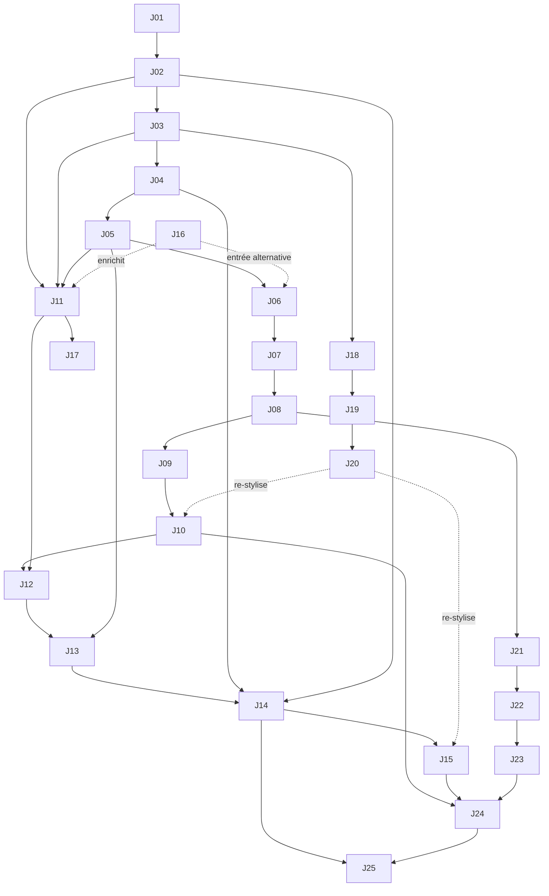

# AI CREATOR Studio : Architecture Pédagogique V1

> **Statut** : V1 consolidée, en attente de validation explicite.
> **Date** : 3 novembre 2026.
> **Base analysée** : dépôt `AI_CREATOR_STUDIO` au commit `e4ec56e`, et dépôt `Kreesten-hsh/video` sur la branche `feat/obsidian-flame` (README.md, VIDEO_PRODUCTION_PLAYBOOK.md, docs/ARCHITECTURE.md, requirements.txt, docs/VIRAL_CONTENT_ENGINE.md, docs/CAROUSEL_VIRAL_ENGINE.md, docs/LINKEDIN_GROWTH_ENGINE.md).
> **Portée** : ce document définit l'architecture cible. Il ne modifie ni le code, ni la navigation, ni les journées. Les corrections sont listées en section 10 et relèvent de missions séparées.

### Légende des marqueurs

| Marqueur | Signification |
| :--- | :--- |
| `[RÉALISÉ]` | Existe dans le dépôt et correspond à l'architecture cible (sous réserve de revalidation éditoriale) |
| `[PARTIEL]` | Existe dans le dépôt mais diverge en partie de l'architecture cible |
| `[PROPOSÉ]` | Proposition de la présente architecture, rien n'est implémenté |
| `[À VÉRIFIER]` | Affirmation technique ou tarifaire à confirmer sur une source officielle avant rédaction des leçons |

### Vocabulaire retenu (décision par défaut, voir D-04)

- **Formation** : l'un des 5 blocs du cursus (01 à 05).
- **Jour** : l'une des 25 unités chronologiques (Jour 01 à Jour 25).
- **Étape** : l'une des 4 étapes internes d'un jour (Comprendre, Prompt Claude, Exemple guidé, À vous de jouer).
- **Bonus** : module indépendant, hors décompte des 25 jours.

Les termes « Module » et « Leçon » présents dans le code et dans `CURRICULUM_BLUEPRINT.md` sont considérés comme historiques.

---

## 1. Positionnement pédagogique officiel

### 1.1 Problème traité

Beaucoup d'experts, formateurs, coachs et créateurs possèdent un savoir déjà formalisé ou encore implicite. L'apprenant n'est pas restreint à un type unique de support ni obligé de posséder un PDF préexistant. Il peut partir :
- d'un ebook ou guide PDF existant ;
- d'un livre de recettes ou guide nutritionnel ;
- d'un programme de fitness ou de suivi bien-être ;
- d'un manuel de prospection B2B ou playbook commercial ;
- d'un programme de coaching ou d'accompagnement thérapeutique ;
- d'un tableur (calculateur de prix, budget, rentabilité) ;
- de notes personnelles ou d'une expertise professionnelle non encore écrite (extraite via le Jour 16).

Sous forme de document statique, ce savoir laisse au lecteur tout le travail d'application : il doit lire, trier et transposer seul.

### 1.2 Proposition pédagogique

AI CREATOR Studio apprend à **piloter Claude** pour transformer ce savoir en **produit digital interactif autonome** (fichier HTML/CSS/JS unique : diagnostics, calculateurs, parcours guidés, générateurs), puis à le présenter, l'héberger et le vendre.

La promesse pédagogique centrale repose sur une émancipation créative totale :
> « Tu ne vas pas apprendre à créer notre plateforme. Tu vas apprendre à créer la tienne. »
> « Apprenez à utiliser Claude pour transformer votre propre savoir en une plateforme web interactive professionnelle, personnalisée avec votre propre direction artistique et conçue pour votre propre audience. »

La formation n'enseigne pas le développement web traditionnel. Elle enseigne :

1. à prendre des décisions produit avant de générer du code ;
2. à formuler des instructions précises à Claude et à vérifier ce qu'il produit ;
3. à tester chaque livrable sur des critères observables.

### 1.3 Public visé

- Formateurs et créateurs de contenus éducatifs.
- Coachs et consultants qui disposent d'une méthode propriétaire.
- Freelances qui veulent proposer la transformation de documents en outils interactifs.
- Pas de prérequis en programmation. Il faut un ordinateur, un navigateur récent et un compte Claude (offre gratuite suffisante pour la majorité des jours, voir 3.4).

### 1.4 Méthode : la journée en 4 étapes `[RÉALISÉ]`

La structure est déjà implémentée dans le moteur (`StepTabs`, test `ensures every single day has exactly 4 steps in canonical order`) :

| Étape | Rôle pédagogique |
| :--- | :--- |
| 1. Comprendre | Cadrer la décision du jour, l'écueil à éviter, le critère de qualité |
| 2. Prompt Claude | Générer la production avec un prompt alimenté par le profil de l'apprenant |
| 3. Exemple guidé | Analyser un livrable de référence réel (démos du dépôt ou exemple vérifiable) |
| 4. À vous de jouer | Produire son propre livrable et le valider sur une checklist |

### 1.5 Principes éditoriaux

- **Aucune promesse de résultat financier.** La formation transmet des capacités et fait produire des livrables. Les ventes dépendent de facteurs extérieurs à la formation (marché, audience, offre, exécution).
- **Pédagogie de la preuve** : chaque affirmation technique est démontrée par une manipulation ou un fichier réel.
- **Transparence sur les coûts** : chaque jour indique s'il requiert une offre payante ou un service tiers.
- **Règle R-02** (héritée de `CURRICULUM_BLUEPRINT.md`) : aucun tiret cadratin dans les textes français.
- **Anti-slop** : pas de formulations génériques d'IA, ni dans les leçons ni dans les livrables produits (méthode enseignée au Jour 17).

### 1.6 Principe fondamental : personnalisation intégrale du produit de l'apprenant

Le studio applique une séparation absolue entre le contenant de formation et les créations des apprenants :

#### A. Distinction stricte d'identité visuelle
L'esthétique Néo-Brutaliste Éditoriale Rouge Brique (`#B63131`), Rose Poudré (`#E6A0A8`), Rose Pâle (`#F7E0E2`), Crème Papier (`#FAF6F0`) et motifs damier appartient exclusivement à la plateforme AI CREATOR Studio et à sa démonstration fil rouge (`apres-hub-interactif.html`).
Il est formellement interdit d'imposer cette palette, ce style ou une architecture unique dans les prompts destinés aux apprenants. La plateforme est le véhicule d'apprentissage ; le produit de l'élève doit refléter son propre positionnement.

#### B. Les 10 paramètres de contexte de l'apprenant
Pour garantir un produit sur-mesure, chaque prompt Claude doit être alimenté par les variables réelles du projet de l'apprenant :
1. **Domaine d'expertise** : le secteur d'activité et la thématique spécifique (`{{business}}`).
2. **Source de savoir** : le matériau de départ (PDF, tableur, notes, interview vocale).
3. **Audience finale** : les utilisateurs cibles et leur niveau de maturité (`{{targetAudience}}`).
4. **Problème résolu** : la douleur précise et urgente traitée.
5. **Résultat attendu** : la transformation promise à l'acheteur (`{{mainObjective}}`).
6. **Format du produit interactif** : l'architecture retenue au Jour 04 (`{{productType}}`).
7. **Fonctionnalités utiles** : les interactions strictement nécessaires au sujet (calculateur, quiz, filtres).
8. **Direction artistique** : l'ambiance graphique retenue (`{{brandStyle}}`).
9. **Palette et typographies** : les codes couleurs et polices choisis par l'élève.
10. **Contraintes techniques** : autonomie monobloc, accessibilité et ergonomie mobile.

#### C. Interdiction absolue des gabarits clones
Tout template universel qui produirait 25 plateformes identiques est proscrit. Chaque apprenant choisit librement :
- son univers graphique (minimaliste pastel, éditorial sombre, rétro, tech, organique, brutaliste, etc.) ;
- ses couleurs et ses typographies ;
- son mode de navigation (onglets thématiques, quête quotidienne, arbre de décision, calculateur monopage, défi à paliers) ;
- ses composants interactifs et son ton rédactionnel.

---

## 2. Transformation finale de l'apprenant

À l'issue du Jour 25, un apprenant qui a réalisé tous les livrables dispose d'un écosystème complet portant sa propre direction artistique, son architecture fonctionnelle adaptée et son ton rédactionnel singulier (sans cloner la démonstration du cours) :

| Actif | Produit aux jours | Nature |
| :--- | :--- | :--- |
| Une offre documentée (niche, acheteur, positionnement, format, hypothèse de prix, plan) | 01 à 05 | Document de décision |
| Un produit digital interactif autonome, personnalisé et testé sur mobile | 06 à 10, enrichi aux jours 21 à 23 | Fichier HTML/CSS/JS |
| Une page de vente éditoriale personnalisée avec démonstrateur interactif | 11 à 15, réécrite au Jour 17 | Fichier HTML/CSS/JS |
| Un corpus d'expertise structuré et une grille anti-slop personnelle | 16, 17 | Documents texte |
| Un design system et des instructions visuelles permanentes pour Claude | 18 à 20 | Fichier de tokens et instructions |
| Un hébergement de production sur domaine, avec une page d'accès client | 24 | Site en ligne |
| Un parcours d'achat testé de bout en bout | 25 | Paiement et délivrance |

**Capacités acquises** : décider une offre, déconstruire un contenu, piloter Claude pour produire et itérer du code autonome, concevoir une logique interactive, rédiger sans tics d'IA, appliquer un système visuel, publier et encaisser.

**Ce que la formation ne promet pas** : un volume de ventes, un revenu, une audience ou une conversion. La mise en ligne d'un parcours d'achat fonctionnel ne vaut pas validation commerciale de l'offre.

---

## 3. Architecture des cinq formations

### 3.1 Vue d'ensemble

| N° | Formation | Jours | Nb | Finalité | Livrable de sortie | État réel du contenu |
| :--- | :--- | :--- | :--- | :--- | :--- | :--- |
| 01 | COMMENCER ICI | 01 à 15 | 15 | Passer d'une expertise à un produit interactif en ligne et à sa page de vente | Produit interactif déployé et page de vente assemblée | `[PARTIEL]` : jours 06 à 10 développés, 01 à 05 et 11 à 15 en squelette |
| 02 | PARLONS-EN | 16 à 17 | 2 | Extraire l'expertise et écrire de façon humaine | Corpus d'expertise et grille anti-slop | `[PROPOSÉ]` : squelettes actuels hors sujet (automatisation) |
| 03 | FAITES-LE VÔTRE | 18 à 20 | 3 | Construire une identité visuelle propre et la rendre permanente dans Claude | Design system et instructions permanentes | `[PROPOSÉ]` : squelettes actuels hors sujet (n8n, relances, tests) |
| 04 | CONCEVOIR + CONSTRUIRE | 21 à 23 | 3 | Concevoir une logique interactive avancée et des exports | Diagnostic à score, calculateur multi-variables, exports | `[PROPOSÉ]` : squelettes actuels hors sujet (carrousels, vidéo, posts) |
| 05 | HÉBERGEZ-LE | 24 à 25 | 2 | Mettre en production et vendre | Site sur domaine et parcours d'achat testé | `[PARTIEL]` : Jour 24 proche de la cible, Jour 25 hors sujet (lancement sur 7 jours) |

Contrôle de répartition : 15 + 2 + 3 + 3 + 2 = **25 jours**.

### 3.2 Parcours

**Logique de progression (proposition, voir D-06)** : la formation 01 produit une première version complète de chaque actif. Les formations 02 à 04 sont des **boucles d'amélioration** appliquées à ces actifs : réécriture de la page de vente (J17), re-stylisation du produit et de la page (J18 à J20), enrichissement fonctionnel du produit (J21 à J23). La formation 05 met la version améliorée en production.

**Point d'entrée alternatif** : un apprenant sans contenu source peut suivre le Jour 16 (interview socratique) avant le Jour 06. Cette possibilité est pédagogique. Dans la navigation actuelle, aucun verrouillage n'empêche cet accès, mais aucun parcours ne le propose non plus.

#### Articulation du Design et de la Personnalisation Visuelle

Pour concilier démarrage rapide et maîtrise approfondie du design sans ambiguïté chronologique, la personnalisation visuelle s'articule en deux niveaux complémentaires :

- **Niveau 1 (Direction visuelle initiale dès 01 COMMENCER ICI, Jours 07 à 15)** : dès la configuration du profil apprenant (`VibePicker` / `{{brandStyle}}`) et la génération du premier squelette au Jour 07, les prompts Claude injectent l'ambiance et les teintes choisies par l'élève. Le prototype V1 obtenu aux Jours 07 à 10 arbore ainsi immédiatement l'univers de l'apprenant, sans jamais lui imposer le Rouge Brique par défaut d'AI CREATOR Studio.
- **Niveau 2 (Système de marque sur-mesure dans 03 FAITES-LE VÔTRE, Jours 18 à 20)** : compétence centrale de différenciation où l'apprenant dépasse les préréglages initiaux pour concevoir un véritable Design System de A à Z (palette hexadécimale validée WCAG AA, échelle typographique hiérarchisée, tokens CSS `:root` et instructions permanentes pour Claude). Ce système propriétaire est ensuite réinjecté pour re-styliser et professionnaliser le produit interactif et la page de vente existants.

### 3.3 Prérequis et limites de Claude Artifacts

Les jours 07 à 15 et 21 à 23 produisent du code dans Claude Artifacts. Les limites ci-dessous conditionnent la conception des leçons.

| Sujet | Constat | Impact pédagogique | Statut |
| :--- | :--- | :--- | :--- |
| Format du livrable | Un fichier HTML unique (HTML, CSS dans `<style>`, JS dans `<script>`) s'affiche dans l'aperçu Artifacts et peut être copié ou téléchargé | Convention centrale déjà enseignée au Jour 07 | `[RÉALISÉ]` |
| `localStorage` et `sessionStorage` | Restreints dans l'iframe isolée de l'aperçu Artifacts. Fonctionnent normalement une fois le fichier ouvert localement ou hébergé | Les jours 08 et 09 et la fiche `cheat-sheet-artifacts` présentent `localStorage` comme fonctionnel sans distinguer l'aperçu du fichier hébergé. La leçon doit enseigner : tester l'interface dans l'aperçu, tester la persistance sur le fichier hébergé (Jour 10) | `[À VÉRIFIER]` sur la documentation Anthropic |
| Stockage persistant natif des Artifacts | Annoncé pour les offres payantes (Pro, Max, Team, Enterprise), lié à la publication | Ne jamais en faire une condition d'un jour. Le produit vendu doit fonctionner hors de Claude | `[À VÉRIFIER]` |
| Scripts externes et CDN | La politique de sécurité (CSP) des Artifacts limite les ressources externes et bloque les appels réseau arbitraires (`fetch`) | La fiche `resources.ts` impose `cdn.tailwindcss.com` : risque de rendu cassé dans l'aperçu, et CDN de prototypage déconseillé en production. Privilégier le CSS embarqué | `[À VÉRIFIER]` |
| Appels réseau (webhooks, API) | Bloqués dans l'aperçu Artifacts | Toute intégration réseau (Bonus 02, paiement) se teste sur la version hébergée, jamais dans l'aperçu | `[À VÉRIFIER]` |
| Téléchargement de fichiers (Blob) | Comportement non vérifié dans l'aperçu | Le Jour 23 doit prévoir un test sur la version hébergée | `[À VÉRIFIER]` |
| Publication d'Artifacts | Disponible sur l'offre gratuite selon les sources secondaires consultées. Les modalités (lien public, connexion requise) varient selon l'offre | Le lien d'Artifact publié n'est pas un hébergement commercial : il dépend de Claude et ne porte pas votre domaine | `[À VÉRIFIER]` |
| Affirmation du Jour 07 sur Claude Pro | « La fenêtre de contexte plus large » de Pro n'est pas confirmée. La différence documentée porte surtout sur les quotas d'usage | Corriger ou sourcer avant validation du Jour 07 | `[À VÉRIFIER]` |
| Taille du fichier | Les Artifacts longs peuvent être tronqués ou ralentir l'itération | Enseigner l'itération par sections (Jour 09) plutôt que la régénération complète | `[RÉALISÉ]` dans le Jour 09 |

### 3.4 Matrice gratuit / payant

Aucun montant n'est figé ici : les tarifs évoluent et doivent être vérifiés à la date de rédaction de chaque leçon.

| Brique | Niveau | Jours concernés | Statut |
| :--- | :--- | :--- | :--- |
| Claude, offre gratuite : conversation, Artifacts, publication | Gratuit, avec quotas d'usage | 01 à 23 | `[À VÉRIFIER]` quotas |
| Claude Pro ou supérieur : quotas plus élevés, stockage persistant Artifacts | Payant | Optionnel, jamais requis dans les 25 jours | `[À VÉRIFIER]` |
| Claude Projects et instructions personnalisées | Disponibilité selon l'offre à confirmer | 20 | `[À VÉRIFIER]` |
| Claude Code | Payant (offre Pro, Max ou facturation API) | Bonus 01 uniquement | `[À VÉRIFIER]` |
| Netlify Drop, offre de base Netlify, GitHub Pages | Gratuit, avec limites d'usage | 10, 24 | `[À VÉRIFIER]` |
| Nom de domaine | Payant (abonnement annuel auprès d'un registraire) | 24 | Fait général |
| Protection par mot de passe sur l'hébergeur | Généralement réservée aux offres payantes | 24 (option) | `[À VÉRIFIER]` |
| Passerelle de paiement (Stripe, Chariow ou équivalent) | Inscription généralement gratuite, commission par transaction | 25 | `[À VÉRIFIER]` |
| ManyChat | Offre gratuite limitée, fonctions avancées payantes | Bonus 02 | `[À VÉRIFIER]` |
| n8n | Logiciel auto-hébergeable gratuitement (serveur à la charge de l'apprenant) ou offre cloud payante | Bonus 02 | `[À VÉRIFIER]` |
| Voix off ElevenLabs | Usage commercial réservé aux offres payantes | Bonus 01 (service tiers, hors moteur) | `[À VÉRIFIER]` |
| FFmpeg, Python, Playwright, Chromium, faster-whisper, NumPy, Pillow, SciPy | Logiciels libres et gratuits | Bonus 01 | Fait (dépôt vidéo) |

---

## 4. Programme chronologique des 25 journées

Colonne « Titre codé » : valeur actuelle du champ `title` dans `src/data/days/day-XX.ts`.

| Jour | Formation | Titre cible | Titre codé | Statut contenu | Statut thématique |
| :--- | :--- | :--- | :--- | :--- | :--- |
| 01 | 01 | Fondations, niche et problème cible | NICHE & PROBLÈME CIBLE | Squelette | `[PARTIEL]` (fondations absentes) |
| 02 | 01 | L'acheteur : situation, frustrations, déclencheurs | PSYCHOLOGIE & LEVIERS D'ACHAT | Squelette | `[RÉALISÉ]` |
| 03 | 01 | Positionnement et promesse | POSITIONNEMENT & PROMESSE | Squelette | `[RÉALISÉ]` |
| 04 | 01 | Format du produit et hypothèse de prix | FORMAT DU PRODUIT INTERACTIF | Squelette | `[PARTIEL]` (pricing absent) |
| 05 | 01 | Architecture du produit | PLAN DU PRODUIT DIGITAL | Squelette | `[RÉALISÉ]` |
| 06 | 01 | Déconstruction du contenu | DÉCONSTRUCTION DU CONTENU STATIQUE | Développé | `[RÉALISÉ]` |
| 07 | 01 | Claude Artifacts et architecture HTML/CSS/JS | LE PROMPT MAÎTRE D'ARCHITECTURE DANS CLAUDE ARTIFACTS | Développé | `[PARTIEL]` (charte studio codée en dur dans le prompt) |
| 08 | 01 | Interactions et persistance locale | CALCULATEURS, DIAGNOSTICS & PERSISTANCE LOCALSTORAGE | Développé | `[PARTIEL]` (limite Artifacts non traitée) |
| 09 | 01 | Itération et feedback visuel | GAMIFICATION, FEEDBACK VISUEL & ITÉRATION CLAUDE | Développé | `[PARTIEL]` (charte studio codée en dur dans le prompt) |
| 10 | 01 | Premier déploiement et validation mobile | EXPORTATION, DÉPLOIEMENT GRATUIT & VALIDATION MOBILE | Développé | `[RÉALISÉ]` |
| 11 | 01 | Récit de vente éditorial | RÉCIT DE VENTE ÉDITORIAL | Squelette | `[RÉALISÉ]` |
| 12 | 01 | Hero et démonstrateur interactif | SECTION HERO & APERÇU INTERACTIF | Squelette | `[RÉALISÉ]` |
| 13 | 01 | Visite du curriculum | PREUVE VISUELLE & VISITE DU CURRICULUM | Squelette | `[RÉALISÉ]` |
| 14 | 01 | Offre, présentation tarifaire et FAQ | OFFRE, TARIFS & FAQ ANTICIPATION | Squelette | `[RÉALISÉ]` |
| 15 | 01 | Assemblage de la page de vente | ASSEMBLAGE DE LA PAGE DE VENTE | Squelette | `[RÉALISÉ]` |
| 16 | 02 | Extraction d'expertise par interview socratique | LEAD MAGNET & MICRO-EXPÉRIENCE | Squelette | `[PROPOSÉ]` (codé hors sujet) |
| 17 | 02 | Rédaction humaine et système anti-slop | FLUX DE MESSAGERIE MANYCHAT | Squelette | `[PROPOSÉ]` (codé hors sujet) |
| 18 | 03 | Psychologie des couleurs et palettes | WEBHOOK N8N & ROUTAGE DES PROSPECTS | Squelette | `[PROPOSÉ]` (codé hors sujet) |
| 19 | 03 | Typographie et hiérarchie visuelle | SÉQUENCE DE RELANCE AUTOMATISÉE | Squelette | `[PROPOSÉ]` (codé hors sujet) |
| 20 | 03 | Design system et instructions visuelles permanentes | TEST GLOBAL D'AUTOMATISATION | Squelette | `[PROPOSÉ]` (codé hors sujet) |
| 21 | 04 | Arbres de décision et diagnostics à score | MOTEUR DE CAROUSELS ÉDITORIAUX | Squelette | `[PROPOSÉ]` (codé hors sujet) |
| 22 | 04 | Générateurs et calculateurs multi-variables | SCRIPTS VIDÉO & DÉMONSTRATIONS | Squelette | `[PROPOSÉ]` (codé hors sujet) |
| 23 | 04 | Export TXT, Markdown et PDF imprimable | POSTS D'AUTORITÉ & ÉTUDES DE CAS | Squelette | `[PROPOSÉ]` (codé hors sujet) |
| 24 | 05 | Hébergement, domaine et accès client | CONTRÔLE QUALITÉ & ACCÈS CLIENT | Squelette | `[PARTIEL]` |
| 25 | 05 | Paiement, délivrance et contrôle final | LANCEMENT DU PRODUIT & BILAN | Squelette | `[PROPOSÉ]` (codé hors sujet) |

Bilan : 5 jours développés (06 à 10), 20 jours en squelette `buildDayFromBlueprint()`, dont 9 entièrement hors du périmètre cible (16 à 23 et 25).

---

## 5. Objectifs, compétences et livrables de chaque journée

Chaque fiche fixe un cadre. Elle ne contient ni contenu de leçon ni prompt final. Les identifiants de compétence (C1 à C10) renvoient à la section 8.

#### Note méthodologique : Diversité des exemples pédagogiques

Pour prouver que la méthode s'applique à tous les secteurs sans enfermer l'élève dans un modèle unique, les exemples guidés (Étape 3) et les cas d'application au fil des 25 journées illustrent des transformations variées (ebook culinaire, guide fitness/bien-être, manuel commercial B2B, programme de coaching, calculateur de tarification).
Chaque leçon distingue rigoureusement trois plans :
1. **L'exemple pédagogique** : une illustration concrète pour comprendre le principe.
2. **Le mécanisme réutilisable** : la structure logique ou le prompt adaptable à tout secteur.
3. **L'adaptation au projet de l'apprenant** : l'application directe sur le domaine et le format propres à l'élève.

### FORMATION 01 : COMMENCER ICI (Jours 01 à 15)

#### Bloc A : Fondations et offre (Jours 01 à 05)

### Jour 01 : Fondations, niche et problème cible

- **Objectif** : comprendre ce qu'est un produit digital interactif (par opposition à un document statique) à partir de sa propre matière de départ (écrite ou non) et formuler le problème précis que le produit résoudra, pour qui.
- **Compétence** : C1 Stratégie d'offre (I).
- **Livrable** : une déclaration de niche orientée problème (une phrase) et une liste de 3 problèmes candidats, classés par urgence.
- **Critère de réussite** : le problème retenu décrit une situation observable chez l'acheteur et cite au moins une solution qu'il utilise aujourd'hui.
- **Prérequis** : compte Claude actif. Profil apprenant renseigné (champs `business`, `targetAudience`).
- **Niveau d'offre** : Claude gratuit.
- **Matière existante** : squelette. Les fondations figurent dans `src/data/startHere/introduction.ts` (non affiché), voir D-01.

### Jour 02 : L'acheteur, situation, frustrations, déclencheurs

- **Objectif** : décrire l'acheteur par ses situations, frustrations, déclencheurs d'achat et objections, plutôt que par des données démographiques.
- **Compétence** : C1 (R).
- **Livrable** : une fiche acheteur (situation de départ, 5 frustrations, déclencheurs, objections, vocabulaire réel).
- **Critère de réussite** : chaque élément est soit rattaché à une source (échange, commentaire, avis, expérience vécue), soit explicitement marqué comme hypothèse.
- **Prérequis** : Jour 01.
- **Niveau d'offre** : Claude gratuit.

### Jour 03 : Positionnement et promesse

- **Objectif** : formuler ce qui distingue le produit interactif des alternatives existantes et la transformation qu'il permet.
- **Compétence** : C1 (R), C6 Rédaction (I).
- **Livrable** : un énoncé de positionnement et une promesse de transformation.
- **Critère de réussite** : la promesse décrit une capacité ou un résultat d'usage vérifiable par l'utilisateur, sans montant de revenu ni garantie de résultat, et se distingue explicitement d'un PDF.
- **Prérequis** : Jours 01 et 02.
- **Niveau d'offre** : Claude gratuit.

### Jour 04 : Format du produit et hypothèse de prix

- **Objectif** : choisir le format interactif adapté à sa matière et à son audience (calculateur monopage, parcours multi-jours, arbre de décision, boîte à outils, etc.) et poser une hypothèse de prix argumentée.
- **Compétence** : C1 (R), C2 Architecture produit (I).
- **Livrable** : une spécification de format (type, 3 à 5 fonctionnalités interactives minimales, liste de ce qui est hors périmètre) et une hypothèse de prix (fourchette, comparaison avec au moins 2 alternatives, condition de révision).
- **Critère de réussite** : le format découle du besoin utilisateur et non d'une structure imposée. Le prix est présenté comme une hypothèse à tester, justifié par la valeur et la comparaison, et pas par une grille de prix « marché » non sourcée.
- **Prérequis** : Jour 03.
- **Niveau d'offre** : Claude gratuit.
- **Note** : les fourchettes « 17 € à 37 € » et « 47 € à 149 € » de `CURRICULUM_BLUEPRINT.md` ne sont pas sourcées et ne doivent pas être reprises comme des faits. Arbitrage pricing : voir D-03.

### Jour 05 : Architecture du produit

- **Objectif** : découper la méthode en 3 à 5 modules progressifs, chacun associé à un résultat et à un composant interactif.
- **Compétence** : C2 (R).
- **Livrable** : le plan d'architecture du produit (modules, résultat attendu par module, composant interactif envisagé).
- **Critère de réussite** : chaque module produit un résultat que l'utilisateur final peut constater lui-même.
- **Prérequis** : Jour 04.
- **Niveau d'offre** : Claude gratuit.

#### Bloc B : Construction du produit interactif (Jours 06 à 10)

### Jour 06 : Déconstruction du contenu

- **Objectif** : auditer son propre contenu source et convertir ses blocs passifs en unités d'action interactives. La démo « Le Système de Création Régulière » sert uniquement d'illustration méthodologique du passage du statique à l'actif.
- **Compétence** : C2 (R), C3 Pilotage de Claude (I).
- **Livrable** : une matrice de déconstruction personnelle (3 modules interactifs, profils utilisateurs, calculs ou diagnostics à automatiser).
- **Critère de réussite** : au moins un calcul ou diagnostic manuel est identifié sur son propre sujet. 2 à 3 profils utilisateurs sont définis.
- **Prérequis** : Jour 05, et un contenu source personnel (sinon Jour 16 en entrée alternative).
- **Niveau d'offre** : Claude gratuit.
- **Matière existante** : `[RÉALISÉ]`. S'appuie sur `public/demos/pdf-to-hub/avant-pdf-statique.html` et `apres-hub-interactif.html` à titre d'exemple pédagogique de référence.

### Jour 07 : Claude Artifacts et architecture HTML/CSS/JS

- **Objectif** : générer dans Claude Artifacts l'ossature d'une application autonome correspondant au format choisi au Jour 04 et utilisant dynamiquement `{{brandStyle}}`, sans imposer ni les 4 onglets de la démo ni la palette d'AI CREATOR Studio.
- **Compétence** : C3 (R), C4 Construction HTML/CSS/JS (I).
- **Livrable** : un squelette d'application adapté au format de l'élève (en-tête, navigation propre, conteneurs) prévisualisé dans Artifacts et téléchargé en `index.html`.
- **Critère de réussite** : le fichier téléchargé s'ouvre localement par double-clic, reflète la direction visuelle choisie par l'apprenant (Niveau 1) et ne reproduit pas la charte Rouge Brique par défaut.
- **Prérequis** : Jour 06.
- **Niveau d'offre** : Claude gratuit.
- **Matière existante** : `[PARTIEL]`. Le prompt actuel code en dur la palette Rouge Brique / Rose Poudré d'AI CREATOR Studio et une structure rigide à 4 onglets (écart E-22). À corriger avant validation : comparatif gratuit/Pro (« fenêtre de contexte plus large ») et seuil « plus de 15 lignes », voir 3.3.

### Jour 08 : Interactions et persistance locale

- **Objectif** : intégrer les composants actifs pertinents pour son propre sujet (calculateur, questionnaire diagnostique, générateur de menus, ou sélection d'état) sans imposer un calculateur d'heures non pertinent, en exploitant ses propres variables CSS, avec persistance dans localStorage.
- **Compétence** : C4 (R), C5 Logique interactive et données (I).
- **Livrable** : le produit enrichi d'au moins un composant actif propre au domaine de l'apprenant dont l'état persiste après rechargement.
- **Critère de réussite** : le composant fonctionne dans l'aperçu Artifacts, et la persistance est vérifiée sur le fichier ouvert hors de Claude (local ou hébergé). Le prompt n'impose aucune couleur studio en dur (écart E-22).
- **Prérequis** : Jour 07.
- **Niveau d'offre** : Claude gratuit.
- **Matière existante** : `[PARTIEL]`. Le prompt actuel impose la couleur rouge brique (écart E-22) et la limite `localStorage` de l'aperçu Artifacts n'est pas traitée, voir 3.3.

### Jour 09 : Itération et feedback visuel

- **Objectif** : modifier un code existant avec Claude sans régression, et ajouter un retour visuel de progression adapté au thème visuel de l'apprenant.
- **Compétence** : C3 (M), C4 (R).
- **Livrable** : le produit avec une jauge de progression et des retours visuels de complétion aux couleurs de l'élève, ainsi qu'une sauvegarde de la version précédente.
- **Critère de réussite** : la jauge reflète exactement l'état des actions, s'intègre harmonieusement dans la charte de l'élève, et aucune fonctionnalité antérieure n'est cassée (test de non-régression manuel).
- **Prérequis** : Jour 08.
- **Niveau d'offre** : Claude gratuit.
- **Matière existante** : `[PARTIEL]`. Le prompt actuel impose en dur la charte Néo-Brutaliste studio, la couleur rouge brique et le fond rose poudré (écart E-22).

### Jour 10 : Premier déploiement et validation mobile

- **Objectif** : publier une première version du produit personnalisé sur une URL publique en HTTPS et la valider sur smartphone.
- **Compétence** : C8 Mise en ligne (I), C10 Assurance qualité (I).
- **Livrable** : une URL publique de test du produit personnalisé de l'apprenant.
- **Critère de réussite** : l'URL fonctionne en HTTPS, sans défilement horizontal à 375 px, et la persistance du Jour 08 fonctionne sur la version en ligne.
- **Prérequis** : Jour 09.
- **Niveau d'offre** : gratuit (Netlify Drop ou équivalent).
- **Matière existante** : `[RÉALISÉ]`. Délimitation avec le Jour 24 : le Jour 10 traite un prototype sur une URL d'hébergeur, le Jour 24 la production sur domaine.

#### Bloc C : Page de vente (Jours 11 à 15)

### Jour 11 : Récit de vente éditorial

- **Objectif** : construire la trame narrative de la page de vente (problème, contraste de méthode, démonstration, offre) sans procédés agressifs.
- **Compétence** : C6 (R).
- **Livrable** : la trame textuelle complète, découpée en sections.
- **Critère de réussite** : chaque affirmation est vérifiable ou supprimée. Aucune promesse de revenu, aucun faux compte à rebours ni fausse rareté.
- **Prérequis** : Jours 02, 03 et 05.
- **Niveau d'offre** : Claude gratuit.

### Jour 12 : Hero et démonstrateur interactif

- **Objectif** : concevoir l'en-tête de la page de vente avec un extrait jouable du produit.
- **Compétence** : C4 (R), C6 (R).
- **Livrable** : une section Hero en HTML intégrant un démonstrateur interactif extrait du produit.
- **Critère de réussite** : le démonstrateur fonctionne sans ressource réseau externe et s'affiche correctement à 375 px.
- **Prérequis** : Jours 10 et 11.
- **Niveau d'offre** : Claude gratuit.

### Jour 13 : Visite du curriculum

- **Objectif** : montrer l'intérieur du produit avant l'achat grâce à un composant de visite (onglets, cartes de modules).
- **Compétence** : C4 (R).
- **Livrable** : un composant de visite intégré à la page de vente.
- **Critère de réussite** : le contenu présenté correspond exactement au plan du Jour 05 et au produit réel (aucun module annoncé qui n'existe pas).
- **Prérequis** : Jours 05 et 12.
- **Niveau d'offre** : Claude gratuit.

### Jour 14 : Offre, présentation tarifaire et FAQ

- **Objectif** : présenter l'offre et son prix de façon claire, et répondre aux objections réelles.
- **Compétence** : C6 (R), C9 Commerce (I).
- **Livrable** : un bloc d'offre (contenu inclus, prix, conditions d'accès, de support et de remboursement) et une FAQ construite à partir des objections du Jour 02.
- **Critère de réussite** : le prix affiché correspond à l'hypothèse du Jour 04 ou à une révision documentée. Chaque condition annoncée est tenable par l'apprenant.
- **Prérequis** : Jours 02, 04 et 13.
- **Niveau d'offre** : Claude gratuit.

### Jour 15 : Assemblage de la page de vente

- **Objectif** : assembler toutes les sections en une page autonome et cohérente.
- **Compétence** : C4 (M), C10 (R).
- **Livrable** : la page de vente complète en un fichier HTML, avec un bouton d'achat présent mais pas encore relié au paiement (branché au Jour 25).
- **Critère de réussite** : lecture complète testée sur mobile et sur ordinateur, aucun texte de remplacement visible, liens internes fonctionnels.
- **Prérequis** : Jours 11 à 14.
- **Niveau d'offre** : Claude gratuit. Mise en ligne optionnelle et gratuite (méthode du Jour 10).

### FORMATION 02 : PARLONS-EN (Jours 16 à 17)

### Jour 16 : Extraction d'expertise par interview socratique

- **Objectif** : faire interroger l'apprenant par Claude, question par question, pour expliciter une expertise implicite.
- **Compétence** : C3 (R), C2 (R).
- **Livrable** : un corpus d'expertise structuré (principes, étapes, exemples vécus, erreurs fréquentes), issu de la transcription de l'interview.
- **Critère de réussite** : chaque principe retenu est illustré par un exemple issu de l'expérience de l'apprenant, et non par une généralité produite par Claude.
- **Prérequis** : Jour 05 recommandé. Utilisable en entrée alternative avant le Jour 06.
- **Niveau d'offre** : Claude gratuit.
- **Usage** : enrichir le produit (Jours 06 à 09) et la page de vente (Jour 11).

### Jour 17 : Rédaction humaine et système anti-slop

- **Objectif** : repérer les tics d'écriture de l'IA et réécrire un texte avec la voix de l'apprenant.
- **Compétence** : C6 (M).
- **Livrable** : une grille anti-slop personnelle (tics interdits, tournures de remplacement, règles de voix) et une section de la page de vente réécrite en version avant et après.
- **Critère de réussite** : la version réécrite ne contient plus aucun tic listé dans la grille (relecture sur checklist), et le sens est préservé.
- **Prérequis** : Jour 11 (texte à réécrire).
- **Niveau d'offre** : Claude gratuit.
- **Délimitation** : le Jour 17 enseigne la méthode. Le Bonus 03 fournit des filtres prêts à l'emploi.

### FORMATION 03 : FAITES-LE VÔTRE (Jours 18 à 20)

La formation 03 constitue une étape clé d'émancipation : la création d'un Design System personnel est traitée comme une compétence centrale de différenciation produit, et non comme un simple habillage cosmétique secondaire. L'apprenant y formalise les règles visuelles qui rendent son produit immédiatement reconnaissable et crédible sur son marché.

### Jour 18 : Psychologie des couleurs et construction de palettes

- **Objectif** : construire une palette sur-mesure cohérente avec son positionnement, organisée par rôles sémantiques.
- **Compétence** : C7 Design visuel (I).
- **Livrable** : une palette par rôles (fond, surface, texte, primaire, accent, états) avec codes hexadécimaux et ratios de contraste.
- **Critère de réussite** : toutes les paires texte/fond utilisées atteignent au moins le niveau WCAG AA (4,5:1 pour le texte courant). La palette se démarque nettement des gabarits IA génériques.
- **Prérequis** : Jour 03.
- **Niveau d'offre** : gratuit.
- **Note** : la psychologie des couleurs se présente comme des associations culturelles, pas comme des effets garantis sur la conversion.

### Jour 19 : Typographie et hiérarchie visuelle

- **Objectif** : définir un système typographique et une hiérarchie qui guident la lecture et renforcent l'identité du produit.
- **Compétence** : C7 (R).
- **Livrable** : un système typographique (2 familles au maximum, échelle de tailles, interlignage, graisses) appliqué à une page existante.
- **Critère de réussite** : la hiérarchie est lisible à 375 px, et les polices retenues sont utilisables légalement et techniquement (licence, mode de chargement, contraintes de l'aperçu Artifacts).
- **Prérequis** : Jour 18.
- **Niveau d'offre** : gratuit.

### Jour 20 : Design system et instructions visuelles permanentes

- **Objectif** : formaliser l'identité visuelle en tokens CSS et en règles de marque, puis la rendre permanente dans le contexte de travail de Claude (Niveau 2).
- **Compétence** : C7 (M), C3 (M).
- **Livrable** : un fichier de design system (tokens `:root`, composants, interdits visuels) et un bloc d'instructions permanentes pour Claude.
- **Critère de réussite** : deux générations successives dans Claude respectent les tokens sans rappel manuel. Le produit interactif et la page de vente sont re-stylisés avec cette identité de marque propriétaire.
- **Prérequis** : Jours 18 et 19.
- **Niveau d'offre** : selon la disponibilité de Projects et des instructions personnalisées dans l'offre de l'apprenant `[À VÉRIFIER]`. Une alternative gratuite (coller le bloc d'instructions en début de conversation) doit être prévue.

### FORMATION 04 : CONCEVOIR + CONSTRUIRE (Jours 21 à 23)

Chaque brique avancée de cette formation est adaptée au domaine de l'apprenant sans imposer de composant inutile à son produit (ex. un calculateur complexe n'est développé que s'il sert la proposition de valeur de l'offre).

### Jour 21 : Arbres de décision et diagnostics à score

- **Objectif** : concevoir un diagnostic à embranchements avec un score pondéré et des résultats par profil, appliqué au sujet de l'apprenant.
- **Compétence** : C5 (R).
- **Livrable** : un diagnostic interactif d'au moins 2 niveaux d'embranchement, avec une table de décision documentée.
- **Critère de réussite** : chaque chemin possible a été testé et mène à un résultat défini. La table de décision correspond au comportement observé sur le sujet propre de l'apprenant.
- **Prérequis** : Jour 08.
- **Niveau d'offre** : Claude gratuit.
- **Délimitation** : le Jour 08 traite un composant simple, le Jour 21 la logique de branchement et la pondération.

### Jour 22 : Générateurs et calculateurs multi-variables

- **Objectif** : construire un outil combinant plusieurs entrées pour produire un résultat calculé ou généré adapté au modèle métier de l'apprenant.
- **Compétence** : C5 (M).
- **Livrable** : un calculateur ou générateur multi-variables avec validation des entrées.
- **Critère de réussite** : les résultats correspondent à au moins 3 cas de test calculés à la main, et les entrées invalides ou vides sont gérées sans erreur.
- **Prérequis** : Jour 21.
- **Niveau d'offre** : Claude gratuit.

### Jour 23 : Export TXT, Markdown et PDF imprimable

- **Objectif** : permettre à l'utilisateur final de récupérer ses résultats sous forme de livrable exportable personnalisé.
- **Compétence** : C5 (M), C4 (M).
- **Livrable** : un export TXT et Markdown des résultats personnalisés, et une feuille de style d'impression permettant d'obtenir un PDF via la fonction d'impression du navigateur.
- **Critère de réussite** : les fichiers exportés sont lisibles et complets, reprennent l'identité de marque du produit (Niveau 2), et l'impression A4 ne montre aucun élément d'interface parasite. Test réalisé sur la version hébergée.
- **Prérequis** : Jour 22.
- **Niveau d'offre** : Claude gratuit.
- **Note** : PDF obtenu par impression navigateur, sans bibliothèque externe. Le téléchargement depuis l'aperçu Artifacts est à vérifier (3.3).

### FORMATION 05 : HÉBERGEZ-LE (Jours 24 à 25)

### Jour 24 : Hébergement, domaine et expérience d'accès client

- **Objectif** : mettre le produit et la page de vente en production sur un domaine, et concevoir l'expérience du client après l'achat.
- **Compétence** : C8 (M), C9 (R).
- **Livrable** : un site de production sur domaine (HTTPS) et une page d'accès client (instructions, lien vers le produit, contact support).
- **Critère de réussite** : le domaine pointe vers le site, HTTPS est actif, et la page d'accès est testée sur mobile.
- **Prérequis** : Jours 10, 15 et 23.
- **Niveau d'offre** : hébergement gratuit possible, domaine payant.
- **Limite à enseigner** : une URL difficile à deviner n'est pas un contrôle d'accès. Les options réelles (délivrance par la plateforme de paiement, protection par mot de passe payante, etc.) sont présentées avec leurs limites. Voir D-08.
- **Matière existante** : le squelette « CONTRÔLE QUALITÉ & ACCÈS CLIENT » couvre l'accès client, mais pas l'hébergement ni le domaine.

### Jour 25 : Paiement, délivrance du produit et contrôle final du parcours d'achat

- **Objectif** : relier la page de vente à un moyen de paiement, automatiser la délivrance et recetter tout le parcours.
- **Compétence** : C9 (M), C10 (M).
- **Livrable** : un bouton d'achat relié à une passerelle de paiement, un mécanisme de délivrance du produit, et un procès-verbal de recette du parcours complet.
- **Critère de réussite** : un achat test (mode test de la passerelle, ou transaction réelle puis remboursée) mène jusqu'à l'accès effectif au produit, sur mobile et sur ordinateur.
- **Prérequis** : Jours 14 et 24.
- **Niveau d'offre** : passerelle de paiement avec commission par transaction.
- **Note** : les obligations légales de vente en ligne (mentions légales, conditions de vente, fiscalité) dépendent du pays de l'apprenant. La formation les signale sans donner de conseil juridique. Voir D-09.

---

## 6. Architecture des trois bonus

Les bonus sont **indépendants** : aucun jour ne les exige, et ils ne sont pas comptés dans les 25 jours. Ils supposent seulement que l'apprenant dispose d'un produit ou d'une page en ligne (Jour 10 ou 15), sans dépendance technique bloquante.

### 6.1 Bonus 01 : VIDÉOS SANS VISAGE (moteur AGENT404)

**Finalité** : comprendre et reconstruire, avec Claude Code, un moteur de vidéo programmatique verticale sur le modèle du dépôt AGENT404.

**Faits vérifiés dans le dépôt vidéo** (`feat/obsidian-flame`) :

| Élément | Valeur documentée | Source |
| :--- | :--- | :--- |
| Format de sortie | 1080 × 1920, 30 FPS, 9:16, H.264 yuv420p, AAC | README.md, ARCHITECTURE.md, PLAYBOOK P7 |
| Langage et rendu | Python 3.12+, HTML/CSS/JS vanilla, Playwright + Chromium headless, FFmpeg/ffprobe | README.md §5 et §6 |
| Dépendances Python | playwright, faster-whisper, numpy, Pillow, scipy, opencv-python-headless | requirements.txt |
| Principe du moteur | DOM piloté par `window.setTime(t)`, sans horloge asynchrone | ARCHITECTURE.md §3.C |
| Blueprints | 9 : `bp_hook_question`, `bp_friction_stack`, `bp_stat_shock`, `bp_versus_compare`, `bp_code_window`, `bp_grid_2x2`, `bp_logo_carousel_rtl`, `bp_cta_conversion`, `bp_split_timeline` | README.md, PLAYBOOK §Catalogue |
| Styles | 3 : Mascotte, Éditorial, Démonstration | README.md §3.A |
| Synchronisation audio | Alignement mot à mot (`build_master_timeline.py`, faster-whisper uniquement en réalignement) | ARCHITECTURE.md §3.A |
| Sound design | Synthèse procédurale NumPy (`sfx.py`) | ARCHITECTURE.md §3.B |
| Contrôle qualité | `preflight_check.py`, `python3 -m unittest discover -s tests -v`, `make_video.py` | README.md §7, PLAYBOOK P6 |

**Structure proposée** `[PROPOSÉ]`, calquée sur les 8 phases réelles du playbook :

| Sous-module | Contenu | Fichiers du dépôt |
| :--- | :--- | :--- |
| B1.1 Architecture et installation | Pipeline, prérequis, multi-projets (`studio_perso`, `studio_clients`) | README.md, requirements.txt |
| B1.2 Script et `project.json` | Entrée agnostique, format de référence 60 s (45 à 90 s), mot-clé de CTA, audit du jargon | PLAYBOOK P1, P5 |
| B1.3 Audio et alignement | Voix off fournie (service tiers ou voix réelle), mesure ffprobe, `words.json`, `timeline.js` | `build_master_timeline.py`, PLAYBOOK P2 |
| B1.4 Moteur graphique et blueprints | `video.js`, `style.css` piloté par variables, `brand.json`, 9 blueprints, 3 styles | PLAYBOOK §Catalogue |
| B1.5 Avatars (style Mascotte) | Détourage et bordure sticker | `build_stickers.py`, PLAYBOOK P3 |
| B1.6 Sound design | Effets procéduraux et rendu déterministe | `sfx.py` |
| B1.7 Rendu et contrôle | Capture Playwright, encodage FFmpeg, pre-flight, tests | `render.py`, `preflight_check.py`, `make_video.py` |
| B1.8 Distribution | Kit de distribution (renvoi vers le Bonus 03) | PLAYBOOK P8 |

**Prérequis** : Linux x86_64 ou environnement compatible, Python 3.12+, FFmpeg, et Claude Code (payant).

**Exclusions** :
- La description actuelle de `bonuses.ts` (banques de b-roll, « sous-titrage sans outils complexes ») n'est pas fondée sur le dépôt et doit être remplacée.
- La voix off (ElevenLabs) est un service tiers, extérieur au moteur.
- Le pipeline `references/` (`analyze_reference.py`) est marqué `[À VÉRIFIER]` : il cite `yt-dlp` et WhisperX, absents de `requirements.txt`.

**Point non documenté** : le dépôt ne décrit pas l'usage de Claude Code pour construire le moteur. L'angle « construire avec Claude Code » est une proposition pédagogique. Voir D-02 (propriété intellectuelle et diffusion du code).

**Incohérences internes au dépôt vidéo** à résoudre avant rédaction :
- `opencv-python-headless` figure dans requirements.txt mais pas dans ARCHITECTURE.md §4.A.
- Le modèle Whisper est `small` dans ARCHITECTURE.md, `base` ou `small` dans le PLAYBOOK P2.
- Le fichier de sortie s'appelle `video<N>.mp4` dans ARCHITECTURE.md et `output_final.mp4` dans le PLAYBOOK §4.

### 6.2 Bonus 02 : AUTOMATISATIONS COMMERCIALES

**Finalité** : relier les réseaux sociaux et le produit interactif à un tunnel automatisé de capture et de relance.

**Origine du contenu** : anciens jours 16 à 20 (squelettes actuels et `CURRICULUM_BLUEPRINT.md` §Module 04).

| Sous-module | Ancien jour | Contenu | Livrable |
| :--- | :--- | :--- | :--- |
| B2.1 Micro-lead magnet | 16 | Extraire du produit un micro-outil gratuit de 60 secondes | Micro-outil HTML hébergé |
| B2.2 ManyChat et Instagram | 17 | Déclencheur « commentaire vers message privé » par mot-clé, règles de la plateforme Meta | Flux ManyChat configuré |
| B2.3 Webhook n8n | 18 | Transmettre les réponses d'un outil hébergé vers n8n et étiqueter les prospects | Workflow n8n et webhook de test |
| B2.4 Séquences de relance | 19 | Messages de suivi adaptés au résultat du diagnostic | Séquence de 3 messages |
| B2.5 Test du tunnel | 20 | Recette de bout en bout, du commentaire jusqu'à l'accès | Procès-verbal de test |

**Contraintes à enseigner** :
- Les appels webhook ne fonctionnent pas dans l'aperçu Artifacts : test sur la version hébergée uniquement (3.3).
- L'automatisation Instagram via ManyChat suppose un compte professionnel et le respect des règles de Meta `[À VÉRIFIER]`.
- La collecte de données personnelles impose consentement et information des personnes (RGPD ou équivalent local).

**Offres** : ManyChat et n8n cloud sont limités en gratuit puis payants. n8n auto-hébergé suppose un serveur (3.4).

### 6.3 Bonus 03 : BIBLIOTHÈQUE MARKETING

**Finalité** : une bibliothèque de ressources prêtes à adapter pour promouvoir le produit.

| Section | Ressources réelles réutilisables | Ancien jour absorbé |
| :--- | :--- | :--- |
| Hooks | VIRAL_CONTENT_ENGINE.md §I (3 lois de rétention), §II format 07 (arsenal d'accroches) ; blueprint `bp_hook_question` | |
| Scripts | VIRAL_CONTENT_ENGINE.md §III (générateur de scripts en 8 nœuds) | 22 (scripts vidéo) |
| Carrousels | CAROUSEL_VIRAL_ENGINE.md §II à §V (6 formats, architecture slide par slide, production 1080 × 1350 de HTML vers PDF) | 21 (carrousels) |
| CTA | Blueprint `bp_cta_conversion` (mot-clé unique), PLAYBOOK P1 §4 | |
| Prompts de copywriting | À créer dans une mission ultérieure (aucun prompt final dans ce document) | 23 (posts d'autorité) |
| Filtres anti-slop | LINKEDIN_GROWTH_ENGINE.md §5 (gouvernance éditoriale), principe de liste de termes bannis du PLAYBOOK P1 | |
| Calendriers éditoriaux | LINKEDIN_GROWTH_ENGINE.md §3 (matrice TOFU/MOFU/BOFU), VIRAL_CONTENT_ENGINE.md §I.4 | 25 (plan de lancement sur 7 jours) |
| Grille d'audit | VIRAL_CONTENT_ENGINE.md §VI (score sur 100) | |

**Règles d'adaptation obligatoires** :
1. Les sources visent les experts B2B sur LinkedIn. Il faut les transposer au public de la formation (créateurs de produits digitaux).
2. Retirer les éléments propres au service AGENT404 : tarifs, objectif d'encaissement, ICP, profil du fondateur.
3. Les statistiques non sourcées (« Data 10 743 Posts ») doivent être sourcées ou supprimées.
4. Les formats attribués à des créateurs nommés sont décrits par leur mécanisme, sans reproduire leurs contenus.
5. Aucune ressource ne promet un nombre de vues, de leads ou de ventes.

---

## 7. Matrice des dépendances pédagogiques

| Jour | Prérequis bloquants | Prérequis recommandés | Livrables réutilisés en aval par |
| :--- | :--- | :--- | :--- |
| 01 | Compte Claude | | 02 |
| 02 | 01 | | 03, 11, 14 |
| 03 | 02 | | 04, 11, 18 |
| 04 | 03 | | 05, 14 |
| 05 | 04 | | 06, 11, 13 |
| 06 | 05, contenu source | 16 | 07 |
| 07 | 06 | | 08 |
| 08 | 07 | | 09, 21 |
| 09 | 08 | | 10 |
| 10 | 09 | | 12, 24 |
| 11 | 02, 03, 05 | 16 | 12, 17 |
| 12 | 10, 11 | | 13 |
| 13 | 05, 12 | | 14 |
| 14 | 02, 04, 13 | | 15, 25 |
| 15 | 11 à 14 | | 24 |
| 16 | | 05 | 06, 11 |
| 17 | 11 | | 15 (réécriture) |
| 18 | 03 | | 19 |
| 19 | 18 | | 20 |
| 20 | 18, 19 | | 10 et 15 (re-stylisation) |
| 21 | 08 | | 22 |
| 22 | 21 | | 23 |
| 23 | 22 | | 24 |
| 24 | 10, 15, 23 | 20 | 25 |
| 25 | 14, 24 | | Fin du parcours |

**Inversions signalées** : la rédaction humaine (J17) et le design (J18 à J20) arrivent après la production de la page de vente (J11 à J15). Ce n'est acceptable que si les formations 02 et 03 sont explicitement présentées comme des boucles d'amélioration (D-06).

---

## 8. Matrice des compétences

**Familles de compétences** :

| Code | Compétence |
| :--- | :--- |
| C1 | Stratégie d'offre (niche, acheteur, positionnement, prix) |
| C2 | Architecture produit et déconstruction de contenu |
| C3 | Pilotage de Claude (instructions, itération, contexte permanent) |
| C4 | Construction HTML/CSS/JS autonome dans Artifacts |
| C5 | Logique interactive et données (état, persistance, score, calcul, export) |
| C6 | Rédaction et copywriting humain |
| C7 | Design visuel et design system |
| C8 | Mise en ligne et exploitation |
| C9 | Commerce (offre, paiement, délivrance) |
| C10 | Assurance qualité (mobile, accessibilité, recette) |

Légende : **I** = introduite, **R** = renforcée, **M** = maîtrisée.

| Jour | C1 | C2 | C3 | C4 | C5 | C6 | C7 | C8 | C9 | C10 |
| :--- | :-: | :-: | :-: | :-: | :-: | :-: | :-: | :-: | :-: | :-: |
| 01 | I | | I | | | | | | | |
| 02 | R | | | | | | | | | |
| 03 | R | | | | | I | | | | |
| 04 | M | I | | | | | | | I | |
| 05 | | R | | | | | | | | |
| 06 | | M | I | | | | | | | |
| 07 | | | R | I | | | | | | |
| 08 | | | | R | I | | | | | |
| 09 | | | M | R | | | | | | I |
| 10 | | | | | | | | I | | R |
| 11 | | | | | | R | | | | |
| 12 | | | | R | | R | | | | |
| 13 | | | | R | | | | | | |
| 14 | | | | | | R | | | R | |
| 15 | | | | M | | | | | | R |
| 16 | | R | R | | | | | | | |
| 17 | | | | | | M | | | | |
| 18 | | | | | | | I | | | R |
| 19 | | | | | | | R | | | |
| 20 | | | M | | | | M | | | |
| 21 | | | | | R | | | | | |
| 22 | | | | | M | | | | | R |
| 23 | | | | M | M | | | | | |
| 24 | | | | | | | | M | R | |
| 25 | | | | | | | | | M | M |

---

## 9. Critères de validation d'une leçon

Une journée n'est considérée comme **validée** que si tous les critères ci-dessous sont remplis.

### 9.1 Structure

- [ ] La journée n'utilise plus `buildDayFromBlueprint()` et `isSkeletonPlaceholder` vaut `false`.
- [ ] Les 4 étapes sont présentes dans l'ordre canonique (Comprendre, Prompt Claude, Exemple guidé, À vous de jouer).
- [ ] Le `sprintId` et l'appartenance à la formation correspondent à la section 4.
- [ ] Objectif, compétence, livrable et critère de réussite sont identiques à la fiche de la section 5, ou leur révision est documentée.

### 9.2 Pédagogie

- [ ] Le livrable est concret, enregistrable et réutilisé en aval (section 7).
- [ ] Le critère de réussite est observable par l'apprenant lui-même (checklist de l'étape 4).
- [ ] L'exemple guidé s'appuie sur un fichier réel du dépôt ou sur un exemple vérifiable, jamais sur un cas client inventé.
- [ ] Le quiz porte sur la compréhension du sujet, pas sur la reformulation du titre (défaut actuel des squelettes).
- [ ] Aucun prompt de la leçon ne contient en dur les couleurs (`#B63131`, `#E6A0A8`), les textes ou la structure figée d'AI CREATOR Studio : tout passe par les variables de contexte de l'apprenant (`{{business}}`, `{{targetAudience}}`, `{{productType}}`, `{{brandStyle}}`, `{{mainObjective}}`) et ses propres choix d'architecture.

### 9.3 Exactitude et transparence

- [ ] Chaque affirmation sur Claude, Artifacts ou un service tiers est vérifiée sur une source officielle datée.
- [ ] Toute fonctionnalité payante est signalée comme telle, et aucune n'est présentée comme gratuite.
- [ ] Aucun résultat commercial (revenu, ventes, conversion, audience) n'est présenté comme garanti ou typique.
- [ ] La différence entre l'aperçu Artifacts et le fichier hébergé est explicitée chaque fois qu'elle a un effet (persistance, réseau, téléchargement).

### 9.4 Technique

- [ ] Les livrables HTML générés suivant la leçon fonctionnent sans ressource externe obligatoire.
- [ ] Le rendu est testé à 375 px et sur ordinateur, sans défilement horizontal.
- [ ] Les contrastes respectent WCAG AA, et les éléments interactifs sont utilisables au clavier.

### 9.5 Média et éditorial

- [ ] Le bloc vidéo contient un `videoUrl` valide, ou bien l'absence de vidéo est assumée et le bloc retiré (pas de vidéo de remplacement avec une durée fictive).
- [ ] Aucun tiret cadratin (règle R-02).
- [ ] Relecture passée sur la grille anti-slop (Jour 17).
- [ ] Le vocabulaire respecte le glossaire (Formation, Jour, Étape, Bonus).

### 9.6 Critère transversal de différenciation (Test des deux apprenants)

- [ ] **Test des deux apprenants** : Deux apprenants ayant des domaines, des contenus sources et des goûts visuels différents (ex. un coach sportif créant un tracker d'entraînement pastel versus un consultant B2B créant un calculateur de ROI sombre) qui suivent exactement la leçon obtiennent deux produits substantiellement différents dans leur contenu, leur structure, leur navigation, leurs fonctionnalités et leur direction artistique.

---

## 10. Écarts entre l'architecture pédagogique et l'état réel du dépôt

Aucun de ces écarts n'est corrigé par la présente mission.

### 10.1 Problèmes signalés explicitement

| # | Problème | Localisation | Effet | Gravité |
| :--- | :--- | :--- | :--- | :--- |
| E-01 | Navigation `MainSidebar` non dynamique : toute route de jour est attribuée à `course-01`, et la sélection d'une formation ouvre toujours le Jour 1 | `src/components/layout/MainSidebar.tsx` L25 et L44 (alors que `CourseOverview.tsx` L34 utilise `dayRange[0]`) | Cliquer sur « 02 PARLONS-EN » dans la barre latérale ouvre le Jour 01 | Haute |
| E-02 | Navigation `CourseSidebar` non dynamique : filtre en dur des jours 1 à 15 | `src/components/course/CourseSidebar.tsx` L39 | Les jours 16 à 25 ne sont jamais listés, quelle que soit la formation | Haute |
| E-03 | `navigateToDay()` associe toujours `courseId: 'course-01'` | `src/context/ProgressContext.tsx` L144 à L157 (et `navigateToStartHere` L134) | Les jours 16 à 25 sont rattachés à la mauvaise formation | Haute |
| E-04 | Anciennes catégories dans `sprints.ts` : sprint-4 « STUDIO D'AUTOMATISATION » (16 à 20) et sprint-5 « USINE À CONTENU & LANCEMENT » (21 à 25), découpage 5 × 5 | `src/data/sprints.ts` L30 à L45 | Incompatible avec le découpage 15 + 2 + 3 + 3 + 2. Le test `courseEngine.test.ts` L25 vérifie qu'il y a exactement 5 sprints : à intégrer dans la mission corrective | Haute |
| E-05 | Documentation des bonus incohérente avec le nouveau périmètre : trois définitions concurrentes | `README.md` L51 à L53 (Automatisation & IA / Prompts systèmes / Déploiement & monétisation) ; `src/data/navigation/bonuses.ts` (b-roll, sous-titrage, « Pack de 25 prompts ») | L'apprenant voit des promesses de bonus qui ne correspondent ni au README ni à la section 6 | Moyenne |
| E-06 | 20 journées utilisent encore `buildDayFromBlueprint()` : 01 à 05 et 11 à 25 | `src/data/days/dayFactory.ts` L16 ; `isSkeletonPlaceholder: true` L28 | Contenu générique : quiz tautologique, texte de structure visible par l'apprenant | Haute |
| E-07 | Vidéos non intégrées : aucune journée ne définit `videoUrl`. `VideoBlock` affiche alors un écran de remplacement | `src/components/widgets/VideoBlock.tsx` L22 ; `dayFactory.ts` L63 (durée fictive « 05:00 ») ; aucun bloc vidéo dans les jours 06 à 10 | 20 jours affichent un faux emplacement vidéo, 5 jours n'en ont aucun | Moyenne |

### 10.2 Autres écarts détectés

| # | Écart | Localisation | Gravité |
| :--- | :--- | :--- | :--- |
| E-08 | Le README affirme que les jours 01 à 15 sont « implémentés avec contenu complet » et que `PromptBuilder` est « utilisé sur les 25 journées » de façon validée. Seuls les jours 06 à 10 sont développés | `README.md` L68 | Haute |
| E-09 | Le README annonce les formations 02 à 05 comme « Module à venir », alors que `mainCourses.ts` les déclare `available: true` | `README.md` L41 à L47 ; `mainCourses.ts` | Moyenne |
| E-10 | Les descriptions des formations divergent de l'architecture cible : course-02 « Conversation & Personas d'IA », course-04 « persistance locale multi-composants », course-05 sans paiement | `src/data/navigation/mainCourses.ts` L20, L25, L44, L49, L56, L61 | Moyenne |
| E-11 | Thèmes codés des jours 16 à 23 et 25 hors périmètre (section 4) | `src/data/days/day-16.ts` à `day-25.ts` | Haute |
| E-12 | Pricing absent des jours 01 à 05 | `src/data/days/day-04.ts` | Moyenne |
| E-13 | Les jours 08 et 09 et la fiche `cheat-sheet-artifacts` présentent `localStorage` comme fonctionnel sans évoquer la restriction de l'aperçu Artifacts | `src/data/days/day-08.ts` L9 et L25 à L30 ; `resources.ts` | Haute `[À VÉRIFIER]` |
| E-14 | La fiche ressource impose `cdn.tailwindcss.com` et suggère Alpine.js, ce qui contredit la règle « sans dépendance externe » du Jour 07 | `src/data/navigation/resources.ts` L26 et L34 | Moyenne |
| E-15 | Comparatif gratuit/Pro non sourcé (« fenêtre de contexte plus large ») | `src/data/days/day-07.ts` L43 et L44 | Moyenne `[À VÉRIFIER]` |
| E-16 | Vocabulaire mixte : « Module 2 », « Module 02 », « Module 03 », « Leçon » | `day-05.ts` L8 ; `day-10.ts` L205 à L231 ; `dayFactory.ts` | Faible |
| E-17 | Leçons `startHere/` conservées mais non affichées ; elles contiennent les fondations du Jour 01 | `src/data/startHere/`, `src/data/course.ts` | Faible (D-01) |
| E-18 | `CURRICULUM_BLUEPRINT.md` parle de « transformations garanties » et contient des fourchettes de prix non sourcées | `CURRICULUM_BLUEPRINT.md` L8, L29, L39 | Faible (document d'archive) |
| E-19 | `bonuses.ts` (Bonus 03) annonce un « Pack de 25 prompts » et un « générateur de promesse irrésistible » non adossés à des ressources existantes | `src/data/navigation/bonuses.ts` | Moyenne |
| E-20 | Incohérences internes au dépôt vidéo : dépendances (OpenCV, yt-dlp, WhisperX), modèle Whisper, nom du fichier de sortie | Dépôt vidéo, voir 6.1 | Moyenne |
| E-21 | Doublons à délimiter lors de la rédaction : J10 et J24 (déploiement), J15 et J25 (paiement), J08 et J21-22 (logique interactive), J17 et Bonus 03 (anti-slop) | Sections 5 et 6 | Moyenne |
| E-22 | Standardisation forcée dans les prompts des Jours 07, 08 et 09 (`day-07.ts` L116-121 et L137-142, `day-08.ts` L102 et L125, `day-09.ts` L104-112 et L117-127) : les templates de prompts codent en dur la palette Rouge Brique `#B63131` / Rose Poudré `#E6A0A8` et le style Néo-Brutaliste d'AI CREATOR Studio au lieu d'injecter dynamiquement `{{brandStyle}}` et le format propre à l'apprenant | `src/data/days/day-07.ts`, `day-08.ts`, `day-09.ts` | Haute |
| E-23 | Mono-exemple sectoriel : les Jours 06 à 10 n'illustrent que le cas d'un consultant/freelance (`Le Système de Création Régulière`). Il manque des exemples ciblés montrant comment le même prompt s'adapte à d'autres niches (ex. ebook culinaire, fitness/bien-être, coaching, calculateur financier) | `src/data/days/day-06.ts` à `day-10.ts` | Moyenne |

---

## 11. Décisions restant à valider

Les choix marqués « par défaut » ont servi à rédiger ce document. Ils restent révisables.

| # | Décision | Choix par défaut appliqué | Alternative |
| :--- | :--- | :--- | :--- |
| D-01 | Sort des leçons `startHere/` (Bienvenue, Configuration) | Orientation hors décompte, non affichée. Les fondations nécessaires sont reprises dans le Jour 01 | Fusionner la configuration (compte Claude, profil) dans le Jour 01 et retirer `startHere` du modèle |
| D-02 | Bonus 01 : propriété intellectuelle du moteur AGENT404 | Enseigner l'architecture et la méthode de construction avec Claude Code. La diffusion du code source reste à trancher | Fournir le code source complet, ou un moteur réduit dédié à la formation |
| D-03 | Placement du pricing | Jour 04 « Format et hypothèse de prix » ; le Jour 14 présente le prix | Jour dédié au prix, ce qui oblige à fusionner deux autres thèmes des jours 01 à 05 |
| D-04 | Vocabulaire officiel | Formation, Jour, Étape, Bonus | Conserver Module et Leçon (vocabulaire de l'archive) |
| D-05 | Titres cibles des jours | Ceux de la section 4 | Conserver les titres codés des jours conformes |
| D-06 | Positionnement des formations 02 à 04 | Boucles d'amélioration appliquées aux livrables de la formation 01 | Réordonner le cursus (impossible sans modifier les plages de jours imposées) |
| D-07 | Jour 16 en entrée alternative | Signalé pédagogiquement, sans changement de navigation | Ajouter un parcours guidé vers J16 pour les apprenants sans contenu |
| D-08 | Contrôle d'accès au produit vendu (Jour 24) | Présenter les options et leurs limites, sans en imposer une | Standardiser une solution unique (plateforme de délivrance, protection payante) |
| D-09 | Obligations légales de vente (Jour 25) | Signalement générique, sans conseil juridique | Ressource dédiée, par pays, validée par un professionnel |
| D-10 | Passerelle de paiement de référence pour l'exemple guidé du Jour 25 | Non tranchée (Stripe, Chariow ou équivalent cités) | Choisir une passerelle de référence selon le marché cible |
| D-11 | Confirmation des limites de Claude Artifacts et des offres (section 3.3 et 3.4) | Marquées `[À VÉRIFIER]` | Vérification sur la documentation Anthropic avant la rédaction des jours 07, 08, 20 et 23 |
| D-12 | Tarifs et conditions des services tiers (3.4) | Nature gratuite ou payante seulement, sans montant | Ajouter des montants datés et revérifiés à chaque mise à jour |
| D-13 | Adaptation des ressources marketing du dépôt vidéo au public de la formation (6.3) | Règles d'adaptation listées | Création d'une bibliothèque originale |
| D-14 | Mise à jour de `README.md`, `bonuses.ts`, `mainCourses.ts`, `sprints.ts` et du test associé | Hors périmètre de cette mission | Mission corrective dédiée après validation de ce document |
