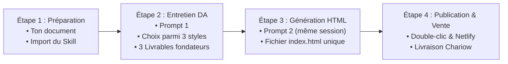

# GUIDE D'UTILISATION DU PARCOURS APPRENANT

**Promesse de la méthode** :  
> *« Transforme ton document existant en application interactive à ton image et publie-la en ligne en 3 jours, sans coder. »*

Ce guide explique pas à pas comment utiliser le dispositif AI CREATOR Studio pour convertir n'importe quel document métier (guide, workbook, méthode, tableur financier, checklist, support de formation) en une application web remarquable.

---

## Les 3 Piliers de la Méthode

1. **Aucune compétence en programmation requise** : Tout le code HTML/CSS/JS est généré par l'IA sous forme d'un unique fichier autonome `index.html`.
2. **Direction artistique sur mesure** : Votre produit ne ressemblera pas à un tableau de bord générique d'IA. Il aura une véritable identité visuelle dérivée de votre sujet.
3. **Fidélité absolue à votre contenu** : 100 % de vos formules, étapes, méthodes et avertissements sont scrupuleusement conservés.

---

## Le Parcours en 4 Étapes Pratiques

---

### Étape 1 : Préparer son document et importer le Skill (10 min)

1. **Préparez votre document source** :
   - Rassemblez votre contenu sous forme de fichier PDF, Word, texte, Markdown ou tableur (par exemple notre fiche d'une page [`SOURCE-FICHE-PRIX.md`](../examples/pricing-calculator/SOURCE-FICHE-PRIX.md) : *« Fixer un prix qui respecte ton temps et ton travail »*).
   - Assurez-vous que vos formules, règles métier et étapes clés y figurent clairement.
2. **Importez le Skill dans Claude.ai Free (Les 7 gestes officiels)** :
   - Connectez-vous à votre compte gratuit sur [claude.ai](https://claude.ai).
   - Ouvrez **Settings > Capabilities** et activez **Code execution and file creation**.
   - Ouvrez **Customize > Skills**, cliquez sur le bouton **`+`**, choisissez **`+ Create skill`**, puis **`Upload a skill`**.
   - Sélectionnez le fichier `AI-CREATOR-DESIGN-INTELLIGENCE.zip` fourni avec la formation et vérifiez que le Skill est bien **activé**.

---

### Étape 2 : Cadrage Fonctionnel, Code d'Accès & Direction Artistique (Prompt 1) (15-20 min)

1. Ouvrez une **nouvelle conversation** dans Claude.
2. Glissez ou joignez votre document source dans le champ de saisie.
3. Copiez et collez l'intégralité du fichier [`PROMPT-ENTRETIEN-DIRECTION-ARTISTIQUE.md`](../prompts/PROMPT-ENTRETIEN-DIRECTION-ARTISTIQUE.md).
4. **Phase 1 (Leçon 2 — Choisir son idée et son code d'accès acheteur)** :
   - Claude analyse votre document sans afficher de code et vous propose **3 idées d'applications interactives** adaptées à votre sujet.
   - Vous indiquez l'idée choisie ainsi que le **code d'accès réservé à vos acheteurs** (ex. `CREATOR2026`).
   - Claude rédige vos deux premiers livrables : **« Mon plan d'application »** (*Product Blueprint*, incluant le code d'accès) et **« Les règles de mon document »** (*Source Fidelity Mapping*). Copiez-les dans vos notes par sécurité.
5. **Phase 2 (Leçon 3 — Choisir sa direction artistique)** :
   - Dans la même conversation, demandez à Claude de passer à l'habillage visuel : il vous pose une ou deux questions simples puis vous soumet **3 pistes visuelles contrastées** en **6 points simples** sans code ni jargon.
   - Choisissez votre direction préférée (ex. l'atelier Bleu Cobalt, Crème & Jaune Soleil du Calculateur de Prix en `FCFA` et `€`) ou demandez des ajustements.
   - Claude formalise votre troisième livrable : **« Ma fiche de style »** (*Visual Direction Brief*, incluant l'écran de verrouillage `.gate`). Copiez-la également dans vos notes.
   
> [!NOTE]
> Claude s'arrête ici et **n'émet aucun code HTML à ce stade**. C'est parfaitement normal !

---

### Étape 3 : La Génération de l'Application HTML (Prompt 2) (5 min)

1. **Restez impérativement dans la même conversation Claude** (ne créez pas de nouvelle session afin de conserver la mémoire des décisions).
2. Copiez et collez l'intégralité du fichier [`PROMPT-GENERATION-PRODUIT-HTML.md`](../prompts/PROMPT-GENERATION-PRODUIT-HTML.md).
3. Claude applique scrupuleusement votre brief visuel, vos règles métier et intègre l'écran de verrouillage par code d'accès (`.gate` avec `ACCESS_CODE`).
4. Il effectue son auto-critique et émet le code complet de `<!DOCTYPE html>` à `</html>` dans un fichier nommé exactement `index.html` (voir l'exemple complet [`docs/examples/pricing-calculator/index.html`](../examples/pricing-calculator/index.html)).

---

### Étape 4 : Tester, Publier et Organiser la Livraison (Jour 3)

1. **Tester immédiatement sur votre ordinateur** :
   - Enregistrez le code dans un dossier local `mon-application/` sous le nom `index.html` (sans extension `.txt`).
   - Faites un simple **double-clic** sur le fichier : il s'ouvre directement dans votre navigateur par défaut sans serveur local (`file:///`).
   - Testez d'abord un faux code d'accès (message d'erreur), puis saisissez votre vrai code (ex. `CREATOR2026`) pour déverrouiller l'outil, vérifiez tous les calculs (`FCFA` / `€`) et le bouton `Verrouiller`. Notez qu'une connexion Internet reste nécessaire pour charger les polices web externes comme Google Fonts.
2. **Publier gratuitement sur Netlify Drop** :
   - Glissez simplement le dossier `mon-application` contenant votre fichier `index.html` à la racine sur [app.netlify.com/drop](https://app.netlify.com/drop).
   - Personnalisez votre sous-domaine via `Project Overview > Customize > Manage project name and cover image`.
   - Contrôlez la visibilité publique dans `Project configuration > General > Visitor access > Project visibility` en vérifiant la valeur **Public** : l'hébergement Netlify doit être **Public** pour que vos clients puissent charger la page sans compte Netlify, tandis que l'écran de code d'accès intégré à votre fichier `index.html` réserve l'usage de l'outil à vos acheteurs.
   - Le certificat HTTPS est activé automatiquement. Notez que le forfait gratuit utilise un quota mensuel de crédits (les projets peuvent être mis en pause temporairement si le quota est épuisé jusqu'au renouvellement mensuel).
3. **Organiser la livraison commerciale sur Chariow** :
   - Créez un produit téléchargeable de type **Fichiers** sur Chariow avec ses visuels minimaux (carré 600 × 600 px, bannière 702 × 260 px), téléversez votre **Guide d'Accès PDF** (contenant le lien Netlify cliquable et le code d'accès de l'application) et cliquez sur **Publier**.
   - Renseignez également votre lien public Netlify et le code d'accès dans le champ `Instructions après achat` (`Produits > ⋮ > Modifier > Informations`). Vos clients reçoivent ainsi immédiatement leur lien et leur code d'accès après l'achat et dans leur Guide d'Accès PDF, sans dépendre d'une redirection automatique.
   - Validez le parcours d'achat avec un code promo de test à 100 % strictement limité (1 utilisation totale, 1 par client, restreint au produit) : testez en navigation privée (commande à 0 € acceptée ou arrêt au panier sans payer votre propre produit si refusée), puis désactivez immédiatement le code.

---

## Foire Aux Questions & Dépannage Rapide

### Que faire si Claude interrompt son code au milieu du fichier ?
Collez simplement la consigne :  
*« Continue exactement là où tu t'es arrêté, sans répéter les lignes précédentes, jusqu'à la fermeture `</html>`. »*

### La barrière par code d'accès protège-t-elle comme un serveur bancaire ?
**Non.** Le code d'accès intégré au fichier `index.html` agit comme une barrière **dissuasive** côté navigateur : il offre une expérience VIP à vos acheteurs et empêche l'accès immédiat aux simples visiteurs curieux, mais ne constitue pas une authentification serveur cryptographique.

### Mes données sont-elles envoyées sur un serveur ou synchronisées entre mes appareils ?
**Non.** Les applications générées fonctionnent à 100 % dans le navigateur de l'utilisateur :
- Pour un calculateur (comme le Calculateur de Prix), les calculs s'exécutent en mémoire vive.
- Pour un outil de suivi sur plusieurs jours (checklist, journal), l'avancement est sauvegardé localement dans le navigateur de l'appareil utilisé (`localStorage`), et des boutons **« Exporter ma sauvegarde (.json) »** / **« Importer une sauvegarde (.json) »** permettent à votre acheteur de transférer son suivi entre son ordinateur et son téléphone.

### Puis-je modifier une couleur, un texte ou le code d'accès après la génération ?
Oui ! Il vous suffit de demander à Claude dans la même conversation :  
*« Applique une retouche : remplace le bouton bleu par un bouton émeraude, conserve le code d'accès `CREATOR2026` et renvoie-moi le fichier `index.html` complet. »*
