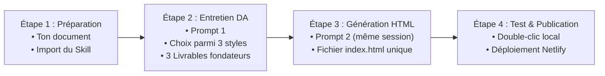

# GUIDE D'UTILISATION DU PARCOURS APPRENANT

**Promesse de la méthode** :  
> *« Transforme ton document existant en application interactive à ton image et publie-la en ligne en 3 jours, sans coder. »*

Ce guide explique pas à pas comment utiliser le dispositif AI CREATOR Studio pour convertir n'importe quel document métier (guide, workbook, méthode, tableur financier, checklist, support de formation) en une application web remarquable.

---

## Les 3 Piliers de la Méthode

1. **Aucune compétence en programmation requise** : Tout le code HTML/CSS/JS est généré par l'IA sous forme d'un unique fichier autonome `index.html`.
2. **Direction artistique sur mesure** : Votre produit ne ressemblera pas à un tableau de bord générique d'IA. Il aura une véritable identité visuelle dérivée de votre sujet.
3. **Fidélité absolue à votre contenu** : 100 % de vos formules, étapes, méthodes et avertissements sont scrupuleusement conservés.

---

## Le Parcours en 4 Étapes Pratiques

---

### Étape 1 : Préparer son document et importer le Skill (10 min)

1. **Préparez votre document source** :
   - Rassemblez votre contenu sous forme de fichier PDF, Word, texte, Markdown ou tableur.
   - Assurez-vous que vos formules, règles métier et étapes clés y figurent clairement.
2. **Importez le Skill dans Claude.ai Free** :
   - Connectez-vous à votre compte gratuit sur [claude.ai](https://claude.ai).
   - Rendez-vous dans **Settings** $\rightarrow$ **Skills** $\rightarrow$ **Upload a skill**.
   - Sélectionnez le fichier `AI-CREATOR-DESIGN-INTELLIGENCE.zip` fourni avec la formation.
   - Vérifiez que le skill apparaît avec le statut **Activé (ON)**.

---

### Étape 2 : L'Entretien de Direction Artistique (Prompt 1) (15-20 min)

1. Ouvrez une **nouvelle conversation** dans Claude.
2. Glissez ou joignez votre document source dans le champ de saisie.
3. Copiez et collez l'intégralité du fichier [`PROMPT-ENTRETIEN-DIRECTION-ARTISTIQUE.md`](../prompts/PROMPT-ENTRETIEN-DIRECTION-ARTISTIQUE.md).
4. **Le dialogue s'engage** :
   - Claude confirme sa compréhension de votre document sans afficher de code.
   - Il vous pose une ou deux questions ciblées sur l'esprit visuel recherché (personnalité, ambiance, public cible) avec des choix concrets.
   - Répondez simplement en quelques phrases ou choisissez parmi ses suggestions.
5. **Découverte des 3 directions artistiques** :
   - Claude vous soumet 3 concepts visuels réellement différents nés de votre sujet (ex. un univers éditorial type livre d'art, un carnet d'atelier tactile ou une console technique épurée).
   - Choisissez votre direction préférée ou demandez des ajustements (ex. *« J'aime la piste 1 mais avec des tons plus chauds »*).
6. **Réception des 3 Livrables Fondateurs** :
   Claude valide vos choix et formalise :
   - Le **Product Blueprint** (la structure et les calculs de votre futur outil).
   - Le **Source Fidelity Mapping** (la garantie que rien n'a été oublié).
   - Le **Visual Direction Brief** (la spécification de votre design).
   
> [!NOTE]
> Claude s'arrête ici et **n'émet aucun code HTML à ce stade**. C'est parfaitement normal !

---

### Étape 3 : La Génération de l'Application HTML (Prompt 2) (5 min)

1. **Restez impérativement dans la même conversation Claude** (ne créez pas de nouvelle session afin de conserver la mémoire des décisions).
2. Copiez et collez l'intégralité du fichier [`PROMPT-GENERATION-PRODUIT-HTML.md`](../prompts/PROMPT-GENERATION-PRODUIT-HTML.md).
3. Claude applique scrupuleusement votre brief visuel et vos règles métier.
4. Il effectue son auto-critique en 5 questions et émet le code complet dans un bloc `index.html`.

---

### Étape 4 : Tester et Publier en Ligne (10 min)

1. **Tester immédiatement sur votre ordinateur** :
   - Copiez le code produit ou téléchargez l'artefact sous le nom `index.html`.
   - Faites un simple **double-clic** sur le fichier : il s'ouvre dans votre navigateur par défaut (Chrome, Safari, Firefox).
   - Vérifiez que tous les boutons, jauges, calculs et formulaires fonctionnent instantanément, même sans connexion Internet.
2. **Publier gratuitement sur Netlify (Jour 3)** :
   - Glissez simplement le dossier contenant votre fichier `index.html` sur [app.netlify.com/drop](https://app.netlify.com/drop).
   - En moins de 30 secondes, votre application dispose d'une URL publique sécurisée en HTTPS (`https://mon-outil.netlify.app`), prête à être partagée ou vendue !

---

## Foire Aux Questions & Dépannage Rapide

### Que faire si Claude interrompt son code au milieu du fichier ?
Collez simplement la consigne :  
*« Continue exactement là où tu t'es arrêté, sans répéter les lignes précédentes, jusqu'à la fermeture `</html>`. »*

### Mes données financières ou personnelles sont-elles envoyées sur un serveur ?
**Non.** Les applications générées fonctionnent entièrement dans votre navigateur. Aucun compte ni serveur externe n'est requis pour exécuter les calculs.

### Puis-je modifier une couleur ou un texte après la génération ?
Oui ! Il vous suffit de demander à Claude dans la même conversation :  
*« Applique une retouche : remplace le bouton or par un bouton émeraude et renvoie-moi le fichier `index.html` complet. »*
