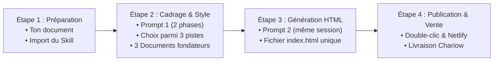

# GUIDE D'UTILISATION DU PARCOURS APPRENANT

**Promesse de la méthode** :
> *« Transforme ton document existant en application interactive à ton image et publie-la en ligne en 3 jours, sans coder. »*

Ce guide explique pas à pas comment utiliser le dispositif AI CREATOR Studio pour convertir n'importe quelle matière métier (ebook PDF, guide, workbook, méthode, tableur, CSV, notes vocales transcrites, messages WhatsApp, pages Notion, support de formation) en une application web remarquable.

---

## Les 3 Piliers de la Méthode

1. **Aucune compétence en programmation requise** : Tout le code HTML/CSS/JS est généré par l'IA sous forme d'un unique fichier autonome `index.html`.
2. **Direction artistique sur mesure** : Ton produit ne ressemblera pas à un tableau de bord générique d'IA. Il aura une véritable identité visuelle dérivée de ton sujet.
3. **Fidélité absolue à ton contenu** : 100 % de tes formules, étapes, méthodes et avertissements sont scrupuleusement conservés.

---

## Le Parcours en 4 Étapes Pratiques

---

### Étape 1 : Préparer son document et importer le Skill (10 min)

1. **Prépare ta matière source** :
   - Rassemble ton contenu sous forme de fichier PDF, Word, texte, Markdown, CSV ou notes structurées — par exemple notre ebook de référence [`SOLDE-EBOOK-BUDGET-MENSUEL-OBJECTIFS.pdf`](../../public/downloads/demo-pdfs/SOLDE-EBOOK-BUDGET-MENSUEL-OBJECTIFS.pdf) (*« Organiser son budget mensuel et atteindre ses objectifs d'épargne »*, 20 pages, FCFA & €).
   - Assure-toi que tes formules, règles métier, seuils et étapes clés y figurent clairement.
2. **Importe le Skill dans Claude.ai Free (Les 7 gestes officiels)** :
   - Connecte-toi à ton compte gratuit sur [claude.ai](https://claude.ai).
   - Ouvre **`Paramètres > Capacités`** (*`Settings > Capabilities`*) et active **`Exécution de code et création de fichiers`** (*`Code execution and file creation`*).
   - Ouvre **`Personnalisation > Compétences`** (*`Customize > Skills`*), clique sur **`+`**, choisis **`+ Créer une compétence`** (*`+ Create skill`*), puis **`Importer une compétence`** (*`Upload a skill`*).
   - Sélectionne le fichier `AI-CREATOR-DESIGN-INTELLIGENCE.zip` fourni avec la formation et vérifie que le Skill est bien **activé**.
   - **Attention Safari macOS** : Safari décompresse parfois automatiquement les fichiers `.zip` en dossier. Si tu ne vois qu'un dossier dans *Téléchargements*, décoche *« Ouvrir automatiquement les fichiers "fiables" »* dans *Safari > Réglages > Général* ou fais un clic droit → *Compresser* sur le dossier `ai-creator-design-intelligence`.

---

### Étape 2 : Cadrage Fonctionnel, Code d'Accès & Direction Artistique (Prompt 1) (15–20 min)

1. Ouvre une **nouvelle conversation** dans Claude.
2. Glisse ou joins ton document source dans le champ de saisie.
3. Copie et colle l'intégralité du fichier [`PROMPT-ENTRETIEN-DIRECTION-ARTISTIQUE.md`](../prompts/PROMPT-ENTRETIEN-DIRECTION-ARTISTIQUE.md) (v2.4).
4. **Phase 1 (Leçon 2 — Choisir son idée et son code d'accès acheteur)** :
   - Claude analyse ton document sans afficher de code et te propose **3 idées d'applications interactives** (évaluant si des profils pré-remplis, un simulateur « Et si… » / crash-test, un score avec bouton correctif ou un résumé copiable enrichissent ton sujet).
   - Réponds avec `PROMPT_CHOIX_IDEE` en précisant l'idée choisie et le **code d'accès réservé à tes acheteurs** (ex. `SOLDE2026` ou `[Ex : MONCODE2026]`).
   - Claude rédige tes deux premiers documents en français clair : **« Mon plan d'application »** (incluant l'architecture mobile *Flux linéaire* ou *Cockpit Mobile Dual-Mode* et la stratégie de sauvegarde des données) et **« Les règles de mon document »**. Sauvegarde-les dans tes notes.
5. **Phase 2 (Leçon 3 — Choisir sa direction artistique)** :
   - Dans la même conversation, envoie : `Plan et règles validés, passons au style.`
   - Claude te pose 1 ou 2 questions simples puis te soumet **3 pistes visuelles contrastées** en **6 points simples** sans code ni jargon.
   - Choisis ta direction préférée (ou ajuste-la avec `PROMPT_AJUSTEMENT_STYLE`).
   - Claude formalise ton troisième document : **« Ma fiche de style »** (incluant la mise en scène de l'écran de code d'accès). Sauvegarde-la également dans tes notes.

> [!NOTE]
> Claude s'arrête ici et **n'émet aucun code HTML à ce stade**. C'est parfaitement normal ! Si ta conversation Claude Free atteint sa limite avant l'étape suivante, utilise `PROMPT_REPRISE_SESSION` (inclus en annexe du Prompt 1) pour repartir proprement dans un nouveau chat avec tes 3 documents sauvegardés.

---

### Étape 3 : La Génération de l'Application HTML (Prompt 2) (5 min)

1. **Reste impérativement dans la même conversation Claude** (pour conserver toute la mémoire des décisions).
2. Copie et colle l'intégralité du fichier [`PROMPT-GENERATION-PRODUIT-HTML.md`](../prompts/PROMPT-GENERATION-PRODUIT-HTML.md) (v2.2).
3. Claude applique scrupuleusement « Ma fiche de style », « Les règles de mon document » et intègre l'écran de code d'accès (avec une clé dédiée à ton produit, ex. `KEY = "solde_access"`, `ACCESS_CODE = "SOLDE2026"`).
4. Il effectue son auto-critique en 5 questions et émet le code complet de `<!DOCTYPE html>` à `</html>` dans un fichier unique `index.html` (voir l'application de référence SOLDE : [`docs/examples/solde/index.html`](../examples/solde/index.html)).

---

### Étape 4 : Tester, Publier et Organiser la Livraison (Jour 3)

1. **Tester immédiatement sur ton ordinateur et sur mobile** :
   - Enregistre le code dans un dossier local `mon-application/` sous le nom exact `index.html` (sans extension `.txt`).
   - Fais un simple **double-clic** sur le fichier : il s'ouvre directement dans ton navigateur sans serveur (`file:///`).
   - Teste d'abord un faux code d'accès (message d'erreur), puis saisis ton vrai code (ex. `SOLDE2026`) — même avec des minuscules ou un espace en trop, l'accès se déverrouille. Vérifie tous les calculs (`FCFA` / `€`), le bouton `Verrouiller`, la vue mobile `375 px` (verdict visible dès l'ouverture) et les boutons Export/Import JSON + « Copier mon résumé » si ton outil sauvegarde les données.
2. **Publier gratuitement sur Netlify Drop** :
   - Glisse le dossier `mon-application` contenant `index.html` à la racine sur [app.netlify.com/drop](https://app.netlify.com/drop).
   - Personnalise ton sous-domaine via `Project Overview > Customize > Manage project name and cover image`.
   - Vérifie la visibilité publique dans `Project configuration > General > Visitor access > Project visibility` (**Public**), afin que tes acheteurs ouvrent la page sans compte Netlify tout en passant par ton écran de code d'accès intégré.
   - Le certificat HTTPS est activé automatiquement. Note que le forfait gratuit utilise un quota mensuel de crédits.
3. **Organiser la livraison commerciale sur Chariow** :
   - Crée un produit téléchargeable de type **Fichiers** sur Chariow avec ses visuels minimaux (carré `600 × 600 px`, bannière `702 × 260 px`), téléverse ton **Guide d'Accès PDF** (contenant le lien Netlify cliquable et le code d'accès de l'application) et clique sur **Publier**.
   - Renseigne également ton lien public Netlify et ton code d'accès dans `Instructions après achat` (`Produits > ⋮ > Modifier > Informations`).
   - Valide le parcours d'achat avec un code promo de test à 100 % strictement limité (1 utilisation totale, 1 par client, restreint au produit) en navigation privée, puis désactive-le immédiatement.

---

## Foire Aux Questions & Dépannage Rapide

### Que faire si Claude interrompt son code au milieu du fichier ?
Colle simplement la consigne :
*« Continue exactement là où tu t'es arrêté, sans répéter les lignes précédentes, jusqu'à la fermeture `</html>`. »*

### L'écran de code d'accès protège-t-il comme un serveur bancaire ?
**Non.** Le code d'accès intégré au fichier `index.html` agit comme une barrière **dissuasive** côté navigateur : il offre une expérience d'accès réservé à tes acheteurs et empêche l'accès immédiat aux simples visiteurs curieux, mais ne constitue pas une authentification serveur cryptographique.

### Mes données sont-elles envoyées sur un serveur ou synchronisées entre mes appareils ?
**Non.** Les applications générées fonctionnent à 100 % dans le navigateur de l'utilisateur :
- Pour un **outil ponctuel**, les calculs s'exécutent uniquement en mémoire vive.
- Pour un **simulateur / planificateur sauvegardé** (modèle SOLDE) ou un **suivi multi-jours**, les données sont enregistrées localement dans le navigateur de l'appareil utilisé, et des boutons **« Exporter ma sauvegarde (.json) »** / **« Importer une sauvegarde (.json) »** (plus **« Copier mon résumé »** sur un planificateur) permettent à ton acheteur de conserver ou transférer son travail entre ordinateur et téléphone.

### Puis-je modifier une couleur, un texte ou corriger un détail après la génération ?
Oui ! Utilise **`PROMPT_RETOUCHE_CIBLEE` v2** (en annexe du Prompt 2) en joignant ton fichier `index.html` actuel et, si besoin, une capture d'écran : Claude appliquera uniquement tes ajustements et renverra le fichier complet de `<!DOCTYPE html>` à `</html>` sans rien casser.
